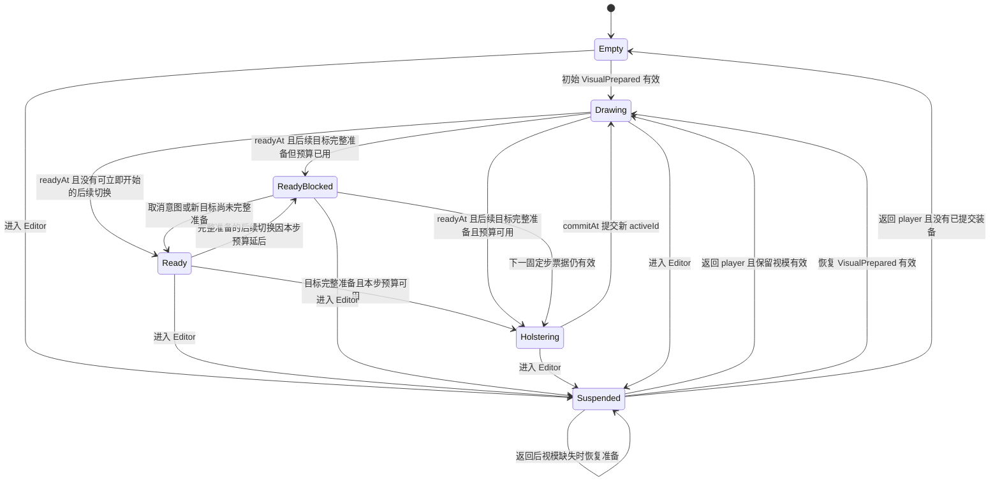

# 动画运行时与多枪切换设计

- 日期：2026-11-11
- 状态：阶段 1—4、Classic/Phantom 本地音频、阶段 5 稀疏控制与弹药事实采样已实现；Judge/Odin 整枪及其他枪型的完整发布/空间声待实施。后续皮肤资源由用户处理，不再自动生成或替换 texture。当前接口见[武器玩法](../../weapons/gameplay.md)、[发布与播放](../../weapons/animation-and-assets.md)、[运行时音频](../../weapons/audio.md)和[稀疏控制](../../weapons/runtime-controls.md)，更新契约见[运行时架构](../../architecture.md)。
- 目标：建立可接入现有九枪资源的动画运行时，并完整定义多枪持有、切换、换肤和异步资源生命周期。
- 首轮验收：Classic Smite 与 Phantom Tactiplay 两枪切换，Classic 第二皮肤验证外观独立；随后用 Judge、Odin 验证控制轨道。
- 前置：[阶段优先组件 Tick](2026-11-11-phase-first-component-tick.md)、[CameraComponent](2026-11-11-camera-component.md)。

## 1 设计结论

武器分为可共享的定义、玩家持有的逻辑实例、可以销毁重建的视觉实例。背包拥有逻辑实例；装备控制器唯一决定当前装备、切换事务和动作资格；animation 只解释已接受的玩法事件并计算表现姿态。

多枪支持从第一版进入数据模型、模块接口和验收。分步实现仅用于缩小调试范围，不允许把一把枪的弹药、当前动画或资源路径写进全局单例，然后再通过条件分支扩成多枪。

首版切换采用“目标准备完成后收枪、固定时刻交接、掏枪就绪后开放操作”。已开始的事务完整执行；期间只保留最新一个后续目标。这一选择保证切换时序可验证，代价是连续切换可能等待当前事务结束。未来若调整为允许掏枪中断，只改装备控制器的转换政策，提交点、实例所有权和事件协议继续保留。

### 1.1 阶段 1 实施范围

阶段 1 独立交付时已实现 Definition 校验、按实例隔离的 Inventory、EquipmentController 与 Classic/Phantom 数据，以及切换、换弹打断、冷却和生命周期测试。该阶段仅通过普通准备票据对接视觉适配者，尚未加载模型；后续 PlayerWeapons、后坐力、散布、射线与视角历史已在阶段 3 接入，不能将本节的历史范围当作当前项目状态。

首版控制器每固定步最多接受一次射击，要求定义的 fire.interval 不小于 fixedDelta，构造时拒绝不支持的组合；自动射击沿绝对 deadline 推进，避免重复向上取整射击间隔造成累计降速。suspend/reset/dispose 直接返回同步失效批次，调用方在停止 tick 前处理。Editor 返回统一用新 epoch 票据重新确认保留枪的视觉准备，再发 DrawStarted(resume)；可复用的视模由适配者立即应答，不能复用旧票据。

### 1.2 阶段 2 实施范围

当前 Classic Smite / Phantom Tactiplay 制作源已通过显式配方发布到 public/weapons 的 v1 包，共 61 个片段。function/animation 实现 ClipLibrary、AnimationStateMachine、AnimationPlayer；WeaponAssets 复用 ResourceManager，提供模板预热和同步独立实例化。源码、资源及浏览器验证见第二阶段说明。

独立开发预览页为 `/weapon-preview.html`。阶段 2 独立交付时尚未接入玩家；当前阶段 3 已完成准备票据、装备事实、ViewModel pass、后坐力/散布与输入接线，并按玩法期限调整动作播放。源 camera 动画仍只保留在视觉实例内部，不额外叠加世界相机。声音曾不在阶段 2 交付范围，现已另行完成双枪接线。

### 1.3 阶段 3—4 当前实施范围

主页面已实现 Classic ↔ Phantom、半自动/全自动、换弹/检视打断、ADS/FOV、固定步瞄准与射线、统一历史表现时间和 HUD。阶段 4 增加 `setSkin / cycleSkin`、带 epoch/revision 的皮肤准备、固定步 `SkinChanged` 与到时的原子材质替换；切换事务参与者的请求延后，不使保留票据失效。

Classic 当前使用 v2 包，复用 v1 的同一 GLB，包含保留现有本地外观的 smite 与制作源 Sakura；Phantom 继续使用 v1。Sakura 的 SourceUV/网格权重、rest rig 和全部动作已通过只读后台 Blender 对比；v2 由显式皮肤发布配方产生，不修改 `.blend` 或旧模型。既有 v1 本地贴图替换仅修正对应尺寸/哈希登记，没有改写贴图像素。

新增回归覆盖换肤不重置动作/弹药/冷却、失败保留外观、请求乱序、切换保留、Editor 返回与 20 次切换中重生的 Mixer 清理。主游戏 Chrome/WebGPU 验收已验证可信 K 输入、Sakura 实际解码、相同模型/骨架/材质/动作身份、三轮切枪换肤及销毁归零；本次报告在 `D:/opencode-temp/opencode/weapon-stage4/gameplay-browser/`，脚本默认输出目录见工具说明。阶段 5 与音频不在这些通过结果之内。

2026-11-12 阶段 4 全量 Node 回归为 294/294；Classic v1/v2、Phantom v1 的官方 glTF 校验均为零 error/零 warning，修改文件 ESLint 与生产构建通过。阶段 5 的制作源已找到，但原始九枪 manifest/runtime 源包在记录路径和仓库中缺失，具体输入要求见[发布说明](../../weapons/animation-and-assets.md#后续阶段的本地输入缺口)。

### 1.4 当前音频实施范围

AudioSystem、resource.binary、关卡 AudioBank、WeaponAudio 和 Engine 的 presentation 后 flush 已实现；八个 Classic/Phantom 本地音频文件按 SHA256 校验并真实解码。输入可信交互解锁，射击/掏枪/换弹/检视由已接受事实驱动，独立 marker 游标不重复播放 Mixer 声音。暂停、0/正变速、Editor/重生/卸载、动作取消与 late decode 失效已接线。

音频阶段交付时全量 Node 317/317，通过真实 Time 的 30/60/144 FPS、两步/五步批次与 250 ms 裁剪算例。生产构建的独立 Chrome 回归通过真实 Ogg 解码、输出 Analyser 非零波形、至少 16 发连射、换弹打断、暂停不补播、变速和卸载清理；具体报告与范围见[运行时音频](../../weapons/audio.md)。未实现的其他枪型、齐射/拉栓实际玩法和 3p 空间声不在本次通过范围内；未生成或改写纹理。

### 1.5 阶段 5 当前控制轨道范围

AnimationPlayer.setControls 已实现显式白名单、绝对局部时间与主 Mixer 后的稀疏属性覆盖；覆盖前先恢复底层姿态，避免 Mixer 缓存和 Action original 被污染。实例拥有独立绑定/插值器，不额外创建 Mixer 动作或事件时钟。WeaponAssets 预检 runtimeControls/ammoDisplay；WeaponViewModel 只在 P 到达已展示事实时更新弹药档位。

只读核验 Judge/Odin 当前制作源，提取了可复现的数值夹具：Judge 的 5 个 LINEAR 弹药缩放和恒定 bullets.scale，Odin 的 8 组 STEP 弹链和 red_1/red_2 缩放。Odin 的 barrel 不是枪管旋转；未据片段名推导玩法。显示采用显式的 min(magazine, 可见窗口) 本地策略，不声称重建了缺失的原始 runtime 映射。

新增 35 项（含子测试），当前全量 Node 352/352；30/60/144 FPS、乱序/重复采样、实例隔离、清除/销毁、主姿态恢复、STEP 编码边界、实际 GLTF CUBICSPLINE、补弹事实及取消/恢复均通过。修改文件 ESLint、生产构建及原有双枪玩法/音频生产浏览器回归通过。源哈希未变，夹具逐字节复现；详见[控制轨道接口与验收范围](../../weapons/runtime-controls.md)。Judge/Odin 完整发布与实际整枪视觉验收尚未完成，继续需要原始九枪 manifest/runtime 源包；没有生成或替换纹理。

## 2 状态所有权

| 数据或模块 | 唯一负责的状态 | 生命周期 |
| --- | --- | --- |
| WeaponDefinition | 枪型能力、弹量、射速、玩法动作时刻、后坐力图案/恢复与散布参数、动画语义映射、资源引用 | 只读配置，多实例共享 |
| SkinDefinition | 兼容模型版本、材质槽与贴图，不含弹药或射速 | 只读配置，多实例共享 |
| WeaponInstance | instanceId、definitionId、skinId、magazine、reserve、nextFireAt、blockedUntil、射击序号、图案进度与散布状态 | 从获得武器到移除武器；离手仍保留 |
| Player AimState / ViewPoseHistory | 固定步基础瞄准、权威后坐力偏移与冲量、ADS/FOV、眼部姿态的历史 | 每玩家一份；相机只读采样 |
| Inventory | 槽位到 instanceId 的映射与持有实例集合 | 随玩家；由重生规则决定保留或重建 |
| EquipmentController | activeId、phase、锁定的 switch transaction、最新 queuedTarget、动作提交状态与派生 canAct | 每玩家一份 |
| WeaponViewModel | 当前与准备中的视觉实例、材质副本、AnimationPlayer、表现事件 | 可以释放后重建，不影响弹药 |
| WeaponAssets | 当前关卡内武器模板与纹理的加载任务、缓存键和准备结果 | 关卡作用域 |
| AnimationPlayer | Mixer、actions、ASM、playbackId、局部时间、混合权重、marker、稀疏控制绑定与底层姿态 | 每个视觉实例一份 |

例如，两把 Classic 必须有不同 instanceId，即使使用同一 definitionId；同一把 Classic 换皮只改 skinId，不生成新逻辑实例。槽位编号也不是 instanceId，替换槽位不能意外继承旧枪的弹药。

首版弹药储备归各 WeaponInstance，未装备的武器不继续换弹。射击冷却使用绝对固定模拟时间，收枪后仍自然经过，但切回来不能重置 nextFireAt。将来需要共享弹药池时，在 game 层引入库存规则，不修改动画运行时。

槽位是配置数组。默认可采用 primary、secondary，melee 只在有可用定义和资源时启用。九种枪是 catalog 中的选择，不意味着玩家必须同时携带九把。练枪房可以配置额外槽位，不把两个槽位写死在控制器中。

## 3 模块与依赖

计划新增目录如下；Inventory 等简单数据结构不必逐个建立类或管理器。

```text
src/engine/runtime/function/animation/
  animation-player.js              对外统一播放接口
  animation-state-machine.js       内部状态转换、播放代次、混合
  clip-library.js                  绑定校验、marker 与控制轨道
  control-sampler.js               独立实例绑定、绝对采样及底层姿态恢复

src/engine/runtime/function/audio/
  audio-system.js                  AudioContext、voice、增益与调度

src/engine/runtime/function/framework/component/animation/
  animation-component.js           世界模型的 motion 适配

src/game/weapons/
  player-weapons.js                每玩家武器模块的装配与窄接口
  equipment-controller.js          固定步装备事务与动作裁定
  weapon-definition.js             当前阶段的定义校验与冻结
  inventory.js                     槽位与逻辑实例的私有状态
  weapon-logic.js                  射击、换弹及弹药规则
  weapon-viewmodel.js              第一人称视觉生命周期与 motion 适配
  weapon-animation.js              玩法事件到动画语义的映射
  definitions/                    枪型、皮肤与 loadout 配置
  assets/weapon-assets.js          关卡资源与发布包适配

src/engine/runtime/function/render/passes/
  viewmodel-pass.js                独立视模深度与 HDR 合成

tools/weapons/
  publish.mjs                     显式配方驱动的发布入口
```

engine 不导入 game 中的枪名、背包或弹药规则。game 传入动画定义；animation 不读取 InputSystem、不发射子弹、不自行加载资源。WeaponAssets 复用 ResourceManager，不创建第二套 GLTFLoader。ViewModel 使用 AnimationPlayer，世界 AnimationComponent 也使用它；同一实例只允许一个更新与销毁所有者。

PlayerWeapons 对 Player 暴露 queue(command)、step(context)、snapshot()、dispose()；对唯一的表现适配者提供按序消费的表现批次。内部可以拆分 controller、weapon logic 与异步适配，但调用方不管理加载 Promise、Mixer 或转换锁。

EquipmentController 接收普通数据和准备结果，不依赖 Three.js、DOM 或 Promise。它返回事件与准备意图，适配代码负责执行异步准备。快切竞态与弹药规则可通过同一个控制器接口独立验收。

## 4 切枪事务

### 4.1 阶段和提交点



ReadyBlocked 是图示别名，内部仍为 `phase=Ready, actionBlockReason=nextSwitchDeferred`。Drawing→Holstering 是同一固定步中的到期串接，按序发出 EquipReady 与 SwitchStarted，中间不接受武器动作；它不允许提前打断尚未到 readyAt 的掏枪。真正暂停保留原 phase，作为正交门槛；任意状态死亡/重生均走 epoch 失效与 Empty/重建流程，卸载走 dispose，均不等待图中的动画完成。

资源准备是独立请求，不是让当前枪停用的阶段。Ready(A) 等待 B 时，A 仍能开火、换弹和检视。B 的模型、必要动作、当前皮肤与实例绑定全部通过准备后，下一固定步才能开始切换。

开始时记录 `{switchId, epoch, fromId, toId, commitTick, readyTick}`。创建事务时即向上量化每段时长：`commitTick = startTick + ceil(holsterDuration / fixedDelta)`，`readyTick = commitTick + ceil(drawDuration / fixedDelta)`；commitAt/readyAt 是对应 tick 乘 fixedDelta。这样每段都获得完整的配置时长，不会因为前段延迟到下一固定步而压缩后一段。初始装备没有收枪阶段。时间来自 WeaponDefinition，不能读取 clip.duration 决定玩法，也不能等待 mixer.finished 提交。

| 时段 | 玩法 activeId | 表现游标到达该时刻后的视模 | 可开火 |
| --- | --- | --- | --- |
| 等待 B 准备 | A | A | 按 A 当前动作规则 |
| Holstering | A | A 收枪 | 否 |
| commitAt 后的 Drawing | B | B 掏枪 | 否 |
| readyAt 后 | B | B 的当前基础姿态 | 必须满足 canFire，Ready 本身不等于可开火 |

交接事件在表现游标到达 commitAt 时，在同一批表现更新中移除 A、挂载已准备的 B，不先清空旧模型再等待下载。统一历史插值期间允许 gameplay activeId 已为 B、renderActiveId 仍为 A，二者不能用同一字段代替。不对两套含手臂的枪模做整树交叉淡化；同时最多可见一套视模。

### 4.2 连续请求

1. Ready 时，尚未开始的准备请求采用最新目标。选回当前枪会取消切换意图；已完成的缓存可保留。
2. Holstering 或 Drawing 时，fromId/toId 与时刻锁定。新的选择覆盖唯一 queuedTarget，不建立无限 FIFO 队列。
3. A→B 过程中选 A 必须记录 queuedTarget=A，即使此时 activeId 仍是 A。
4. A→B 过程中先选 A、后选 B，后一个 B 必须清除 queuedTarget=A，不能因 B 等于事务目标而忽略请求。
5. readyAt 到达时先处理 queuedTarget。若下一目标已准备好且本步预算可用，立即进入下一次收枪，没有中间开火窗口；预算已用则进入 ReadyBlocked；若未准备好，B 进入 Ready 并等待，仍可使用。
6. 重复选当前 Ready 的实例为幂等操作，不重播掏枪、不重置冷却。

数字键选择指定槽位；滚轮按最新意图槽位轮转，过滤空槽，避免一个尚未提交的 activeId 导致连续滚轮都选择同一把枪。上一把武器记录只在新武器达到 Ready 后更新；准备失败或未完成掏枪不污染历史。

### 4.3 打断与同一步冲突

首版政策如下，后续调整集中在 EquipmentController。

| 情况 | 规则 |
| --- | --- |
| 检视中接受切枪 | 取消检视和未来 marker，开始收枪 |
| 换弹提交前接受切枪 | 取消换弹，不增加弹药；以后重新发起换弹 |
| 换弹提交后接受切枪 | 已转入弹匣的弹药保留；剩余动画取消，必要恢复期限 blockedUntil 保留 |
| 射击后立刻切枪 | 已扣弹和命中不撤回；nextFireAt 不重置 |
| 收枪或掏枪时开火、换弹、检视 | 不缓存这些一次性命令，不在就绪后突然补执行 |
| 切枪时持续按住开火 | 全自动枪在就绪和冷却满足后可继续；半自动枪要求就绪后的新按下边沿 |
| ADS 中切枪 | 开始收枪即退出 ADS；B 就绪后根据当前按住状态与 B 的能力重新判断 |
| 选择不支持 ADS 的枪 | 保持普通视野；不能因为存在 aim 动画就允许 ADS |
| 相同固定步同时收到切枪与开火 | 有效且可开始的切枪优先；仅资源准备不阻止当前枪使用 |
| 相同固定步同时收到换弹与开火 | 有效换弹优先；无效换弹不吞掉合法开火 |

定时提交量化到首个满足时间的固定步。每步按以下顺序执行，不能由事件监听器的注册顺序决定：

1. 处理死亡、重置或控制权失效；发生失效则取消本步旧 epoch 的其余操作。
2. 消费最新的选择命令，再校验准备票据；旧目标的票据不能抢在本步新选择之前开始事务。
3. 推进已存在切换的 commitAt/readyAt，按顺序发出交接与就绪事实。
4. 若已 Ready、最新目标的完整 VisualPrepared 有效且本步预算可用，开始新的 Holstering，同时取消旧 reload；预算已用则派生 nextSwitchDeferred，否则保持当前枪。
5. 提交仍有效的换弹时点并结束到期的动作锁，再依次判断有效的新换弹、射击和检视。

因此切枪与补弹恰好发生在同一步时，尚未提交的补弹被取消；上一步已提交的弹药保留。时长允许为零，每步至多开始一笔新切换，其内部零时长阶段按 Holstering→Drawing→Ready 有界推进；如果还有已准备的后续切换因本步限额等待下一步，期间不开火。所有固定步冲突测试按这一规则断言。

每次换弹拥有 actionId，提交记录使用 `(actionId, commitIndex)` 幂等键。首版一次装填只有 index=0，转移量为 `min(capacity - magazine, reserve)`；重复事件、过时动作和 Mixer marker 都不能再提交。将来逐发装填增加独立 index，不能继续只用整段动作的一个 committed 布尔值。首版未装备的武器没有后台换弹或后台连射。

### 4.4 统一操作门槛与恢复路径

```text
canAct = alive && controlMode == player && !paused && timeScale > 0
         && phase == Ready && activeId != null && actionBlockReason == null
canFire = canAct && weaponActionAllowsFire
          && now >= blockedUntil && now >= nextFireAt && magazine > 0
```

canReload、canInspect、canADS 也以 canAct 为共同门槛，再检查动作资格与能力。切枪本身使用装备转换规则，可以取消尚未完成的 reload，不受 canFire 限制。实时输入裁决读取当前控制器结果及原因；ASM、准星和同步画面消费对应表现时间的历史结果，不能用实时 canAct 提前结束过去时间中的 Drawing。各处不复制资格公式。

snapshot 明确输出 `pendingTarget`、`pendingReadiness=loading|visualPrepared|failed|null`、`actionBlockReason=null|nextSwitchDeferred` 和 canAct/canFire。nextSwitchDeferred 只在最新后续目标已有有效 VisualPrepared、且本步切换预算耗尽时成立；每个固定步根据最新意图和票据重新推导。选择回当前枪，或改选尚未准备好的枪，会解除该阻塞；不能等待异步回调手动清锁。

| 当前状态与条件 | 固定步结果 | 操作资格 |
| --- | --- | --- |
| Empty，准备未完成或失败 | 保持 Empty，可重试 | 禁止 |
| Empty，初始票据有效 | 提交 active，发 EquipCommitted、DrawStarted(initial)，进入 Drawing | 禁止 |
| Ready，新目标准备中或失败 | 保持当前装备 | 按 canAct 和动作条件 |
| Ready，选当前 active | 清除未开始意图，不重播掏枪 | 按 canAct 和动作条件 |
| Ready，新目标完整准备且预算可用 | 锁定票据，Holstering | 禁止 |
| Ready，新目标完整准备但预算已用 | ReadyBlocked | 禁止 |
| Holstering/Drawing，新选择 | 只更新最新 queuedTarget | 禁止 |
| Holstering，到 commitAt | 提交 B，发 EquipCommitted、DrawStarted(switch)，Drawing | 禁止 |
| Drawing，到 readyAt 且后续票据有效 | 先发 EquipReady，再 Holstering；预算已用则 ReadyBlocked | 禁止 |
| Drawing，到 readyAt 且无完整后续票据 | Ready | 按 canAct 和动作条件 |
| ReadyBlocked，下一步票据仍有效 | Holstering | 禁止 |
| ReadyBlocked，意图取消或改为未准备目标 | Ready | 按 canAct 和动作条件 |
| 任意 player 状态，进入 Editor | 同步失效旧 epoch，保留已提交装备，Suspended | 禁止 |
| Suspended，返回且保留视模有效 | 重新计算 readyTick，DrawStarted(resume)，Drawing | 禁止 |
| Suspended，返回有 active 但视模缺失 | 保持 Suspended(reason=resumePreparing)，只恢复该 active 的视觉准备 | 禁止 |
| Suspended(resumePreparing)，恢复票据有效 | 保留既有 activeId，DrawStarted(resume)，Drawing；不重复 EquipCommitted | 禁止 |
| Suspended，返回且无 active | Empty，按初始准备流程处理 | 禁止 |
| 任意状态，暂停或 timeScale=0 | 保持 phase 与剩余时间 | 禁止 |
| 任意状态，死亡/重生/卸载 | 统一失效，取消事务和未提交动作；重建或释放 | 禁止 |

## 5 Tick 时间和事件契约

### 5.1 固定步拥有瞄准 后坐力和散布

后坐力图案、恢复、连续射击散布与随机采样都由 game/weapon-logic 在固定步推进。来源 camera_recoil/recoil 经显式语义映射进入 WeaponDefinition.recoil；保留幅度、时间与轴向单位的转换依据，不因字段带 camera 就划入纯表现。WeaponInstance 保存图案进度、散布状态及随机种子/射击序号；Player AimState 保存基础 yaw/pitch 和当前权威后坐力偏移。

每步顺序为“移动解算 → 消费一次 pendingLook 并推进恢复/散布衰减 → 计算 preShot 眼位与有效瞄准 → 射击 → 提交本发冲量 → 封存 postShot 视角”。当前发按“冲击前有效瞄准 + 本次散布样本”产生射线、扣弹并记录 ShotFired，冲量影响之后的瞄准。ShotFired 携带实际 preShot eyeOrigin、aimDirection、shotDirection、shotId/seed，不能由渲染相机或骨骼反推命中方向。身体移动只使用基础 yaw，pitch 和后坐力不把角色碰撞体倾斜。

眼高/踏步滤波每固定步只推进一次；preShot/postShot 安全约束可使用各自朝向/FOV纯求值两次，但不能再次推进滤波。前后眼位共用同一规则，瞬时边界两侧不必数值相同；射击事件保存自己的 preShot 起点，历史同时保留边界两侧结果。

散布定义弹丸偏离瞄准中心的范围，不随机旋转世界相机；准星显示同一权威散布状态。图案若已包含在有效瞄准中，射线不可再次叠加。切枪保留玩家当前后坐力偏移并连续恢复，不能靠切枪瞬间归零；新枪使用自己的图案进度与散布，恢复系数按已提交的冲量/恢复段保存。

CameraComponent 只显示权威视角的历史采样结果。视模枪身 kick、手臂晃动可以是纯表现；首版不再额外给世界相机添加改变瞄准中心的随机 shake。资产内 camera 节点或旧 camera_recoil 若已转为权威规则，就不能再作为第二份世界相机旋转叠加。

### 5.2 统一历史插值与现有相机的改造

首版统一选择历史插值，接受相对实时模拟时间约一个固定步的表现延迟，不采用武器外推。

```text
h = fixedDelta
C = 最近完成的 fixedElapsed
S = C + alpha * h                       未延迟的模拟时钟位置
presentationTime = max(epochStartTime, S - h)
```

Engine 每帧在固定步循环结束后生成一次共享表现时间，包括固定步数为零但 alpha 改变的帧；Camera、视模动画、视模 FOV、后坐力、准星和枪口火光均消费它。段起点使用事实的 at。尚未到 presentationTime 的已提交事件保存在有序队列中；到达后恰好处理一次。删除外推所需的未来 marker 暂存、提前到终点等待确认等规则；这里的队列只保存已经发生、等待统一展示的事实。

当前 CameraComponent 只有位置历史插值：input 直接改变 yaw/pitch，眼高和踏步平滑按 rawDelta 推进；Transform 也只有 previousPosition。因此实施时必须补齐 Player ViewPoseHistory，不能只替换武器的时间公式：

- 保存已完成固定步的眼部位置、基础/有效朝向、ADS 与世界/视模 FOV、眼高及踏步平滑状态。位置与连续朝向按相同历史区间采样，四元数采用最短路径插值。
- 眼高和踏步平滑、近裁面安全约束移到固定步视角求值中，再提交历史；Camera.presentation 不额外按 rawDelta 追赶。射线起点使用同一固定步眼部姿态，避免平滑相机与射线起点使用两套眼高。
- input 只积累 pendingLook 并计算供下一个 Motor 固定步使用的 headingYaw 命令，不修改已发布的相机。Motor 读取该纯 yaw 命令；postPhysics 提交同一目标 yaw/pitch，并只消费一次 look 增量。后续子步沿用方向，不重放输入；不新增同阶段 Player→Motor 顺序依赖。
- 零固定步时，可以更新待处理命令，但已提交的视角不立即跳到新 yaw/pitch。当前“零固定步也立即 look”的行为及相关验收须随实现更新，这属于统一时间基准的延迟取舍。
- 重生/传送在固定步提交，并同时塌缩位置、朝向、后坐力、FOV 和动画时间历史；Editor 交接是显式不连续重置，不在旧新姿态间插值。暂停游标不前进，恢复不补播墙钟时间。

瞬时后坐力冲量不能直接 lerp 到上一帧，否则会在 ShotFired.at 之前出现抬枪。历史保留事件前/后姿态或等价的带时间冲量记录；权威与表现共用同一个后坐力求值函数，普通采样只包含 `impulse.at <= presentationTime` 的贡献，连续恢复段才插值。装备交接、弹药变化与火光同样是离散事件，不跨事件边界混合。

ShotFired.aimDirection 对应该 shotSequence 应用本发冲量之前的 preShot 样本；常规 Camera 在精确 at 采用同刻事件处理后的 postShot 样本。同刻多发按 sequence 顺序保存边界，不承诺默认 sample(at) 等于每一发各自的发射方向。无散布时，shotDirection 等于该发的 preShot aimDirection；随后抬枪与射线的差别由事件顺序解释，不能由不同阶段各加一次后坐力造成。

### 5.3 阶段与事件消费

继续使用现有 input → fixed/postPhysics → motion → presentation 顺序：

- input：Player 唯一收集并排队，滚轮/槽位选择压缩为最新意图；边沿与 pendingLook 带序号，零固定步也不丢失。
- fixed：Motor 使用输入命令计算移动，提交位置与身体 yaw。
- postPhysics：Player 先处理越界/重生，再推进 AimState 与 PlayerWeapons.step；完成装备、射击和弹药裁定，并暂存 ViewPoseHistory/事实。at 使用当前子步 snapshot.fixedElapsed；此时最近完成时间 C 仍是上一步，只有该子步成功 completeFixedStep 后，其结果才能进入可展示事实集合。
- motion：先处理 epoch/资源票据保留等立即生效的生命周期事实，再把视觉队列推进到 presentationTime。音频有独立的 cue 游标，见第 13.4 节，不等待画面队列释放后才提交调度。
- presentation：Camera 与 ViewModel 从共享历史时间独立采样，无相互读取本阶段尚未提交的姿态。必要的世界挂点查询在相机与模型输出完成之后由明确的收尾步骤处理。
- presentation 后、render 前：AudioSystem.flush 一次，使用最终 listener pose；rendererTick 仅绘制，重复调用不再次发声。

事件基本字段为 `{epoch, sequence, fixedTick, at, instanceId, type, payload}`；切换增加 switchId，动作增加 actionId，表现生成独立 playbackId。主要事实包括 ShotFired、ReloadStarted、AmmoCommitted、ReloadCancelled、SwitchStarted、EquipCommitted、DrawStarted(initial|switch|resume)、EquipReady、PresentationReset。DrawStarted 是掏枪动画和声音的唯一来源；同一次 EquipCommitted 不再重复触发 draw。

一个适配者接收事实并分发至独立游标。视觉游标按时间先后分段推进旧动作、执行到时事件、再推进剩余时间；同一 at 以 sequence 排序。自然完成回调先收集，Mixer.update 返回后处理，已接受的中断事件优先于同刻的旧完成事件。音频和视觉都按语义 ID 去重，不能对同一个 ShotFired 各制造第二份声音。

同帧跨提交点时，视觉先推进 A 到 commitAt，再释放 A、晋升 B 并推进剩余区间。枪口火光随该历史时刻的挂点出现；脱离模型的弹壳一旦生成，由独立生命周期管理。命中仍由固定步即时裁定，延迟展示只改变画面与声音的呈现时刻。

## 6 异步准备和资源生命周期

现有 ResourceManager 的取消作用于同名 pending 任务，且没有引用计数。因此 equip 请求不能把自己的 AbortSignal 直接传入共享加载。

首版使用关卡作用域缓存：WeaponAssets 是这一作用域内武器资源的唯一加载入口，底层只绑定关卡 signal。取消装备请求仅使请求代次失效；成功的共享模板可继续缓存。只有关卡结束才取消底层加载并卸载模板，不引入按枪切换 unload 或 LRU。

准备结果使用 `{epoch, requestId, instanceId, modelVersion, skinRevision}` 识别。准备分两步：异步任务只加载共享模板与纹理，完成后投递 AssetReady；表现适配者在 motion 核对最新意图与实例额度，释放过时 staged 后同步克隆并校验新的 detached 实例，再投递 VisualPrepared。下一固定步重新核对最新命令和票据，才允许开始收枪。任何异步回调都不能直接挂模型、改 activeId 或启动玩法动作。

staged 的生命周期由 WeaponViewModel 独占；EquipmentController 只保存不透明的准备票据，不持有 Three 对象。锁定事务占用 staged 时，后续目标只能预热模板。旧 active 在表现提交点释放后，才能为下个目标创建 staged。准备失败或替换目标都先释放过时实例，确保任何回调完成顺序下实例总数不超过两套。

资源保留不能随历史插值一起延后。SwitchStarted 已被玩法接受时，motion 必须先将对应票据从 Prepared 标记为 ReservedBySwitch，再处理新的选择、换肤与过时准备回收；动画可以稍后开始，但 B 不能因 queuedTarget 改成 C 被释放。逻辑 EquipCommitted 后，票据进入 AwaitingPresentationCommit；只有 presentationTime 跨过 commitAt 并完成实际交接后才晋升 Active、腾出 staged 槽。EquipReady 或逻辑事务结束不能提前释放这份保留。每帧顺序为“立即失效/保留 → 到时的视觉交接 → 回收未锁定旧准备 → 空槽内准备新目标”。

初始装备没有 SwitchStarted，接受其 EquipCommitted 时也立即保留票据为 AwaitingPresentationCommit。恢复准备的 DrawStarted(resume) 同样立即保留对应票据，等表现时间到达后重新挂接；无须重新提交已有 activeId。

本规格中的“目标准备好”均指完整 VisualPrepared；仅模板已缓存称为预热完成。AssetReady 提供只读共享资产句柄，内容为资产键、模板、clips 和材质输入；VisualPrepared 只标识 ViewModel 唯一 staged 槽位及其版本。票据只要参与锁定事务，就不能因后续选择或皮肤请求被释放。准备票据被替换、拒绝或作用域关闭时，均由 WeaponViewModel 的同一释放路径回收，不由控制器直接 dispose。

缓存键带作用域命名、weaponId、assetVersion、skinId/materialRole，以及影响资源解释的采样配置，避免与其他关卡资源同名。失败任务从业务任务表移除以便重试，同批已成功的子资源保留。回调除核对 generation 外还检查 scope.closed，关闭后不得重新写入缓存或挂树。

| 场景 | 处理 |
| --- | --- |
| B 加载失败 | 保持 A；记录具体失败与可重试状态，不自动反复重试 |
| 请求 B 后改为 C，B 最后完成 | B 可以成为缓存，但不能装备；独有的过时准备实例立即释放 |
| 关卡卸载或玩家重生后准备完成 | epoch 不匹配，忽略并释放独有实例 |
| 目标已经准备好 | 直接投递准备结果，仍在固定步提交，不绕过时序 |
| 切换中收到第三个目标 | Holstering 或尚未完成表现交接时只预热；Drawing(B) 且旧 A 已释放后，可在空出的 staged 槽准备 C |
| 切换目标移出背包或被替换 | 首版禁止对事务参与者做普通移除；死亡/重置走显式失效路径。未来丢枪必须通过控制器操作 |

进入关卡时预热当前 loadout 的模型与所选皮肤。level.load 只等待首选枪必要的共享资源 AssetReady，随后启动 Engine 并让 Player/Weapons 正常 tick；motion 产生初始 VisualPrepared，后续固定步进入 Drawing/Ready。不能等待 VisualPrepared 或 EquipReady 才启用承担 step 的 Player，否则准备和更新互相等待。需要冻结初始移动时只屏蔽移动命令，武器操作由 Empty/Drawing 自身禁止。

目录中的其他枪按需加载。初始装备加载失败时 activeId 保持 null，提供明确错误和重试入口，不伪装成已就绪。未持有的枪、未使用皮肤不创建 Mixer。逻辑背包可包含多枪，但视觉实例只保留 active 和一个 staged。已访问模板与贴图保留到关卡退出是首版的内存取舍，发布记录保留解码尺寸，并在全枪全皮肤访问验收中记录内存峰值。

模板共享 geometry、只读 clips 与纹理。每实例独有节点、Skeleton、Mixer、被修改的材质副本；加载皮肤纹理仍由 WeaponAssets/ResourceManager 持有。销毁实例时解绑监听、停止并 uncache Mixer、释放实例 Skeleton 和材质、脱离场景，不能释放共享几何或共享纹理。关卡卸载必须先停止准备与实例，再卸载本作用域登记的资源键。

未来确实需要跨关卡共享或受预算约束的驱逐时，将租约和引用计数放进 WeaponAssets，并在视觉实例的统一释放路径归还内部借用。届时可扩展内部资产句柄，PlayerWeapons 与 AnimationPlayer 的调用接口保持不变。首版不把资源存活条件散落到每个武器或皮肤脚本。

## 7 换肤与资产发布

发布单位为每枪一个 base model，以及独立 skin 描述。WeaponDefinition 引用资产包版本和动画 profile，SkinDefinition 引用兼容签名；运行时不扫描 skin_work_folder。

```text
public/weapons/<weaponId>/<assetVersion>/
  model.glb
  manifest.json
  skins/<skinId>.json
  textures/<contentHash>.png
```

manifest 包含 schemaVersion、资产哈希、rig/geometryUV/clipSet 兼容签名、动作角色、材质角色、挂点、坐标与持枪约定。来源中的 ammo/ammo_amount 等字段差异在发布时归一化。camera_recoil/recoil 的玩法参数归入 WeaponDefinition.recoil，显式转换角度单位、轴向/符号、时间基准、随机范围与“当前发偏移/发射后冲量”语义；运行时只接受一种规范 schema，不能仅改字段名。武器材质、瞄准镜材质与角色手臂材质分别命名；更换枪皮肤不修改角色手臂。音效 cue 可被动画 marker 引用，音频缓存与播放归对应功能模块，不由 Mixer 持有。

本次源资产核验覆盖九枪 32 个候选皮肤，同枪候选的几何、SourceUV、骨架和动作一致；八枪与原单枪工程一致。Odin 当前网格不同，须重新发布其 base。Vandal/Odin 从 E04_VANDAL_Actions/E09_ODIN_Actions 提取独立动作；不能导出 Preview sequence only。七枪使用 80_ThreeJS_Export。制作源中的 camera、views 等必要对象也可能受 Action 驱动，发布器不能只保留主骨架通道。

发布器采用显式源文件/场景配方，读 packed 图片或当前 PNG 映射，保留 STEP 可见性通道；不要依赖已失效的 Blender 原图片路径。原版资源包可用于复用和对照，但当前皮肤发布仍须完成新的 GLB 与浏览器验收。

同兼容签名的换肤只替换实例材质贴图，不重建 Mixer、不改变弹药、不重新掏枪。新贴图准备成功后在一次 motion 内原子替换；失败保留旧外观。skin 请求也带 revision，旧完成结果不得覆盖新选择。目标枪的皮肤在切换事务开始时锁定，事务中新的皮肤选择排在该实例就绪后应用，避免已经准备好的目标失效。

不同网格或骨架的皮肤将来应声明独立模型变体。其更换走完整视觉准备与兼容校验，不伪装成纹理替换；仍复用同一 WeaponInstance 的玩法数据。

## 8 九枪差异和动画层能力

| 差异 | 归属和处理 |
| --- | --- |
| 半自动、全自动、以后加入的连发 | WeaponDefinition 与 weapon logic；ASM 接受每次 ShotFired |
| ADS、瞄准镜倍率与遮罩 | 明确能力字段；game 选择，Camera/render 呈现，不根据 aim clip 是否存在推断 |
| 战术换弹、空仓换弹、分段或逐发装填 | game 定义带提交点的动作计划；第一批两枪使用单次弹药转移，以后多提交点保持相同 actionId/幂等规则 |
| 掏枪、收枪、射击动画长于玩法锁定 | 动画 profile 显式定义速度、退出位置或恢复段裁切；不统一按完整片段长度推导玩法时间 |
| Judge/Odin 弹药显示、枪管或枪机 | manifest 的 runtime_control/control_bones；主 Mixer 后对指定属性覆盖采样，禁止把整段控制片段全权重叠加 |
| 枪型独有动画、缺少可选动作 | 装配时验证能力要求；缺少必需 clip 拒绝准备，可选动作使用显式 fallback |
| 不同枪骨架与手臂结构 | 每个视觉实例独立 Mixer，不要求跨枪共用同一骨架；提交点替换整套视模 |

首版 AnimationPlayer 支持一次/循环、显式重播、普通过渡、当前权重连续的打断、marker 与状态快照；相同射击片段允许明确重启。playbackId 过滤旧事件。控制轨道以稀疏属性覆盖扩展，暂不建设通用 Blend Tree、IK、重定向或图形编辑器。

视觉 clip 长度与玩法时刻不同是常态。例如原包 Vandal shoot 为 1.9 秒，参考 RPM 为 585；因此连射由固定模拟持续生成 ShotFired，每次选择重启或配置好的射击段。具体动作节奏必须逐枪预览调整，不能假定所有导出动作播放到底都适合游戏。

## 9 第一人称呈现和输入

render 层增加独立视模 scene/camera/pass。视模有自己的深度，保留枪械与手臂遮挡；在世界 HDR 颜色之后合成，再统一 tone mapping、SMAA 和 LUT。视模背景透明，合成输入统一为线性预乘 alpha，使用 `viewRGB + worldRGB * (1 - viewAlpha)`，避免透明边缘和重复色调映射。世界 AO 不直接作用于视模；视模光照由 render 配置。切枪更新当前模型、持枪变换和视模 FOV，rendererTick 不创建或销毁武器实例。resize 同时更新两套投影与目标尺寸，RenderSystem 统一释放 pass 资源。

视模根结构为 viewmodelAnchor → visualRoot。anchor 承载固定挂载约定，Mixer 只写子树。世界 AnimationComponent 则使用 worldAnchor → visualRoot，外层交给 Mesh/Transform。资产的 camera 动画只作为局部表现信号；世界相机始终由 CameraComponent 统一合成。

当前 InputSystem 只有键盘动作与 Pointer Lock/mousemove；扩展统一鼠标按钮、滚轮动作，并在解锁、失焦、禁用时清理。首次点击只捕获鼠标，不开火。建议 R 换弹、Home 重生、T 检视、数字键选槽、滚轮切换；鼠标主键开火、副键由当前枪的明确能力解释。键位仍由 app 注入，Weapon 和 ASM 不监听 DOM。

真正暂停保留事务和剩余时间；恢复后没有按墙钟补执行。timeScale=0 不提交装备或弹药；暂停期间不积压开火/换弹/检视，槽位意图最多保留最新一个并在恢复后重新校验。恢复时清理旧开火边沿与 held 状态，防止误射。

切到 Editor 自由/轨道模式按控制权移交处理，必须在禁用 Player tick 之前同步取消未完成动作/准备意图、清空队列并使 epoch 失效，进入 Suspended。依据控制器最后已提交的 activeId 保留并隐藏一套视模：尚未提交 B 则保留 A；已提交 B 而画面仍是 A，则保留 staged B、释放 A。停止旧 playback/action voice，为保留对象建立新 epoch 的绑定，不复用旧票据；弹药、冷却与已提交装备保留。

返回 player 时复位视角/表现历史，以保留对象发出 DrawStarted(resume)，重新计算 readyTick 后进入 Drawing，不再次提交装备所有权。没有已提交装备则进入 Empty 走初始准备；已有 active 而对象意外不可用，则保持 Suspended(reason=resumePreparing)，开启恢复准备所需 tick 但禁止武器操作；新票据就绪后发 DrawStarted(resume)，不能无模型进入 Drawing，也不重复初始 EquipCommitted。该规则与真正暂停不同，避免关闭玩家期间全局时钟前进后恢复过时动作。

死亡、重生和关卡卸载也使 epoch 失效，取消所有未提交动作与切换。练枪房首版重生按 loadout 重建逻辑实例并补满配置弹药；未来保留装备的模式通过 game 的重生政策改变，不通过播放器保存状态。

## 10 实施顺序和验收

| 步骤 | 交付 | 必须通过的验收 |
| --- | --- | --- |
| 1 数据与控制器 | Definition/Instance/Inventory，固定步装备事务，无 Three.js 依赖 | 重复选枪、快切压缩、补弹提交前后切枪、冷却保留、同一步优先级 |
| 2 发布与播放 | Classic、Phantom 包，AnimationPlayer，关卡资源适配 | clip 绑定/采样、STEP、独立骨架、skin 材质不串实例、加载失败与迟到结果 |
| 3 双枪闭环 | ViewModel pass、装备事件接线、开火/换弹/检视、输入 | Classic ↔ Phantom；一次只显示一套手臂；不同 draw/holster 时长与 ADS/FOV 切换 |
| 4 异常与换肤 | Classic 第二皮肤、暂停/重生/卸载 | 动作中换肤不重置；切换过程中死亡；缓存命中/冷加载；重复装卸无残留 |
| 5 数据扩展验收 | Judge/Odin 控制轨道，其余枪发布清单 | 弹药显示与实际弹药一致；Odin 使用当前网格；新增标准枪型不改 controller/AnimationPlayer |

关键回归序列至少包括：

1. A 射击后切 B 再切 A，A 弹药保持减少，冷却未重置；另一个 A 实例不受影响。
2. A→B 中选 A，再选 B，最终停在 B；A→B 中连续选 C/D，后续只执行最新 D。
3. B 准备未完成时选 C，B 最后完成不夺取装备；B 准备失败时 A 仍可用。
4. 换弹提交前、提交同一步、提交后分别切枪，弹药提交次数为 0、0、1。
5. Drawing 到期且 queuedTarget 已准备好，同时按火，不产生夹在两次切换之间的射击。
6. 0/1/5 固定步、30/60/144 Hz 帧率、限步长帧、timeScale=0 下，弹药和装备结果按固定模拟时间一致。半自动边沿不会因帧数重复消费。
7. 旧动作 finished/marker、旧加载回调在切枪、重生、卸载后不改变状态；同一 gameplay event 不重复发出表现副作用。
8. 两套同枪实例独立播放、独立换肤；销毁一套不破坏另一套的共享资源。
9. 连续切枪、换肤和卸载后，活跃 Mixer/监听/独有骨架资源数量恢复；资源模板只在作用域结束释放。
10. 同一固定输入与随机种子在 30/60/144 FPS 下得到相同 shotDirection、弹药、patternIndex；零固定步不提交新 aim，五步追帧只消费一次 look，pitch/recoil 不倾斜身体或改变基础移动 heading。
11. 在 ShotFired.at/EquipCommitted.at 前后分别采样，瞬时 kick、火光与换枪不会提前；同一 presentationTime 重复采样不推进恢复、楼梯滤波或随机数，也不重复发事件。yaw 跨 ±π 沿最短路径采样。
12. 零时长事务耗尽本步预算时显示 ReadyBlocked，canAct/canFire 为 false；下一步继续切换或选择回当前枪后解除，不能永久卡住。
13. gameplay active 已为 B、renderActive 仍是 A 时进入 Editor，保留 B 并在返回时重新 Drawing；SwitchStarted 已接受而尚未展示时选 C，B 票据仍被保留，视觉实例数不超过两套。
14. 音频在同一时钟段内保持事件间距，普通帧不重锚；30 Hz 两步批次、83.3 ms 五步批次和 250 ms 裁剪帧分别验证准时调度、明确迟到丢弃和断点恢复。正变速按 1/r 映射；暂停恢复不补枪声，长动作在丢时后按正确 offset 接续。

验收中的“新增枪型不改 controller”适用于现有能力组合。真正的新玩法，例如逐发装填的新中断语义或新射击模式，需要扩展 game 的规则模块及测试；不承诺所有未来能力只改 JSON。

## 11 后续扩展的修改位置

| 后续需求 | 应修改的位置 | 保持的契约 |
| --- | --- | --- |
| 新枪型或兼容皮肤 | 发布配方、资源包、definitions、loadout | 装备提交点、实例身份、动画运行时 |
| 新背包槽位 | Inventory/loadout 和输入映射 | controller 不依赖槽位数量 |
| 修改快切手感 | EquipmentController 转换政策与对应验收 | 固定步提交、唯一 activeId、generation 失效 |
| 丢枪或拾枪 | game 的库存转移与世界展示适配 | 逻辑实例保留弹药，视模可重建 |
| 第三人称 | 独立视觉适配、世界 AnimationComponent、相应资源 | 复用玩法事实，不复用第一人称含手臂的模型 |
| 多人同步或回放 | game 的命令/事实权威与校正层 | Definition/Instance 分离、固定步规则、表现不修改玩法 |
| 内存预算或跨关卡缓存 | WeaponAssets 内部租约与驱逐 | 活实例使用期间不释放模板 |

这些位置是明确的扩展入口，不代表多人、拾取、回放或高级动画已经实现。后续实现应先修改本规格中的具体政策与验收，再修改对应模块，避免把特殊规则追加到播放器或渲染回调。

## 12 依据

- 当前调度与资源契约：[Engine](../../../src/engine/runtime/engine.js)、[Time](../../../src/engine/runtime/core/time.js)、[ResourceManager](../../../src/engine/runtime/resource/resource-manager.js)。
- 当前组件约束：[Player](../../../src/game/player/player.js)、[MeshComponent](../../../src/engine/runtime/function/framework/component/mesh/mesh-component.js)、[渲染管线](../../../src/engine/runtime/function/render/render-pipeline.js)。
- 原始资产说明：`D:/Projects/vandal-roundtrip/valorant-first-person-pack/00_打开说明.md`；源工作目录：`D:/Projects/Mine_VALORANT/skin_work_folder`。这些路径仅是本地来源记录，不写入运行时配置。
- [Three.js AnimationMixer](https://threejs.org/docs/pages/AnimationMixer.html)：实例播放与释放接口。Piccolo 的职责分层作为组织参考，本项目的装备控制器与 ASM 根据以上契约自行设计。

## 13 新增音频盘点与接入

### 13.1 可用范围

2026-11-11 对 public/audio 的 48 个 Ogg 文件逐一执行 ffprobe 元数据检查和 FFmpeg 浮点 PCM 解码，全部成功，没有空音轨。全部为 Vorbis、48 kHz；45 个立体声、3 个单声道。文件合计 5,663,295 字节，约 5.40 MiB；按源采样率解码为 Float32 PCM 约 41.40 MiB，浏览器重采样与缓存开销另计。因此优先预热当前 loadout 的音频。

48 个文件与 reference-mod 对应的 tacz_sounds 原文件 SHA256 一致。以下时长来自文件元数据；它们不是玩法冷却或操作完成时刻。

| 枪型 | 文件数 | 本地枪声 秒 | 掏枪 秒 | 检视 秒 | 换弹 秒 |
| --- | --- | --- | --- | --- | --- |
| Classic | 6 | 1.168 | 0.981 | 2.932 | 1.927 |
| Ghost | 5 | 1.295 | 0.857 | 2.903 | 1.666 |
| Sheriff | 5 | 2.083 | 1.003 | 2.993 | 2.359 |
| Vandal | 5 | 1.711 | 1.177 | 3.759 | 2.783 |
| Phantom | 5 | 1.288 | 1.104 | 3.727 | 2.495 |
| Operator | 6 | 3.017 | 2.194 | 4.332 | 3.988 |
| Outlaw | 6 | 2.485 | 1.444 | 4.143 | 战术 2.240，空仓 4.076 |
| Judge | 5 | 1.741 | 1.048 | 4.019 | 2.597 |
| Odin | 5 | 3.425 | 2.571 | 6.752 | 5.455 |

每枪另有 shoot_3p；Classic 另有 1.202 秒 shoot_salvo，Operator 另有 1.182 秒 bolt。38 个文件可由原 manifest.sounds 映射，Classic salvo 从动画 sound_effects 映射，共 39 个本地操作文件；其余 9 个是第三人称枪声。Classic、Judge、Outlaw 的 shoot 与 shoot_3p 字节相同，可共享 buffer，但保留不同的播放角色。

Classic 与 Phantom 的双枪闭环已具备开火、掏枪、换弹、检视所需音频。除 Outlaw 外，八枪的战术/空仓换弹共用一个文件。目录尚无原 manifest 中引用的 hit/head_hit，也没有 put_away、专用空击、脚步或 UI 文件；收枪可以先无声，缺失音效不能阻止装备或补弹。

### 13.2 事件映射与特殊情况

| 语义 | 触发来源 | 播放规则 |
| --- | --- | --- |
| 普通枪声 | 已接受的 ShotFired | 每次实际射击一次；本地选 shoot，其他角色选 shoot_3p，不叠加两份 |
| draw | DrawStarted(initial/switch/resume) | 动作音轨播放一次，EquipCommitted 不再重复触发；Editor 返回也覆盖 |
| reload_tactical / reload_empty | ReloadStarted 中已经选定的分支 | Outlaw 分开，其余按显式别名复用；不能随途中弹量重新选分支 |
| inspect | 已接受的检视开始 | 动作音轨一次；打断时停止该动作声音 |
| Classic salvo | 一次已接受的齐射动作 | 专用 salvo 声一次，不按三颗弹重复播，也不再叠加普通 shoot |
| Operator bolt | shoot/shoot_aim 的动作 marker | 原 manifest 标记 0.2549 秒；按动作局部时间触发，保留相对时序 |

原 Classic 逻辑一次齐射调用三次 shootOnce，动画只启动一次 shoot_salvo；接入时 ShotFired 的声音分组必须区分一次齐射与每颗弹丸。Phantom 的 draw/shoot/reload，以及 Vandal 的 draw/reload，在顶层声音表和 clip.sound_effects 都存在；发布时归一成唯一语义 cue，不能玩法事件与动画 marker 双播。对普通 shoot 消费顶层枪声后，去掉同义的零时刻 marker，保留 Operator bolt 等独立动作声音。

Operator bolt 文件自身在约 0.24 秒后才超过测量的活跃阈值；不能擅自裁去前段，再仍使用原 marker，否则改变同步。Odin draw 文件 2.571 秒，动画仅 1.250 秒，参考玩法掏枪时间 1.000 秒；以 10 ms 窗口 RMS > -50 dBFS 估算，其声音活动持续到约 1.73 秒，差异并非全由静默尾部造成。这些动作须在游戏内对齐验证，不通过音频长度延长玩法锁定，也不自动按文件长度拉伸所有动画。

当前 reload/inspect/draw 先按整段动作音轨接入；不能把同一完整文件在多个零件 marker 上重复播放。需要任意动作变速、分段装填或可中断动作拼接时，应补切片/分段 cue 与对应时间映射。首版不承诺整段音轨能自动适应所有动画变速。

### 13.3 音频模块和生命周期

当前已实现 function/audio 的 AudioSystem 与 binary 加载类型，单个 RuntimeContext 最多持有一个按需创建的 AudioContext；它接收 buffer 和通用播放参数，管理 voice、输出总线和调度，不认识枪名或弹药。以下契约已用于 Classic/Phantom，其他枪型的实际玩法接线另行验收。

resource 层新增 binary 类型，复用已有带完整性校验与取消的下载逻辑。WeaponAssets 在关卡作用域持有解码后的 AudioBank，通过注入的解码能力使用 AudioSystem 的 context；resource 不反向导入 function/audio。解码时传入原始 bytes 的副本，避免消费共享 ArrayBuffer。取消装备请求不取消共享下载；关卡取消使解码结果逻辑失效，无法中断的迟到解码丢弃。卸载先停止关卡 voices，再释放 bank 引用和资源缓存。

每次播放创建新的 source，重复使用已解码 AudioBuffer。枪声长于射击间隔，必须允许受控重叠；不能每次开火重启唯一 source。Web Audio 的 source 是一次性节点，buffer 可复用，见 [AudioBufferSourceNode](https://developer.mozilla.org/en-US/docs/Web/API/AudioBufferSourceNode)。

- 枪声绑定 level 与 shot/group ID，切枪保留已经发生的枪声尾音；超过 voice 上限时优先淡出旧尾音，不影响玩法射击。
- 掏枪、换弹、检视和拉栓声绑定 epoch、instanceId、actionId。动作取消先撤销该动作在取消 at 之后尚未开始的 voice，并在映射后的取消音频时刻用约 5–10 ms 淡出已开始声音；迟到取消立即淡出，不能排入过去。epoch 失效/卸载则立即取消。自然完成与取消分别处理；自然完成时是否保留尾音由 cue 配置。
- 使用语义事件 ID 去重，不能由第一人称和第三人称两套视觉实例分别播放同一射击声音。初版本地声音不做世界距离衰减；3p 文件保留给空间声路径，不能仅按文件名假定其一定为单声道。
- 异步音频失败或浏览器未解锁时静默并报告一次；不阻塞模型准备和玩法，也不在稍后解锁时补播历史枪声。
- 首次受信任的用户操作接入音频解锁；只有 resume 成功且 context 为 running 后才能建立音频锚点。Engine 暂停和 timeScale=0 同步暂停游戏声音；[AudioContext.resume](https://developer.mozilla.org/en-US/docs/Web/API/AudioContext/resume) 的成功与失败都需处理。完整时间映射与迟到政策见下一节。

### 13.4 稳定音频锚点 调度延迟和迟到策略

音频使用 Web Audio 秒，模拟使用缩放后的游戏秒。设 h=fixedDelta、C=已完成 fixedElapsed、S=C+alpha*h、P=S-h、r=本时钟段固定的正 timeScale。锚点必须选定未延迟的 S，不能一处用 C、一处用 P。

```text
anchorSimTime   = 建段时的 S
anchorAudioTime = 同一时刻 AudioContext.currentTime
jitterMargin    = 0.010 秒                 初始调度余量
lead            = 0.006 秒                 最小提前量
latency         = h / r + jitterMargin
audioTime(at)   = anchorAudioTime + latency + (at - anchorSimTime) / r
```

60 Hz、r=1 时总调度延迟为约 26.7 ms，其中 16.7 ms 对应画面历史插值，10 ms 是音频余量；设备输出延迟另计。若改用 P 做 anchorSimTime，必须去掉 h/r，不能重复添加插值延迟。普通帧保持锚点不动，不因某个事件迟到就重锚或平移整批声音。上述初值可通过设备试听调整，但公式与迟到口径不随帧率改变。

motion 收到已提交 ShotFired/DrawStarted 等事实后即可向音频队列提交，不等待 P 到达该事件；音频按 audioTime 预约，画面仍按 P 展示。动作 cue 游标独立于视觉游标：从同一已接受动作及其时间映射中提取 `at <= C` 的 marker，携带真实模拟 at，不能使用“本帧发现 marker 的时间”。这不会预测未接受的射击，也不会驱动弹药或装备。

每帧在 presentation 后一次 flush，按 `(at, sequence)` 排序并先处理已确认的取消/失效。设 `deadline = audioTime(at) - lead`，普通瞬态枪声的迟到阈值明确为 `audioNow > deadline`：已错过阈值就丢弃该声音并记录 missed-deadline；否则保持原始绝对 audioTime 调度。禁止逐个 `start(now)`，也禁止把过期枪声排队补播或整批平移。同一时钟段内保留下来的声音间隔为 `(at₂-at₁)/r`。丢的是音频副作用，ShotFired、伤害、弹药和视觉事实不丢。

固定的一步级缓冲不保证无损覆盖五步追帧。例如未丢模拟时间的 83.3 ms 长帧会在末尾一次交付五步，最早事件已比最新步早 4h；要保证全批不迟到，延迟至少为 `4h + lead`，60 Hz 时约 72.7 ms。本规格选择 26.7 ms 的常态低延迟，并对过期声音执行上述丢弃策略，不声称两者兼得。长动作音轨如配置允许补入，则从当前动作对应的正确 offset 接续，不能从头补播；起音仍需满足 lead。

仅在显式时钟段改变时建立新锚点：首次解锁、暂停/音频 interrupted 后恢复、正 timeScale 改变、模拟时间重置或关卡时间域切换，以及真实帧时间裁剪/固定步丢时。普通武器切换、动作 playbackId 或玩家重生若没有改变全局时间轴，只失效对应实体事件，不重置其他发声者的公共时钟。

当前 Time.rawDelta 已经裁剪至 maxDelta，droppedSimulationTime 只记录固定步上限丢失的部分。实施须增加未裁剪帧间隔/被裁剪墙钟时间的诊断，才能识别完整的时钟断点：250 ms 帧在当前上限下只推进 83.3 ms 模拟，真实差额为 166.7 ms，而现有 droppedSimulationTime 只报告 16.7 ms。不能继续使用旧锚点让后续声音永久迟到。新段建立时撤销旧段未开始的 voice，先按旧段 deadline 丢弃断点追帧批次的过期瞬态，记录重锚原因与偏移；重锚之后的新事实采用新映射，不逐帧追平误差。

语义 cue 记录与一次性 source 分离，状态至少区分 queued、scheduled、started、ended/dropped。同一 cue 因变速重建 source 时使用原语义 ID，不被“已调度”去重标记误吞，也不创建第二个并发 voice。变速可重映射仍有效的未播放 cue；暂停/解锁/不连续恢复不补播此前未开始的瞬态枪声。暂停前正在播放的 source 可随 context 恢复；丢时期间已经继续走快的长动作音轨则必须淡出，并按新时钟段的正确动作 offset 重建，不支持接续的 cue 静音。枪声尾音按既定政策保留。动作取消与 epoch 失效先过滤 cue，再进行任何重建。

timeScale=0 走暂停流程，公式不除以零。r 改变后重新映射未播放事件；已开始的枪声尾音保持原始音高。长动作音轨按 `playbackRate = r * actionPlaybackRate` 跟随动作，明确接受音高变化；需要保音高的素材另行提供时间拉伸能力，首版不承诺。解锁前的历史声音不回补；恢复仍有效的动作时依据其暂停/动作位置继续，取消的动作不复活。AudioContext.currentTime 是音频渲染时钟，不能用每帧修正锚点来掩盖设备输出延迟，见 [Web Audio 时钟规范](https://www.w3.org/TR/webaudio/#dom-baseaudiocontext-currenttime)。

### 13.5 音量与验收

浮点解码有 8 个文件的样本峰值超过 0 dBFS：Sheriff shoot/3p 约 +6.48/+6.41 dBFS、Odin 3p +4.21、Vandal shoot/3p +2.59/+0.18、Operator shoot/3p +1.59/+0.18、Operator inspect +1.07。这是解码样本峰值，不是主观失真结论或 true-peak 测量；Vorbis 浮点重建可能超出满幅。直接以 unity gain 输出可能削波，先配置逐 cue 增益和混音余量，再检验连射叠加峰值，不直接修改源 Ogg。

音频专项验收包括：Classic/Phantom 双枪动作同步、连续射击保留独立起音、切枪取消旧动作声但保留枪声尾音、齐射不重复、Operator 拉栓延迟、Outlaw 两种换弹、1p/3p 互斥、未解锁/暂停恢复不补播、迟到批次不聚集、关卡卸载后无残余 voice。当前双枪本地路径已完成 Node 与真实 Chrome 解码/输出波形及生命周期验收；齐射、Operator/Outlaw 和 3p 尚待实际枪型接线。主观音量、设备延迟与逐动作听感仍需人工试听，不能用非零波形代替。

调度公式已用零锚点、60 Hz 固定步、r=1 的算例核对；假设每步各产生一个测试瞬态事件，不代表真实武器每步射击：

| 一次帧交付 | audioNow 毫秒 | 按公式保留的起音时刻 毫秒 | 结果 |
| --- | --- | --- | --- |
| 60 Hz，一步 | 16.667 | 43.333 | 1 条准时，0 条丢弃 |
| 30 Hz，两步 | 33.333 | 43.333、60.000 | 2 条准时，间隔仍为一步 |
| 83.333 ms，五步且未丢时 | 83.333 | 93.333、110.000 | 2 条准时，3 条因错过 deadline 丢弃 |

同时使用 Time 类核对了 250 ms 帧的裁剪：模拟推进 83.333 ms，墙钟差额 166.667 ms；旧锚点会把下一步声音排到 126.667 ms，重锚后排到 293.333 ms。以上是规格形成时的算例；当前 audio.test.mjs 还直接验证了实现中的五步丢弃与 293.333 ms 重锚结果。
