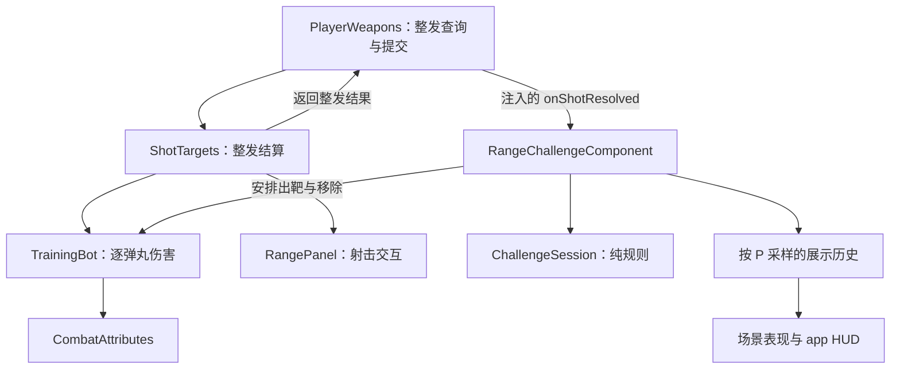

# 靶场核心玩法：30 靶射击测试与消灭 50／100 个

日期：2026-11-16  
状态：**设计草案，已补充 UI 基础、输入模式、最小商店、DOM 更新策略，以及挑战接口、展示时序与分阶段计划，尚未实施。本次仅修改文档。场景面板的具体大小与位置尚未由用户提供，在此前不启动本方案的代码修改；实施计划不构成开工授权。**

## 1. 目标与范围

在现有练枪房基础上建立两种完整的单人挑战：

| 模式 | 玩家选择 | 推进条件 | 结束条件 | 成绩 |
| --- | --- | --- | --- | --- |
| 射击测试（30 个） | 简单／中等／困难 | 击倒当前目标，或当前目标超时 | 30 次出靶机会全部结算 | 击杀数／30，越高越好 |
| 消灭 50／100 个 | 50 个／100 个 | 仅击倒当前目标 | 完成选择的全部击杀 | 总用时，越短越好 |

两种模式均通过**射击靶场面板上的「开始」按钮**启动，挑战中一次只有一个当前目标，出靶位置在靶区内变化。

本次需求不包含移动靶、多个同时存活的挑战目标、玩家受伤、机器人反击、排行榜、联网、奖励或资产重做。暂不扩展为通用任务／关卡脚本系统。

挑战接入前先建立共享 UI 基础、输入模式和练枪房最小商店。首版商店用于免费选择现有武器，完整经济系统、购买阶段、退货、队友请求／赠送及技能购买均后置；参考图中的技能栏和队伍信息不自动变成首版需求。

机器人被击杀时，必须先出现短促的击杀 VFX，随后主体消失；不播放倒地／倒下动画，不保留尸体或加入布娃娃模拟。该表现属于首版范围，视觉方向见第 5.4 节。

### 实施前置约束：由用户提供场景面板大小与位置

这是用户明确提出的约束，适用于后续实施，不是渲染技术选型可以代替的工作：

- 开局控制面板、悬挂计分板等场景面板的**实际大小和具体位置必须由用户提供**。目前尚未提供，保持待定；参考截图只说明视觉方向与信息结构，不提供可直接采用的世界坐标或尺寸。
- 每块面板需要记录世界单位下的宽／高，以及世界坐标或明确场景锚点下的位置；朝向、挂载对象与可点击区域的对应关系一并明确。若用户通过场景标注提供，先确认标注对应的尺寸与位置，再进入实现。
- `CanvasTexture`、文字纹理或 Mesh 只解决绘制与承载方式，不能据此自行决定面板放在哪里、多大。不得猜坐标、自动选择摆放位置，或先做占位面板绕过此条件。
- **在用户补齐这些信息并要求开始实现之前，本方案保持文档阶段，不修改游戏／UI 代码、场景或资产。** 不以 UI 基础、纯规则或其他模块可以独立开发为由提前开工。后续实施仍缺信息时，先补充对应设计记录。

### 规则依据与未核实项

- 玩法规则以本次用户提供的描述为准。
- 参考：[VALORANT Wiki — Range](https://wiki.playvalorant.com/en-us/Range)。
- **简单、中等、困难的具体秒数尚未核实，本文不填写猜测值。**
- 机器人属性、各枪伤害、出靶间隔等未在需求中确定的内容，分别在后文标记为建议或待确认项，不当作官方规则。

## 2. 共同概念

| 名称 | 定义 |
| --- | --- |
| 一次出靶机会 | 一个新目标成为当前目标，直到它被击倒或按模式规则移除 |
| 当前目标 | 本局当前唯一可被攻击、可推进挑战的机器人 |
| 命中 | 射线／弹丸击中目标的有效命中部位；不等于击杀 |
| 击倒／击杀 | 目标由存活变为死亡；本设计中两者指同一计分事件 |
| 已结算机会数 | 已经因击杀或超时结束的出靶次数，仅用于 30 靶模式 |
| 击杀进度 | 已经完成的有效击杀数，不包含超时、打空或非致死命中 |

基本不变量：

1. 每次出靶有独立身份，新目标不继承上一个目标受到的伤害。
2. 一个目标最多产生一次击杀、一次机会结算。
3. 命中、受击动画、枪口特效和击杀是不同事实，不能用受击动画播放次数代替击杀数。
4. 开始按钮、墙面、已死亡目标以及非本局目标都不增加成绩。
5. 同一发射击的多个弹丸先查询同一批目标，再处理伤害；不能击倒旧目标后，让剩余弹丸继续攻击刚刷出的下一靶。

## 3. 模式一：射击测试（30 个）

### 3.1 开始流程

1. 玩家选择射击测试。
2. 玩家选择简单、中等或困难。
3. 玩家射击面板「开始」。
4. 游戏清空本局击杀数与已结算机会数，生成第 1 个目标。
5. 从该目标开始出现时计算它的有效射击窗口。

**30 指出靶机会总数，不是必须完成的击杀数。** 超时也会用掉一次机会。

### 3.2 单个目标的处理

| 发生的事情 | 目标 | 计分与推进 |
| --- | --- | --- |
| 打空 | 保留，窗口继续减少 | 不加分，不换靶 |
| 命中但未击倒 | 保留剩余生命，窗口继续减少 | 不加分，允许补枪 |
| 在窗口内击倒 | 当前目标结束 | 击杀数 +1，已结算机会数 +1 |
| 窗口结束时仍存活 | 当前目标消失 | 击杀数不变，已结算机会数 +1 |
| 换弹、切枪、检视 | 仍按原窗口处理 | 不额外延长目标时间 |

一次机会结算后：

- 已结算机会数不足 30：在靶区另一个位置生成下一目标。
- 已结算机会数等于 30：立即结束，不再生成第 31 个目标。

本模式**没有固定的整局倒计时**。每个目标有自己的时限；提前击倒会提前推进，因此不同对局的总时长可以不同。

### 3.3 难度

| 难度 | 单靶有效时间 |
| --- | --- |
| 简单 | 待定，三档中最长 |
| 中等 | 待定，比简单短、比困难长 |
| 困难 | 待定，三档中最短 |

时长配置必须满足：

```text
简单时长 > 中等时长 > 困难时长 > 0
```

难度仅改变单个目标的有效时间，不同时改变机器人生命、护甲、体型、受击判定或武器伤害。后续如需其他变化，应另行定义。

### 3.4 成绩与示例

```text
最终成绩 = 本局有效击杀数 / 30
0 ≤ 有效击杀数 ≤ 已结算机会数 ≤ 30
```

第 12 个目标出现在右侧，玩家命中但未击倒，补枪前目标超时：

- 第 12 次机会已消耗。
- 击杀数不增加。
- 继续生成第 13 个目标。
- 最终击倒 23 个时，成绩显示为 **23／30**。

第 30 个目标无论被击倒还是超时，都触发本局结束。命中次数、造成的伤害和总用时不替代击杀成绩。

## 4. 模式二：消灭 50／100 个

### 4.1 开始流程

1. 玩家选择消灭模式。
2. 玩家选择 50 个或 100 个。
3. 玩家射击面板「开始」。
4. 游戏将击杀进度与计时归零，生成第 1 个目标。
5. 首个目标出现与计时开始属于同一个玩法提交边界。

50 与 100 使用同一套规则，只改变目标击杀总数，不附加简单／中等／困难的单靶时限。

### 4.2 单个目标的处理

| 发生的事情 | 目标 | 进度与计时 |
| --- | --- | --- |
| 打空 | 保留 | 进度不变，计时继续 |
| 命中但未击倒 | 保留剩余生命 | 进度不变，计时继续，允许补枪 |
| 停下来瞄准、换弹或切枪 | 保留 | 进度不变，计时继续 |
| 击倒，尚未达到目标数 | 结束当前目标，生成下一目标 | 击杀数 +1，计时继续 |
| 击倒第 50／100 个目标 | 不再生成新目标 | 击杀数 +1，立即停表并结算 |

本模式**没有单个目标超时，也没有整局超时**。只要没有击倒，当前机器人就不会因等待而自动换成另一个。

### 4.3 成绩与示例

```text
最终成绩 = 最后一个目标被击倒的挑战时间 - 首个目标出现的挑战时间
```

这里的挑战时间来自游戏模拟时间，不是读取电脑墙钟。普通瞄准、打空、补枪和换弹的耗时全部计入；真正暂停的处理见第 7 节。

在 50 个档位中，进度达到 **21／50** 后连续打空两枪：

- 当前仍是第 22 个目标，不重新刷靶。
- 进度仍为 21／50。
- 计时继续增加。
- 第 50 个目标被击倒时若累计 58 秒，结果为 **58 秒完成 50 个击杀**。

最终一次致死命中接受时就应停表，不等待击杀 VFX、机器人主体消失或成绩面板动画结束。

## 5. 面板、局内显示与结算

本节的「射击开始按钮」及第 5.4 节的击杀 VFX／主体消失流程是已明确的需求。UI 分层、输入模式和最小商店按第 8.8 节规划；具体界面布局、场景面板大小与位置仍须由用户提供或确认，不能从参考图推算成正式配置。

参考图中的界面分为三类，不强行使用同一种渲染方式：

| 界面 | 首版承载方式 | 交互与数据来源 |
| --- | --- | --- |
| 武器商店、设置弹窗 | DOM／CSS | 鼠标、键盘与焦点导航；发出装备／设置命令，读取执行结果 |
| 底部武器 HUD、左侧练枪状态 | DOM／CSS；动态准星保留 Canvas | 只读已展示状态；不因图片中存在技能、护甲或经济区域就展示虚构数值 |
| 场景内开局控制台、悬挂计分板 | Mesh 加 CanvasTexture 或文字／图形纹理 | 控制台的开始按钮接入真实射击；计分板只读。大小、位置及朝向使用用户提供的配置 |

场景计分板与屏幕 HUD 使用同一份挑战展示状态。参考图中的「得分／剩余」需要按模式定义含义；30 靶的「剩余」若采用，表示 `30 - 已结算机会数`，包含当前尚未结算的靶，不能减去击杀数。消灭模式则显示剩余击杀数或明确的击杀进度，避免两个模式共用含糊标签。

### 5.1 开局面板

| 区域 | 内容 |
| --- | --- |
| 模式 | 射击测试（30 个）／消灭 |
| 射击测试选项 | 简单／中等／困难，仅在射击测试下显示 |
| 消灭选项 | 50 个／100 个，仅在消灭模式下显示 |
| 开始 | 显示将要启动的模式与档位，射击此按钮启动 |
| 说明 | 射击测试：限时出靶，按击杀数计分；消灭：击杀后刷靶，按总用时结算 |

难度／数量选项采用射击选择、鼠标点击还是其他控件，尚未确定。开始按钮必须接入实际射击命中，不仅提供开发用 DOM／控制台入口。

开始按钮还应满足：

- 不受所持武器伤害大小影响，合法射击命中即可触发。
- 一发霰弹命中多次仍只启动一局。
- 触发开始的这一发只作为面板交互，不能同时击中首个挑战目标。
- 捕获 Pointer Lock 的首次点击沿用现有规则，只捕获鼠标，不视为已经射击按钮。

### 5.2 局内显示

| 模式 | 必要信息 | 避免混淆 |
| --- | --- | --- |
| 射击测试 | 模式、难度、击杀数、当前第几靶／30 | 「第 12 靶」不是已经击杀 12 个 |
| 消灭 | 目标数量、击杀进度、累计用时 | 21／50 表示已击倒 21 个，不是当前目标序号 |

射击测试可增加当前目标的剩余时间条，属于辅助显示，不改变结算规则。生命条、击杀音效等反馈可后续补充，不作为判断击杀的逻辑来源。

### 5.3 结算显示

- 射击测试：`射击测试 · 中等 · 23／30`。
- 消灭模式：`消灭 50 个 · 完成用时 58.00 秒`。
- 结果保留到玩家开始下一局或离开关卡。
- 显示到小数点后两位是建议格式，逻辑不按显示精度逐帧取整或累计。
- 中途取消不生成「已完成」成绩，不把未完成的消灭挑战显示成有效总用时。

### 5.4 击杀 VFX 与主体消失

**已确认：击杀时先播放 VFX，随后机器人主体消失，不需要额外的倒地动画。** 此项不能降级为无特效的直接隐藏，也不列为以后再补的可选反馈。

以本次提供的两张参考图为视觉方向：第一张是机器人身上的黄白色强闪光、星芒和电弧；第二张是主体已消失，原位置仍有短暂电弧、火花及齿轮／机械碎片。首版据此形成以下短促过程：

1. 在击杀事实的展示时刻，机器人原位置爆发黄白色闪光，伴随金黄色／橙黄色电弧、火花和少量机械碎片。
2. 主体在闪光爆发之后迅速隐藏；保留击杀瞬间的姿态即可，不播放倒下、跪倒或其他死亡骨骼动画。
3. 电弧与机械碎片可以在主体隐藏后短暂残留，再衰减消失；不留下可交互残骸，不增加碰撞或伤害。

VFX 由一次有效 `TargetKilled` 驱动，一次出靶只触发一次。非致死命中沿用受击反馈；超时移除、主动取消、重生和卸载不冒充击杀，也不播放这套击杀 VFX。击杀音效仍是独立的可选反馈，不影响视觉需求。

计分、最后一击停表和下一靶的既定生成时刻均不等待 VFX 播完。短暂的旧靶退场表现可以与下一靶重叠，但旧靶已不可命中，始终最多只有一个存活且可命中的挑战目标。闪光强度、主体隐藏延迟、粒子数量与持续时间在实际场景预览时调整；这些属于表现参数，不能反向改变玩法时限。

## 6. 出靶、生命与命中

### 6.1 出靶位置

首版建议使用**经过场景验证的离散出生点集合**，从中抽取位置，而不是在未经检查的包围盒内任意随机。

- 位于实际靶区地面，不穿墙、不悬空、不与场景重叠。
- 从预定射击位置可见，不刷到面板后面或房间外。
- 机器人朝向射击区域，使用一致体型与碰撞／命中尺度。
- 出生点不止一个，相邻两次不使用同一出生点；其他历史位置允许再次出现。
- 随机选择发生在玩法提交阶段，渲染、HUD 读取和截图不得重新抽样。
- 测试可注入固定随机序列，使出靶顺序可复现。

具体位置、边界与分布尚未确定，不能直接把现有三色展示机器人的位置当作完整靶区。

### 6.2 生命与伤害

“命中但未击倒”是必须支持的规则，因此需要真实的存活／死亡结算，而不是每次命中直接加分。

- 每个目标持有独立生命／护甲状态，可复用现有 `CombatAttributes`。
- 非致死命中保留剩余生命，同一个目标允许后续补枪。
- 新目标从配置的满生命／满护甲开始。
- 按存活到死亡的转换通知挑战推进，死亡后重复命中不能重复加分。
- 武器、部位与距离如何得到伤害值，需要单独的显式游戏配置；不能从受击动画或特效推测。
- 霰弹枪逐弹丸结算有效伤害；现有受击动画的“每目标合并一次”不能当作伤害合并规则。
- 场景遮挡继续限制目标命中，不允许穿过墙或面板命中后方机器人。

**待确认数值：**机器人生命、是否有护甲、各枪伤害、部位规则、是否使用距离衰减。本文不默认所有武器一枪击倒，也不擅自填写七枪伤害表。

### 6.3 弹药与刷新间隔

两项会直接影响是否可完成挑战，实施前需要确认：

1. **弹药供应。** 现有武器备用弹药有限，不能直接保证 50／100 个挑战可完成。首版建议“弹匣正常消耗、保留手动换弹、备用弹药无限”，但这是项目方案，不是本次已经确认的规则。
2. **刷新间隔。** 需求未给出击杀后／超时后的出靶间隔。首版建议无额外等待，在本次目标结算后安排下一目标；不能让同一发射击继续命中新目标。如需固定间隔，应明确配置，并说明该间隔是否计入消灭模式总用时。

不因普通命中或换弹重置目标窗口，不为了维持进度自动把目标判为击杀。

## 7. 对局状态与边界

本节补足对局边界。商店与挑战互斥、显式取消及输入隔离按第 8.8 节的首版方案执行；其他标注为建议／待确认的策略仍需落定，均不表示已经实现。

### 7.1 状态

| 状态 | 含义 | 允许操作 |
| --- | --- | --- |
| 待开始 | 尚无运行中的挑战 | 选择模式／档位，射击开始 |
| 进行中 | 按当前固定配置出靶、计分／计时 | 攻击当前目标、正常切枪；通过明确的取消入口结束本局 |
| 已完成 | 保存最后结果，不再推进 | 查看结果，选择下一局配置，再次开始 |

建议规则：

- 开始时锁定本局模式、难度／数量，首版禁用运行中的选项更改；以后若允许预选下一局，也不能改变当前局规则。
- 进行中重复射击开始按钮不清分、不重开，也不生成第二个目标。
- 提供明确的手动取消入口，清理当前目标并回到待开始，不能冒充自然完成；入口的键位／位置待确认，打开商店本身不隐式取消。
- 开始新局时生成新的对局身份，旧局的迟到命中／回调不能影响新局。
- 若保留原有自由练习机器人，运行挑战时应停用或隔离它，避免混淆当前目标与得分对象。

### 7.2 同刻击杀与超时

建议采用明确的半开窗口：

```text
有效射击时段：[目标出现时间, 目标截止时间)
```

- 早于截止时间接受的致死命中有效。
- 恰好到达或晚于截止时间，按超时处理，不再击杀旧目标。
- 截止检查与命中处理必须由明确的玩法流程协调，不能取决于两个组件谁恰好先执行。
- 如固定步需要量化时长，应记录实际采用的窗口，不用动画帧数推算，也不让帧率改变规则。

这一边界是项目建议，不是对 VALORANT 同刻事件规则的核实结论。

### 7.3 暂停、观察模式与重生

| 情况 | 处理策略 |
| --- | --- |
| 正常打空、补枪、换弹、切枪、检视 | 挑战时间照常推进 |
| `Engine.pause()` 或 `timeScale = 0` | 冻结挑战计时与目标剩余窗口，恢复时不补算暂停时长 |
| 进入飞行／轨道 Editor 观察模式 | 取消未完成挑战且不生成成绩；避免全局时间继续但玩家无法射击 |
| Home／复位／越界自动重生 | 取消未完成挑战且不生成成绩，避免通过重生刷新弹药或位置影响成绩 |
| 打开商店／更改配装 | 首版在挑战进行中拒绝打开和提交更改，需先明确取消挑战；正常切换已有武器仍可继续 |
| Esc 解锁、窗口失焦、切到后台 | 是否主动暂停尚待确认；不把“清空输入”误当作引擎已经暂停 |
| 卸载关卡／关闭应用 | 清理本局目标、面板注册与待展示事件，不保留有效进行中对局 |

不得通过读取系统时间补算暂停或后台间隔。若以后决定某种挂起操作保留本局，需显式保存挑战已用时间与剩余窗口，不能恢复时直接使用跨越挂起区间的全局时间差。

## 8. 接入架构与接口契约

本节描述拟实施的方案。新增模块、方法和事实名称用于明确职责与调用约束，不表示当前代码已经提供这些接口。沿用 `app → game → runtime` 的依赖方向。

### 8.1 当前基础与缺口

以下是编写本设计时的代码状态，不是本设计已经完成的内容：

| 现有模块 | 可以复用 | 尚需补充 |
| --- | --- | --- |
| `RangeRoomLevel` | 关卡资源与对象生命周期、现有机器人装配 | 挑战装配、面板、出生点与自由练习切换 |
| `PlayerWeapons` | 固定步射击事实、整发弹丸查询、场景遮挡 | 整发提交入口，以及提交完成后的窄通知接口 |
| `ShotTargets` | 关卡本地目标注册、射线查询与受击分发 | 交互与伤害分流、逐弹丸信息、身份校验和重复提交抑制 |
| `TrainingBotComponent` / `BoneHitboxes` | 骨骼命中盒、部位识别与受击动画 | 独立生命、出靶身份、一次性死亡事实，以及权威姿态与可见姿态的隔离 |
| `CombatAttributes` | 独立生命／护甲及致死转换模型 | 由目标持有，在有效固定玩法步骤调用 |
| Engine / Time | `fixed → postPhysics → motion → presentation`、固定模拟时间与公共展示时间 | 复用既有阶段，不增加靶场专用阶段或第二条时间轴 |
| app HUD／诊断 | 当前关卡的显示和只读检查入口 | 挑战显示，以及分开的权威快照和已展示快照 |
| app 武器 HUD／准星设置 | DOM HUD、准星 Canvas 与现有弹窗 | 共享挂载／焦点／输入模式，窄展示读模型和按变化更新 |
| `InputSystem` / `PlayerComponent` | Pointer Lock、输入清理、玩家与 Editor 的交接 | 单独的菜单输入模式，避免借用停用整个玩家的路径 |
| `EquipmentController` / `WeaponInventory` | 七个现有武器槽位、切换命令及资源准备反馈 | 最小商店入口与显示模型；当前并没有购买／动态替换背包的交易接口 |

当前默认装配蓝／黄／紫三个展示机器人，皮肤上的难度只是视觉元数据；挑战难度必须来自本局锁定配置，不能反向读取皮肤标签决定时限。现有机器人只有命中计数和受击反应，独立战斗属性模型尚未接到目标。

当前 `PlayerWeapons.fixed()` 已先查完一发中的全部弹丸，再调用 `ShotTargets.react()`；后者只保留每个目标最近的一次命中来播放反馈。这个查询顺序可以复用，但合并后的结果不足以结算伤害。当前机器人还在 `fixed` 中直接推进可见骨架，而 `BoneHitboxes` 读取同一套骨骼，展示接入必须同时处理这个耦合。

当前武器 HUD 在 app `frame` 中读取完整玩家快照，并重复查询节点、写入武器名与弹药文本；`PlayerWeapons.snapshot()` 还包含音频、特效和近期事件等诊断内容。应提供供 UI 使用的小型只读展示模型，避免把诊断快照复制和无变化的 DOM 写入放进每帧路径。这是可观察的接入问题，不表示已经测得它是当前帧率瓶颈。

当前七个槽位装配 Phantom、Classic、Ghost、Vandal、Sheriff、Judge、Odin，现有 `select`／`selectSlot` 负责切换已持有武器。`PlayerComponent.setEnabled(false)` 会连同移动、相机、武器生命周期一起停用；不能直接把这条 Editor 路径用作打开商店。

### 8.2 模块职责与装配

| 模块 | 拥有的职责 | 调用方不需要知道的实现细节 |
| --- | --- | --- |
| `ChallengeSession` | 纯数据规则：锁定配置、对局／出靶身份、机会数、击杀数、截止时间、取消与最终结果 | 两种模式的推进差异、重复死亡抑制、结束判定 |
| `RangeChallengeComponent` | 关卡内的挑战适配：驱动规则、选择出生点、启停目标、消费整发结果、记录展示历史 | 目标复用、自由练习隔离、规则结果如何落实为场景变化 |
| `ShotTargets` | 目标注册、最近射线命中、整发交互／伤害分流与结果汇总 | 注册项查找、身份与射击去重；不持有挑战进度或武器伤害表 |
| `TrainingBotComponent` | 本次出靶的属性、命中资格、权威姿态、可见姿态及受击／击杀表现 | 逐弹丸结算、姿态采样、退场记录与重置；不决定下一靶或最终成绩 |
| 伤害配置与计算函数 | 根据 `definitionId`、命中部位和距离求有效伤害值 | 显式数值与映射；不从动画、皮肤或反馈音效推测伤害 |
| `RangePanel` | 可射击控件、控制项身份与当前可交互状态 | 几何命中与命令构造；不直接扣血、刷靶或改成绩 |
| 挑战展示与 app HUD | 按 `P` 读取目标显隐、进度、计时和结果 | 展示游标与格式化；不重新抽出生点或推进规则 |
| app UI 宿主与输入模式协调 | UI 挂载、层级、模态焦点、输入归属与 Pointer Lock 交接 | 具体 DOM 节点与监听清理；不拥有挑战、背包或战斗属性 |
| 最小商店视图与装备命令适配 | 武器目录、选中／准备／失败状态、提交已有槽位的选择意图 | DOM 不知道背包可变结构，不直接创建或替换武器实例 |

`RangeRoomLevel` 是装配入口：持有共享机器人资源和 `ShotTargets`，创建挑战 GO、面板与玩家，注入整发结果通知及玩家生命周期通知。目标 GO 仍由 Level 管理；挑战模块保存句柄并请求停用／移除，不建立另一套对象所有权。

运行时数据流如下，回传事实通过注入的窄接口完成，不要求目标或武器反向导入练枪房模块：



两种模式使用同一个 `ChallengeSession`，以明确分支处理“机会耗尽”和“击杀达标”，暂不建立模式插件框架。纯规则不持有 DOM、Three.js、资源 Promise 或机器人实例；随机源与可用出生点由外部注入，抽样仅发生在一次出靶提交中。

### 8.3 固定步内的提交顺序

复用现有 Engine 的阶段顺序。`RangeChallengeComponent` 在 `fixed` 处理到期和排队命令；射击发生在玩家的 `postPhysics` 调用链内；展示在 `motion`／`presentation` 消费已提交事实。

| 阶段 | 顺序与提交职责 |
| --- | --- |
| `input` | 收集玩家输入及下一局选项／取消意图；不开始挑战、不消耗机会、不扣血。开始仍必须来自合法射击命中 |
| `fixed` | 应用已排队的控制命令，推进挑战截止检查；关闭到期旧靶的命中资格，提交超时与下一靶或完成。无人射击时也必须推进 |
| `postPhysics`：射击前 | 玩家实际重生时先通知取消；确认本步可射击。使用当前权威目标姿态与身份进行查询 |
| `postPhysics`：整发提交 | 完成全部弹丸查询 → 判定是否整发用于面板交互 → 预校验伤害 → 逐弹丸扣血 → 汇总一次性死亡与反馈事实 |
| `postPhysics`：整发提交后 | 同步调用注入的结果通知；挑战接收开始或死亡事实，更新规则，再安排首靶／下一靶或最终结果 |
| `motion`／`presentation` | 按公共 `P` 消费目标和挑战历史，生成共享展示读模型；在渲染前更新到时的显隐、姿态及有变化的场景面板纹理 |
| app `frame` | 渲染后 HUD 消费同一份已准备的展示读模型，合并写入发生变化的 DOM 字段；诊断按需读取双快照 |

必须保持以下约束：

- **同一发查询期间不改变目标集合、姿态或出靶身份。** 死亡立即关闭旧目标命中资格，但替换目标只能在整发结果完整返回后执行，不能在单颗弹丸回调里刷靶。
- `onShotResolved(result, context)` 由 `PlayerWeapons.fixed()` 在整发结算后直接调用；不再增加一个依赖 GO 插入顺序的 `postPhysics` 消费者，也不通过 app `frame` 轮询最近射击来补结算。
- 采用第 7.2 节建议的半开窗口时，截止检查先于本步射击。恰在截止步旧靶已超时；若无刷新间隔，下一靶可以在该步建立，但使用新的 `spawnId`，旧命中不可迁移给它。
- 开始和击杀换靶发生在整发结算后。首靶的 `spawnedAt` 与计时起点相同；最后一次致死命中的 `at` 即停表时间，不等下一固定步或动画完成。
- 激活目标时同步建立该 `spawnId` 的初始权威姿态。固定姿态按提交时间采样，同一步的初始化／采样不得重复推进动画，避免机器人和挑战 GO 的 `fixed` 执行先后改变命中盒。
- 无实际固定步的帧只允许收集命令和读取展示，不提交开局、超时或伤害。多固定步追帧必须逐步处理，不能合并成一次帧末结算。
- 当前 Engine 在渲染之后发出 `frame`。场景纹理更新必须安排在渲染前的展示阶段，不能只在 DOM HUD 的 `frame` 订阅里重绘，否则会额外滞后一帧。两端复用同一份按 `P` 准备的显示值与版本，不能各自查询不同时间的玩法状态。

时间直接来自固定步的 `fixedTick / fixedElapsed`。若时限需量化，沿用固定步时长向上取整的约定，将实际 `windowTicks` 记录进锁定配置，`deadlineTick` 记录进各靶状态，并验证量化后三档仍严格递减。消灭用时由首靶与末次致死的时间差计算，不另建墙钟或按帧累加计时器。这里固定的是接线契约，正式玩法配置及其验收仍需按第 11 节确认具体选项。

### 8.4 整发射击提交接口

#### 8.4.1 调用位置与输入

拟新增同步接口 `ShotTargets.resolveShot(shot, context)`。调用方使用装备控制器已经接受的 `ShotFired` 事实，完成所有射线查询后提交一次。原有 `trace()` 保持只读；`resolveShot()` 不补发射线、不再次扣弹，也不负责武器冷却。

| 输入信息 | 契约 |
| --- | --- |
| `epoch`、`sequence` | 使用现有射击事实身份，在当前关卡／射击来源作用域内唯一；不能只使用会重置的 `shotSequence` |
| `instanceId`、武器 `definitionId` | 分别标识武器实例与伤害配置来源，不从当前展示的武器推断 |
| `fixedTick`、`at` | 必须与实际 `postPhysics` 固定步一致；接受时间不由动画或回调完成时刻填写 |
| `pellets[]` | 按弹丸索引保留方向和完整命中信息。单弹射击在接口内部归一化为 `index = 0` 的一项 |
| 每项 `impact` | 保留距离、命中部位、位置、法线、表面和 `targetId`；打空／静态场景命中也保留 |
| 挑战目标身份 | 查询时将 `sessionId / spawnId` 写入命中事实，不能等结算时才取目标的最新身份 |
| 面板控件身份 | 标识注册项、控件动作及选项修订；命令绑定本次查询时确认的选择，不读取事后变化的 DOM |

已有的汇总 `impact` 可以继续用于准星等展示，但有 `pellets` 时伤害只遍历 `pellets`，不能再把汇总命中扣一次。查询与结算之间只传普通只读数据，不传可变机器人、材质或骨骼引用。

#### 8.4.2 分流、伤害与返回事实

`ShotTargets` 先验证输入结构及射击身份，重复／旧代次提交直接返回 `ignored`；对新射击再校验实际固定步和命中记录，并按注册目标分组。每组保留原弹丸索引；注册目标提供机器人伤害或面板交互的具体实现，注册表不解释难度、生命上限或伤害表。

处理规则：

1. **先判断合法面板交互。** 面板的可接受状态由挑战适配者维护，包含资源就绪、玩家可操作、当前允许开始及已验证选项。一发多个弹丸命中同一开始控件，只生成一个 `StartRequested`。一旦本发接受开始交互，整发不再结算机器人伤害，也不产生其受击反馈；首靶在返回结果被消费后才创建。
2. **未接受交互时处理伤害。** 先由各目标只读预计算本发有效命中的伤害，整发全部通过校验后，再按弹丸索引调用目标持有的 `CombatAttributes` 同步提交。同一目标允许多个弹丸累计伤害；首次存活到死亡后，不再扣血，也不再产生第二次死亡。
3. **整发结束后汇总反馈。** 对本发后仍存活的目标，注册表将合并受击反馈交给目标一次，更新权威受击起点并记录待展示事实；本发致死则向目标展示队列提交一次 `TargetKilled`，用于第 5.4 节的 VFX 与主体消失，不再启动普通受击动画。合并反馈不能代替逐弹丸伤害；返回的事实仅供读取，挑战计分通知不得再次派发特效。旧 `react()` 路径应迁入这条流程，不能新旧路径各执行一次。
4. **返回后再推进挑战。** 目标在结算内部返回死亡事实；不在目标的单次扣血回调中直接调用挑战或刷靶。`PlayerWeapons` 将完整结果交给注入的 `onShotResolved`，挑战只接收属于当前 `sessionId / spawnId` 的死亡。

返回一个只读的整发结果，建议字段如下：

| 返回字段 | 含义 |
| --- | --- |
| 射击身份、`fixedTick`、`at` | 原射击的身份与提交时间，供接收方关联及校验 |
| `disposition` | `interaction / combat / none / ignored`：已接受交互、有效目标伤害、无目标结算、重复／失效提交 |
| `interactions[]` | 已接受的面板命令；开始命令带控件身份、已验证选项及修订，当前一发最多接受一个开始命令 |
| `damage[]` | 逐弹丸实际结算记录：目标／出靶身份、弹丸索引、部位、输入伤害、生命损失与护甲损失 |
| `deaths[]` | 每次生命只产生一次的 `TargetKilled`，携带目标／出靶身份、致死射击身份、`at` 及原位置／姿态等死亡表现数据；在目标展示队列中登记一次，返回后供挑战计分使用，不再次发射 VFX |
| `reactions[]` | 已交给存活目标的合并受击事实的只读副本，保留目标／出靶身份、部位和 `at`；可见反馈由目标表现适配者按展示时间消费，致死目标改用 `TargetKilled` |

合法面板命中不取决于武器伤害大小，但仍必须是装备控制器接受的真实开火，沿用扣弹、冷却与 Pointer Lock 规则。运行中再次命中开始按钮不重开；按钮即使暂不可操作也保留物理遮挡，不能因为忽略交互就让该弹丸穿过面板。其他未击中面板的弹丸只有在整发未接受开始交互时，才可按普通规则伤害当前目标。

#### 8.4.3 去重与失败语义

- 注册表对整发去重，目标对出靶资格校验，`ChallengeSession` 对机会／死亡结算去重。三处各守自己的不变量；同一个 GameObject 被复用不代表仍是同一次出靶。
- 重复提交同一射击返回 `ignored` 和空的新事实；再次传给挑战也不改变成绩。过期局、过期出靶、已注销目标与旧装备代次的迟到新增结算同样不能产生伤害或反馈；已经接受并入队的旧靶退场表现则按第 8.5.3 节独立播放，不因下一靶生成而丢弃。
- 去重记录跟随关卡及射击来源生命周期，使用有界游标／窗口清理；不为每局永久保存全部弹丸，也不允许清理后重放旧代次。
- 武器／部位伤害配置在可开始前校验完整，不能缺失时默认为一击必杀或零伤害。非法输入、重复弹丸索引、非有限伤害等属于程序／配置错误，在任何目标扣血前完成预校验并报错；不留下前几个弹丸已经扣血、后几个才因配置失败退出的结果。
- 接口同步完成，不在逐弹丸结算中加载资源、等待 Promise 或执行外部异步回调。静态场景命中仍可供现有弹痕／粒子使用，但不产生目标死亡事实。

### 8.5 目标展示时序与姿态隔离

#### 8.5.1 权威时间与展示时间

令 `C` 为最近完成的固定模拟时间，`h` 为固定步长，公共展示时间沿用运行时：

```text
P = max(0, C - h + alpha * h)
```

玩法在固定步提交，画面在 `P` 到达事实时间后展示。“目标出现时间”在规则中指 `TargetSpawned.at`；可见目标与 HUD 在 `P` 到达同一个 `at` 时一起切换，不能以 GPU 实际绘制或动画启动回调重设计时起点。

| 已提交事实 | 权威状态立即发生的变化 | `P` 到达该事实时展示 |
| --- | --- | --- |
| `TargetSpawned` | 新 `spawnId`、满属性、出生点与朝向、有效窗口 | 在记录的位置显示新目标，更新靶序号／计时起点 |
| 非致死伤害与受击 | 扣除生命／护甲，当前靶和截止时间保留 | 对应部位的反馈；若显示生命，则同步更新 |
| `TargetKilled` | 旧靶不可命中，结算击杀，安排后续；记录死亡表现数据 | 更新进度并启动闪光／电弧／碎片 VFX，随后快速隐藏旧靶主体，残留特效自行衰减 |
| `TargetExpired` | 旧靶不可命中，消耗一次机会，安排后续 | 直接移除旧靶并更新机会进度，不播放击杀 VFX |
| `ChallengeCompleted` | 冻结结果；消灭模式在末次致死时停表，30 靶模式在末次机会结算时完成 | 与最后一次机会结算到达展示时间时显示最终成绩，不等待击杀 VFX 或主体隐藏完成 |

同一时刻的事实保留稳定序号，按旧靶结束、进度变化、下一靶出现或挑战完成的顺序消费；击杀的旧靶结束会启动独立退场表现，超时则直接隐藏。不同 `spawnId` 的位置切换是离散切换，不能插值成机器人从上一个出生点滑到下一个出生点，也不能把尚未结束的旧靶 VFX 移到新出生点。

展示历史至少保留 `P` 所需的最近状态、当前动画所需的起点和全部尚未展示事实；不能在固定步复用目标时覆盖仍待展示的上一靶记录。消费后按展示游标回收，不保存无限增长的整局日志。多固定步追帧时按提交顺序消费所有到期事实，同一个 `P` 重复采样不重复播放反馈。

诊断明确暴露 `simulation` 和 `presentation` 两份只读快照：前者含当前权威身份、属性、截止、进度与结果；后者含 `presentationTime`、已展示目标与成绩。HUD 只读取后者。运行中的计时显示由展示状态的开始时间与 `P` 推导，完成后读取冻结结果；仅在格式化时取两位小数。

#### 8.5.2 命中姿态与可见姿态

`BoneHitboxes.trace()` 必须读取固定步准备的权威姿态，不能读一个刚按 `P` 采样过的可见骨架。把现有机器人动画直接从 `fixed` 移到 `motion` 而继续共用同一套骨骼，会让命中受渲染帧率影响，不满足本设计。

首版建议在目标模块内部采用独立的权威骨架与可见骨架：

- **权威骨架：**不加入可见场景，由固定步驱动自己的动画播放器和命中盒；出靶时恢复初始姿态，使用权威 Transform。逐弹丸查询不推进动画。
- **可见骨架：**使用独立播放器，依据已提交的带时间戳事实推进到 `P`。有多个事件时先推进到事件时刻、应用事件，再推进到 `P`，不能每帧无条件加一次 `fixedDelta`。
- 非致死受击在整发完成后以射击的 `at` 更新权威动画起点，影响后续固定步的命中姿态；可见侧在 `P` 到达该 `at` 后播放同一反应。致死时保留击杀姿态供退场闪光使用，不启动死亡骨骼动画；退场记录与复用后的新靶分开，不让旧靶反馈重启新靶。
- 两者可以共享模板、几何、纹理和动画片段，但骨骼、播放状态及出靶重置互相独立。权威采样产生的动画结束只恢复命中姿态，不触发击杀或出靶；声音／表现事件只由展示侧消费一次。
- 挑战目标的可见根节点由目标展示适配者单独写入位置、朝向、尺度与显隐。实例的 `MeshComponent` 可保留挂载／释放职责并关闭逐帧姿态同步，避免它又用最新 Transform 覆盖按 `P` 选出的旧靶位置；不需要新增靶场专用引擎阶段。
- 旧靶死亡后即使仍在等待 `P` 到达，其命中资格已经关闭；新靶初始权威姿态也可先准备好。不能用 `GameObject.active = false` 同时停止仍需消费的展示过程，应分别管理命中资格与可见生命周期。

该方案只增加运行时实例状态，不要求重做或重新发布机器人资产。若后续以权威骨骼矩阵快照替代第二套骨架，仍须通过相同的跨帧率命中和姿态隔离验收，不能为了省实例重新共享可变采样状态。

#### 8.5.3 击杀 VFX 的独立生命周期

- `TargetKilled` 提交时固定原目标的世界位置、朝向、尺度、击杀部位及退场所需姿态数据；表现使用与玩法随机源分开的固定种子。记录不得借用下一靶会修改的 Transform、骨骼或可变对象引用。
- 目标展示适配者以 `sessionId / spawnId` 关联一份退场记录，在 `P >= killedAt` 时按 `age = P - killedAt` 采样闪光、电弧与碎片。主体在配置的短暂隐藏延迟后消失，特效在自身寿命结束时回收；使用模拟展示时间，不自建 RAF 或墙钟定时器。
- 下一靶即刻生成时，上一靶所需的短暂可见实例／姿态由退场记录保留，之后再回收。不能因为复用单个可见实例就提前删掉闪光阶段，也不能为了等旧实例释放而推迟下一靶。退场实例与效果使用有界资源预算，不能无限增长。
- 击杀视觉与普通命中粒子区分，单个 `TargetKilled` 只消费一次；重复绘制不重放爆发。多步追帧后若展示时间已越过部分效果，直接采样当前年龄，不从零重播或延长寿命。
- 目标的 VFX 使用独立的 owner／scope；若复用公共粒子能力，必须能按来源清理，不能通过全局 `clear()` 顺带清掉其他武器或目标的效果。只读 HUD 和挑战计分模块不拥有特效实例。
- 自然完成允许最后一靶的 VFX 播完，成绩已经冻结；暂停随 `P` 冻结，取消、重生、进入观察模式时的会话失效或关卡卸载则清理本局退场记录和效果，旧事实不能在新局重新发射。

### 8.6 配置、供弹与生命周期接线

- **配置锁定：**下一局选择与当前局配置分开。时限、目标数、属性、伤害配置版本及刷新策略在开局时固定。首版运行中禁用模式／难度／数量控件及商店配装；若以后允许预选，也只改变下一局。未准备好资源、装备、配置或有效出生点时，开始控件不接受命令，也不消耗机会。
- **资源准备：**在关卡准备期加载共享机器人资源并准备可复用实例；局内每次出靶不重复下载。新靶必须在同步建立权威身份／初始姿态后才取得命中资格，异步完成回调只报告准备结果，不能自行开局。
- **自由练习：**挑战期间关闭现有三个展示机器人的命中资格，并按同一展示时间切换显隐。恢复自由练习的时机由关卡策略规定，不能让它们的命中或死亡进入挑战计分。
- **供弹策略：**若确认采用无限备用弹药，由关卡注入显式 `ammoPolicy`，在 `EquipmentController` 与换弹提交逻辑中实现；保持弹匣消耗、换弹动作和提交时刻。当前 `WeaponInventory` 校验备用弹药为非负安全整数，不能把 `reserve` 填成 `Infinity`，也不能由挑战每帧直接补弹。HUD 从已展示的武器事实读取供弹策略；其作用于整个练枪房还是仅挑战期间需在启用前确认。
- **Editor：**在 `RangeRoomLevel.setPlayerEnabled(false)` 对应的模式交接入口通知挑战取消并使旧局失效，不能只隐藏 HUD 或停掉玩家输入。失效／清理可随生命周期立即执行，不等待已经停用对象的下一次 tick。
- **菜单：**由 app 协调输入归属，保持玩家和武器的资源准备／固定步生命周期可运行；不调用 Editor 停用路径。挑战进行中拒绝商店打开与装备选择请求，已拥有武器的普通切换不受此商店限制。关卡退出或实际重生使旧菜单请求失效。
- **重生：**在玩家实际执行 `respawn()` 时注入通知，先使进行中的挑战失效，再重置玩家／武器；覆盖 Home、面板复位及越界自动重生。仅监听 Home 按键不足以覆盖这些路径。
- **暂停：**`Engine.pause()` 与零 timeScale 沿用引擎冻结，不另做墙钟补算。Esc、失焦和后台策略仍按第 11 节确定；输入清理本身不代表挑战已经暂停。
- **释放：**app 先移除本关卡 HUD／监听；关卡使会话失效、注销面板与目标、清空待展示事实及本局 VFX／退场实例；Level 再释放 GO 的播放器、骨架和可见实例，最后释放共享模型／材质资源。移除后的回调不得重新注册或恢复本局。

### 8.7 建议落点与改动范围

| 位置 | 拟实施内容 |
| --- | --- |
| `src/game/range-room/challenges/` | `ChallengeSession`、`RangeChallengeComponent`、挑战配置／出生点、面板与私有展示历史；先按实际职责组织，不为每个字段拆一个类 |
| `src/game/range-room/level.js` | 装配、共享资源和生命周期接线，保留为组装入口 |
| `src/game/targets/` | 整发目标结算、机器人属性与出靶身份、权威／展示姿态及反馈 |
| `src/game/combat/` | 复用 `CombatAttributes`，增加显式伤害配置的计算入口；模型不承担射击去重或挑战推进 |
| `src/game/weapons/` | 整发提交和结果通知、确认后的供弹策略，以及装备选择命令／准备结果和 UI 展示读模型；保留装备控制器对库存、弹药／冷却的所有权 |
| `src/game/player/player.js` | 实际重生／停用通知的窄接线，不导入具体挑战规则 |
| `src/app/` | UI 宿主、输入模式协调、最小商店、武器／挑战 HUD、按变化更新的 DOM 绑定；诊断与产品展示读模型分开 |

runtime 继续提供既有时间、组件、资源、动画与渲染能力。首版不增加全局 ChallengeSystem、事件总线、第二个 RAF 或通用任务脚本框架。

相关现行契约：

- [运行时架构](../../architecture.md)
- [模块所有权与时序契约](../../runtime-module-contracts.md)
- [最小战斗属性模型](../../combat/attributes.md)
- [武器玩法模块](../../weapons/gameplay.md)

### 8.8 UI 基础、输入模式与最小商店

#### 8.8.1 UI 的所有权与最小公共能力

UI 基础先放在 `app`，由现有应用装配入口创建和释放，不新增 runtime 全局 `UISystem`。它解决已有武器 HUD、准星设置、商店与挑战 HUD 的共同问题；继续使用现有 DOM／CSS／Canvas 即可，不为本次接入引入新的 UI 框架或全局状态库。

公共能力限于：

1. **生命周期与层级：**统一 HUD、模态窗口和调试层的挂载／卸载；固定节点引用，登记并清理事件监听。关闭顶层模态后恢复到之前的 UI 焦点，最后一个模态关闭才允许进入鼠标重新捕获流程。
2. **焦点与输入归属：**鼠标、键盘导航及 Esc 先交给当前模态；模态内保持可见焦点和焦点约束。商店打开、关闭、错误提示等 UI 输入独立于游戏输入启用状态，否则关闭按钮会随游戏输入一起失效。
3. **展示读模型与命令边界：**游戏模块提供窄的只读展示值；UI 只发意图，游戏在有效固定步验证并提交。各模块继续拥有各自状态，不复制成一个每帧重建的全局 UI 大对象。
4. **更新协调：**缓存上次显示值／版本，复用现有 Engine 的展示阶段与 `frame` 订阅；批量处理有变化的绑定。关闭的页面停止订阅其连续展示，重新打开时读取当前模型补齐状态。

建议的窄接口如下，名称是设计契约，不代表已存在实现；读模型应保持小且只读，静态目录可复用引用，具体字段按消费者裁剪：

| 接口边界 | 最小数据或意图 | 不包含的内容 |
| --- | --- | --- |
| 武器展示读模型 | scope／revision、已展示武器身份、弹匣／备用弹药、供弹策略、装备／换弹状态 | 音频发射器、粒子实例、完整背包可变对象、近期事件日志 |
| 挑战展示读模型 | session／revision、`presentationTime`、模式、阶段、已结算机会／击杀进度、显示用时与冻结结果 | 目标对象集合、权威骨架、可变规则实例 |
| 商店模型 | 静态武器目录、已有槽位、当前已展示装备、请求状态与失败原因 | 伪造的资金、未实现的技能／护甲购买状态 |
| 装备选择命令 | `scopeId`、`requestId`、`slotId`，进入游戏命令队列 | DOM 节点、资源 Promise、直接修改库存／网格的回调 |
| 下一局设置／取消命令 | 选项与会话身份，进入挑战控制队列 | 直接改当前局配置；DOM 按钮代替射击开始 |

商店内的悬停、焦点、尚未提交的候选武器属于 UI 本地状态，可以立即变化。已装备武器、弹药、挑战分数等事实必须等提交并到达 `P` 后显示，不能把点击成功当作装备成功。调试需要的完整快照保留为按需入口，不再承担每帧 HUD 数据传递。

#### 8.8.2 输入模式与 Pointer Lock 交接

输入模式是 app 对输入归属的协调，和 Engine 是否暂停是两件事。至少明确以下状态，不能仅用一个 `menuOpen` 布尔值代替实际 Pointer Lock 状态：

| 模式 | 进入条件与可用输入 | 玩家与模拟行为 |
| --- | --- | --- |
| `gameplay` | 游戏画布实际持有 Pointer Lock、窗口可交互、没有模态且未进入 Editor | 接收移动、视角、射击、瞄准与普通切枪 |
| `menu` | 商店／设置等模态持有焦点，游戏输入被屏蔽 | 保留玩家、相机和装备生命周期；无新的玩家移动／视角／射击意图，合法已提交的换弹和资源准备继续推进 |
| `unlocked` | 没有模态但尚未捕获鼠标，或捕获失败／失焦 | 不接收游戏操作；提示点击画布恢复，恢复点击本身不射击 |
| `editor` | 明确切到飞行／轨道观察模式 | 沿用玩家停用与挑战取消的生命周期路径，和菜单区分 |

打开商店的顺序：

1. 先校验当前关卡及挑战状态；首版挑战 `running` 时拒绝打开，提示先取消挑战，不自动取消、不暂停本局来绕过限制。
2. 同步将输入归属切为 `menu`，阻止新游戏输入入队，清理按住键、鼠标增量和未消费的射击／瞄准等动作。下一有效固定步在装备推进前归零 `fireHeld`／瞄准意图，并丢弃失效输入；已开始的合法动作不伪造回滚。
3. 请求释放 Pointer Lock，显示模态并设置焦点。异步 `pointerlockchange`／`pointerlockerror` 负责校准实际状态；解锁回调不能覆盖已经进入的 Editor 或另一个模态。

关闭商店时先消费关闭事件并处理剩余模态。若已没有模态，进入 `unlocked`；有合法用户手势时可以请求捕获鼠标，否则等待画布点击。只有确认实际捕获成功且当前模式仍允许游戏输入，才恢复 `gameplay`。菜单点击、Esc、打开／关闭快捷键及恢复捕获的点击都不能穿透成射击；按住开火开菜单后返回，也不恢复旧的按住状态。

不得通过 `PlayerComponent.setEnabled(false)` 打开菜单：它会停用 Motor／Camera、挂起武器并影响视图模型。菜单需要屏蔽输入，同时保留接受装备命令和完成资源准备所需的固定步路径。UI 热键／焦点层与受 Pointer Lock 限制的游戏输入分别接线，不能只是关闭整个输入系统后期待它继续响应菜单。

首版商店只在未进行挑战时使用；模式／难度／数量的更改也锁到下一局，正常切换已拥有武器仍允许。请求提交时必须再次检查状态，防止“先打开／排队，再开始挑战”的迟到选择改变局内装备；装备准备中也不接受开局。Esc 解锁、窗口失焦和后台是否进一步触发暂停仍按第 11 节落定。既有引擎自动后台暂停行为应一并核对，不新增 UI 私有暂停时钟。

若 Engine 已暂停，DOM 本地导航、关闭与提示仍可响应，游戏命令等待恢复后的有效固定步，不绕过暂停直接改装备；恢复前再次验证 scope 与当前模式。Editor、重生、关卡切换会使旧 scope 的菜单请求和资源回调失效。

#### 8.8.3 首版最小商店：选择已有武器

首版采用练枪房军械库语义：**免费选择已经装配的七个槽位，复用现有 `selectSlot` 路径。** 保留当前槽位结构，不在本阶段暗中改成仅一个主武器加一个副武器；“选择持有武器”和“购买／替换背包”是不同接口。

| 首版提供 | 具体边界 |
| --- | --- |
| 武器分类、名称与图标 | 覆盖当前七把枪；目录取自显式游戏配置，已有图标优先复用，不从截图猜武器可用性 |
| 选中详情与当前装备标记 | 候选高亮立即响应；当前装备标记使用已展示装备结果 |
| 免费选择并装备 | UI 将槽位选择交给装备命令适配者，在固定步通过现有控制器执行 |
| 准备中、成功与失败反馈 | 关联请求身份，阻止重复提交；失败保留原武器及背包，支持重新选择或重试 |
| 关闭与回到射击 | 按输入模式完成焦点／Pointer Lock 交接，不以页面隐藏作为成功捕获的证明 |

武器详情只展示已有明确来源的配置。各枪伤害尚待第 11 节落定时，省略该项或明确显示未配置，不把参考图中的价格、射速、伤害复制为游戏事实。生命／护甲 HUD 只在存在真实状态来源时接入；技能购买、余额、队友请求和购买阶段都不做无行为的伪入口。

选择事务的顺序为 `本地候选 → 排队请求 → 固定步验证 → 必要的资源准备 → 固定步提交 → P 到达后显示已装备`。已准备资源可走短路径，但仍只在固定步提交；资源 Promise 回调仅报告带请求身份的准备结果，不能直接换枪或替换 Mesh。准备失败不得丢失原装备；重复请求不重复执行。新选择取代尚未完成的旧选择时，旧完成回调失效；重生／关卡退出同样失效。

关闭菜单不等于撤销本 scope 已接受的选择请求：它可按既定固定步完成，但必须保持输入隔离，失败反馈可在 HUD 简短呈现或重新打开时显示。挑战开始需要有效装备且没有待完成的商店选择；游戏侧必须同时验证此条件和挑战状态，不能仅禁用一个 DOM 按钮。

后续若要只携带主／副武器、动态替换库存或真正付费购买，另行定义装备获取／替换事务，明确槽位约束、资源成功后的提交、失败保留与库存／金额的一致性。现有切枪命令不能冒充购买接口；完整经济功能不作为本次挑战交付的前置条件。

### 8.9 DOM 与场景纹理的更新策略

逻辑精度、展示采样和 DOM 写入频率分别管理。固定步仍负责命中、伤害和成绩；所有玩法展示从同一个 `P` 及其已提交历史取值，降低文字刷新率不能改变成绩，也不能延迟关键状态到下一次低频轮询。

#### 8.9.1 频率分层

以下是首版起始策略，后续通过实际测量调整，不是已经验证的最优频率或性能结果：

| 内容 | 采样／更新策略 | 写入条件 |
| --- | --- | --- |
| 武器名、弹药、真实生命／护甲、击杀分数、靶序号、模式和结果 | 事实到达 `P` 时及时更新，不做低频轮询 | 比较上次显示值；无变化不写 DOM。低帧率多事实可合并到本帧最终文本，反馈事件仍逐项消费 |
| 商店目录、详情、选中、准备状态和错误 | 打开／本地交互／状态变化时更新 | 静态列表复用；关闭后不逐帧重建或更新隐藏页面 |
| 挑战运行用时文字 | 先采用 20～30 Hz 的刷新上限；低帧率下每帧最多一次 | 由展示状态和 `P` 计算；开始、结束、取消和模式切换强制刷新，完成时显示精确冻结结果的格式化值 |
| 动态准星、连续剩余时间条 | 每个渲染帧采样同一个 `P` | 仅在绘制参数变化时重绘 Canvas 或写样式；剩余时间条不推进规则 |
| 场景计分板、控制台文字 | 内容变化时重绘；若带连续时间文字，复用上述文字采样策略 | 只对变化的纹理标记 `needsUpdate`，相机移动不引发 Canvas 重绘／上传 |
| 调试统计 | 可见时先采用 2～5 Hz | 隐藏停止采样；不混入产品 HUD 必需更新 |

两位小数是格式，不要求每秒写 DOM 100 次。文字限频仅决定何时选取新的显示值，不能用 `setInterval` 每次加 0.01 秒模拟计时，也不能由 DOM、CSS 动画结束或纹理上传回调决定成绩。

#### 8.9.2 单份展示值与提交时机

在已有 `motion`／`presentation` 中准备一次小型展示读模型，同时计算需要共享的格式化文本与版本。场景计分板与 DOM HUD 若显示同一个用时字段，应共享同一个限频后显示值，不各自启动计时器。击杀、机会结算与完成等离散变化不受运行用时限频阻挡，下一次展示机会就更新两端。

场景面板在本帧 renderer 之前检查内容版本，必要时绘制 Canvas 并标记纹理更新；DOM HUD 在渲染后的 app `frame` 中消费同一版本。这保证它们对应同一个展示时刻，不承诺 DOM 合成和 GPU 实际出屏具有物理上的原子同步。摄像机变化由渲染器处理现有 Mesh，不触发面板内容重绘。纹理分辨率根据用户提供的实际面板尺寸与最终清晰度需求再定，不能反推或擅自改变场景尺寸。

没有固定步的帧仍可按既有 `P` 采样展示，但不提交玩法；若 `P` 冻结且显示值未变，相关 UI 不产生重复写入。多个固定步只在同一个展示出口合并本帧文本，不能每完成一步就重建 DOM。

#### 8.9.3 DOM 写入、释放与测量

- 挂载时缓存节点引用，分别比较文本、可见性、class 与连续样式参数；值未变化不赋值，不每帧 `querySelector`、全量 `innerHTML` 或重建整个面板。
- 玩法驱动的 DOM 更新每帧集中提交一次；布局读取集中放在写入前，避免写样式后逐项读取尺寸。尺寸测量仅在挂载、布局变化或窗口调整时进行，不因弹药数字变化反复测量。
- 悬停、键盘焦点、滚动和关闭等纯 UI 响应可直接处理 DOM 事件；装饰性过渡可以由 CSS 完成。它们不需要等待物理步，但不能借此提前显示尚未提交的装备或挑战状态。
- 不新增 RAF、轮询定时器或全局事件总线来同步玩法。商店、HUD 和世界面板的观察／监听随各自 owner 释放；重新挂载先完整同步一次，旧异步结果不能写入已卸载节点或已释放纹理。
- 验收时记录 UI 读取与提交耗时、实际 DOM 变更数、Canvas 重绘及纹理更新次数，分别观察静止画面、连续射击、打开／关闭商店和挑战结束。初始重点是消除无变化写入与无关数据复制；不在未测量时声明帧率提升比例或规定虚构的设备预算。

## 9. 验收清单

以下均为后续实施时应验证的项目，**不是本次已经运行通过的测试**。

### 9.1 射击测试

- [ ] 简单／中等／困难只改变单靶时限，且时限关系正确。
- [ ] 连续击倒全部目标，恰好生成 30 靶，结果为 30／30。
- [ ] 全部不射击，30 次超时后结束，结果为 0／30。
- [ ] 23 次击杀、7 次超时，结果为 23／30。
- [ ] 非致死命中不刷新目标、不增加分数、不重置时限，窗口内可补枪击倒。
- [ ] 第 30 靶击杀和第 30 靶超时都能结束，绝不生成第 31 靶。
- [ ] 截止前、恰到截止、截止后的命中符合最终选定的边界规则。

### 9.2 消灭 50／100 个

- [ ] 两档分别在第 50／100 个目标死亡时完成，不多刷一靶。
- [ ] 打空、非致死命中和长时间等待都保留同一个目标，计时继续。
- [ ] 换弹／切枪不增加进度、不停止计时。
- [ ] 在固定的致死时间序列下，最终用时等于首靶到最后一次致死命中的时间差。
- [ ] 最后一击立即停表，击杀 VFX、主体隐藏延迟或结果动画长度不影响成绩。
- [ ] 按确认后的弹药供应规则，50／100 个挑战不存在备用弹药耗尽后无法继续的问题。

### 9.3 共用与集成

- [ ] 射击真实面板开始按钮可开局；一发多弹丸／重复输入只开一局。
- [ ] 触发开始的射击不能击中首靶。
- [ ] 挑战中始终最多一个存活且可命中的挑战目标。
- [ ] 一发霰弹的所有弹丸查询旧目标后再结算，不能顺带击杀下一靶。
- [ ] 多个有效弹丸可以累计伤害，但死亡与计分各只发生一次。
- [ ] 不同部位和武器按明确配置结算；场景遮挡继续有效。
- [ ] 新目标不继承旧目标伤害；旧局／旧出靶的迟到事实不污染新目标或新局。
- [ ] 出生点可见、落地、不穿场景，相邻两靶位置不同。
- [ ] 暂停冻结时间；观察模式、重生、失焦与后台遵循确认后的策略。
- [ ] 零固定步帧不提前提交开始／结算；30／60／144 FPS 和多固定步追帧不改变相同输入序列的结果。
- [ ] 目标、计分、计时与结果按统一展示时间显示；单独重复绘制不推进玩法。
- [ ] 卸载与重新加载没有残留机器人、注册项、面板监听或旧成绩写入。

### 9.4 提交接口与展示专项

- [ ] 相同整发事实提交两次，以及相同死亡结果消费两次，都不重复扣血、计分、刷靶、播放反馈。
- [ ] 单弹射击只归一化为一个弹丸；霰弹不额外把汇总 `impact` 算作另一颗弹丸。
- [ ] 面板交互在伤害前裁定；一发同时命中开始控件和其他机器人时，接受开始后整发只产生交互结果。
- [ ] 不可操作的面板仍遮挡射线；运行中射击开始控件不重开本局。
- [ ] 错误伤害配置、重复弹丸索引或无效数值在整发预校验中失败，不产生部分扣血结果。
- [ ] 替换／复用目标后，查询时捕获的旧 `sessionId / spawnId` 不会被替换成新身份；注销／卸载后的事实失效。
- [ ] 权威状态已经进入下一靶而 `P` 尚未到达时，画面和 HUD 都保持上一份展示状态；到时一起切换，出生点之间不滑动插值。
- [ ] 完成用时在最后一击提交时冻结；延迟展示、动画长度、重复采样和 HUD 刷新均不改变结果。
- [ ] 可见骨架反复采样不同展示帧不修改权威命中姿态；相同固定步输入在 30／60／144 FPS 下得到相同部位和伤害。
- [ ] 交换挑战 GO 与机器人 GO 的装配顺序，不改变截止处理、初始命中姿态和整发结算结果。
- [ ] 暂停／取消／重生后无重复声音或旧靶反馈；待展示历史消费后可以回收，连续多局不会持续增长。
- [ ] 无限备用弹药若启用，仍仅在换弹提交点补入弹匣；有限供弹路径保持原行为，挑战不直接写背包数值。

### 9.5 击杀 VFX 专项

- [ ] 真实击杀出现参考方向的黄白闪光、金黄电弧、火花和少量机械碎片，随后主体消失；不出现倒地动画、布娃娃或持久尸体。
- [ ] 非致死命中、超时、取消及卸载不播放击杀 VFX；一发多弹丸、重复死亡通知或重复采样不会多次发射。
- [ ] 主体先经历短促的闪光阶段再隐藏，残留效果可继续衰减；计分、最终停表与下一靶生成均不等待表现结束。
- [ ] 下一靶生成或同一机器人实例复用后，上一靶 VFX 仍位于原击杀位置，不附着新靶；短暂退场主体、碎片与电弧均不可命中。
- [ ] 30／60／144 FPS 及多步追帧时效果年龄遵循 `P`，不因重绘延长寿命；暂停冻结，取消／重生／卸载清理本局效果，自然完成保留最后一次 VFX 至结束。
- [ ] 清理目标 VFX 不影响其他来源的效果；连续多局后退场记录、粒子及临时视觉实例可以回收。

### 9.6 UI 基础、输入模式与最小商店

- [ ] 场景面板大小、位置及对应朝向已有用户提供的记录；没有通过猜测坐标、自动摆放或占位实现绕过开工前置条件。
- [ ] HUD、商店和现有准星设置按统一生命周期挂载／释放；模态拥有可见焦点、键盘导航与明确关闭顺序，重载不重复监听。
- [ ] 按住移动／开火／瞄准时打开商店，未消费动作被清理，菜单内不会继续产生射击；装备准备和合法已提交动作仍能完成。
- [ ] 菜单不调用停用整个玩家的 Editor 路径；关闭按钮和 UI 热键在游戏输入屏蔽、Engine 暂停时仍能响应，游戏提交等待有效固定步。
- [ ] Pointer Lock 请求成功、失败、Esc 解锁和失焦都按实际状态切换；菜单点击及重新捕获鼠标的点击不穿透成射击，恢复后不重放旧输入。
- [ ] 七把已有武器可免费选择；候选、准备中、当前装备和失败状态能区分。失败保留原装备，重复请求／旧请求完成回调／旧关卡回调不覆盖新状态。
- [ ] 无固定步时只记录选择意图；资源回调不直接装备，已装备标记与武器 HUD 在对应事实到达 `P` 后更新。关闭菜单后已接受请求仍按 scope 规则完成。
- [ ] 挑战进行中不能打开商店或提交商店配装；取消是明确操作，普通切枪保持可用。先排队选择再尝试开局时不会带着未完成装备请求进入挑战。
- [ ] 商店详情来自显式游戏配置；未配置的价格／伤害不冒充有效数值，不出现无实现的经济、技能或队友请求流程。

### 9.7 DOM 与场景纹理更新

- [ ] 静止且字段未变时，HUD 无重复文本／样式写入，场景面板无重复 Canvas 重绘和纹理更新；相机移动只改变场景渲染，不使面板内容重绘。
- [ ] 分数、弹药、模式与最终结果不受计时文字限频阻挡；用时文字从 `P` 推导，最终成绩来自冻结结果，不依赖 DOM 刷新次数。
- [ ] 场景面板在渲染前更新、DOM 在 `frame` 读取同一版展示值；用时文字共用采样值，没有相互独立的计时器或多余一帧的纹理更新延迟。
- [ ] 动态准星／时间条可随渲染帧采样，未变化时不重复绘制；关闭商店和隐藏调试信息后，其连续刷新停止，重开能同步最新状态。
- [ ] 零固定步、多步追帧、暂停及 30／60／144 FPS 下，展示限频不改变命中、成绩和 VFX 时序；多步完成后只合并文本，不丢失应消费的反馈事实。
- [ ] 记录 UI 耗时、DOM 变更及纹理更新次数，验证节点复用、批量写入与释放；没有以整个诊断快照作为每帧 HUD 输入。

验证分层与每阶段退出条件见第 10 节。此文档阶段不启动代码实现、资产导出或全量回归。

## 10. 分阶段实施与交付

下列阶段均为后续工作，尚未实施或运行验收。**先满足阶段零，再按 UI／输入 → 最小商店 → 挑战规则与整发提交 → 场景展示／VFX → 完整验收推进。** UI 和最小商店先交付可用闭环，挑战复用这些能力；完整经济系统后置，不阻塞挑战。阶段完成需交付实现、对应验证及实际记录，不能把本清单或已有武器测试报告当作完成证明。

### 阶段零：补齐用户场景信息，保持文档阶段

- 等待用户提供每块场景面板的实际大小、具体位置及对应朝向／挂载锚点，把数据记录进设计；目前缺失，不进入代码阶段。
- 明确开局控制台与计分板分别显示的字段和交互区域。允许继续讨论 CanvasTexture、排版和接口，但不自行制作占位面板、不猜测布局、不先改其他模块代码。
- 记录第 11 节中会影响下一阶段的选项。用户明确要求开始实施后，才依次推进后续阶段；本次文档完善不包含该授权。
- **退出条件：**有用户提供的面板空间数据及明确的实施请求。未满足时保持阻塞，不因为纯规则可以独立测试而提前开工。

### 阶段一：UI 基础、输入模式与展示读模型

- 建立 app UI 宿主，统一现有武器 HUD、准星设置和后续模态的生命周期、层级、焦点与 Esc 关闭顺序。
- 接入 `gameplay / menu / unlocked / editor` 的输入归属，完成打开、清理残留输入、释放／恢复 Pointer Lock；保持菜单下玩家与装备的有效固定步路径。
- 提供小型武器展示读模型，将 HUD 从完整诊断快照中分离；落实节点缓存、脏字段比较、批量写入和准星绘制策略。挑战展示接口在此确定，具体挑战数据留到后续接入。
- **退出条件：**现有武器 HUD／准星设置行为可用；菜单内无移动／开火输入泄漏，暂停与捕获失败可正确返回；重载无监听泄漏，静止 HUD 无重复 DOM 写入。验证重点为输入交接和真实 Pointer Lock 行为，不为静态样式补镜像测试。

### 阶段二：最小商店闭环

- 接入七把现有武器的分类、详情、当前装备和免费选择，保留现有槽位；复用装备控制器，建立带 scope／request 身份的命令适配与状态反馈。
- 完成准备中、失败保留、重复请求、连续改选、关闭后完成及卸载失效处理；显示当前装备时遵守 `P`，资源回调不直接换枪。
- 为挑战增加窄的可操作性约束：运行中不能打开／提交商店配装，待完成的装备选择阻止挑战开始。此时可用测试状态验证，下一阶段接入真实挑战状态。
- **退出条件：**能完成打开 → 选择 → 固定步提交／资源准备 → 显示装备 → 关闭并恢复射击；测试覆盖失败与过期回调，实际浏览器验证鼠标／键盘交接。没有假经济数据，也没有把 `selectSlot` 包装成已完成购买系统。

### 阶段三：挑战规则、整发提交与目标伤害

- **先完成纯规则：**实现共享的 `ChallengeSession`，覆盖状态、配置锁定、对局／出靶身份、击杀／超时、取消与结果。固定时间与随机源由外部传入，不依赖渲染、DOM 或资源 Promise。
- 建立模式／数量、三档时限及量化关系、属性／伤害配置引用、有效出生点集合的校验。未定数值只能是明确标注的测试夹具，不成为游戏默认值。
- **再完成射击接线：**接入 `ShotTargets.resolveShot()` 和窄结果通知，查完全部弹丸再处理；机器人持有 `CombatAttributes`，支持逐弹丸累计伤害、一次死亡、出靶重置与身份校验，迁移旧受击反馈以免双发。
- 建立独立权威姿态；定义展示事实的身份、时间和反馈内容，`TargetKilled` 固定击杀位置／姿态与独立表现种子。接入面板交互命令及整发消费语义，供下一阶段真实场景控件使用；明确供弹接口及有限供弹兼容性。
- **退出条件：**纯规则覆盖 30／0／混合成绩、30 次机会与 50／100 次击杀边界、同刻截止、重复／过期死亡、取消重开和固定随机序列。接线测试覆盖补枪、多弹丸累计、整发返回前不换靶、面板消费整发、遮挡及预校验失败无部分扣血。未完成真实面板前，不宣称已经交付可玩挑战。

### 阶段四：用户指定的场景面板、挑战展示与击杀 VFX

- 按阶段零记录的用户数据装配开局控制台与计分板。可以检查遮挡、可读性和射击可达性；若有问题，先反馈并由用户调整配置，不自行改大小或挪位置。纹理分辨率服务于这些已确定的尺寸。
- 在 `RangeRoomLevel` 装配挑战、预备实例和独立出生点，接入自由练习切换及实际重生／观察模式通知。出生点检查落地、遮挡、朝向与相邻不重复，不能直接沿用展示机器人位置充数。
- 真实可射击开始控件接入现有射线／遮挡链，DOM 或控制台只作辅助；装配挑战 HUD、场景计分板与商店状态约束，复用前两阶段 UI 能力。
- 完成权威／可见骨架隔离、按 `P` 消费的目标历史与反馈、双快照诊断，以及渲染前的面板纹理更新／渲染后的 DOM 提交。
- 完成首版必需的击杀 VFX、主体隐藏和独立退场实例，不制作倒地动画；保证历史、去重记录、纹理与特效有清理时机，VFX 不延迟换靶或停表。
- **退出条件：**集成验证零步／多步帧、GO 顺序变化、暂停、重生、Editor、取消和卸载。针对性浏览器检查真实面板开局、HUD／计分板同步、击杀 VFX 后主体消失、商店限制及完整挑战流程，并注明正式配置或测试配置。

### 阶段五：最终参数、UI 测量与完整验收

- 落定第 11 节剩余的时限、属性／伤害、供弹范围、刷新间隔、默认选项和挂起策略；记录来源或明确为项目定值。参数影响接口时回到对应验证，不静默改变阶段零已确定的面板空间数据。
- 对照第 5.4 节调整 VFX 强度、主体隐藏延迟、粒子数量与寿命，反馈清晰且不持续遮挡下一靶；这些表现参数不改变成绩或玩法时间。
- 若启用无限备用弹药，完成换弹提交与供弹策略显示，完整跑通 50／100 个挑战，验证可持续完成且保留手动换弹。
- 使用最终配置验收两种模式、三档时限及第 9 节适用项目，检查跨帧率结果、最后一击停表、连续多局和关卡重载。测量 UI 成本与实际更新次数，再调整文字／调试刷新上限；保持关键状态及时更新。
- **退出条件：**有最终配置版本、相关测试结果、UI 更新测量及实际浏览器验收记录。测试夹具、临时控制台开局或仅显示计数器都不算完整交付。

### 后续独立工作：完整商店与更多 HUD

只有新增明确需求后，再设计主／副武器背包约束、购买／替换事务、经济、护甲、技能与队伍功能，复用本方案的 UI、输入及命令边界。此项没有纳入当前挑战交付，不要求先完成完整商店才能练枪。

各阶段按改动选择验证范围：UI／商店重点验证焦点、输入隔离与装备提交；规则使用无渲染单元测试；射击接线运行目标、属性、玩家／武器与架构相关测试；场景展示补动画、HUD 和针对性浏览器检查。只有修改公共调度／资源等契约时才扩大相应回归，完整集成交付再按范围执行 build 与集成检查。无需因挑战逻辑修改重新导出房间或武器资产；本次仅文档调整，不运行游戏构建或上述实现验收。

## 11. 实施前待确认

**当前只继续完善文档，不开始代码。场景面板大小与位置是用户明确要求的开工前置条件，尚未提供；见第 1 节和阶段零。** 满足前置条件并收到实施请求后，其他选择再于对应实现／验收前落定。已确定的 UI 分层、最小商店范围和菜单输入原则不再列为模糊待选项；尚未确定的数值和布局不静默转为正式默认值。

| 项目 | 当前状态／建议 |
| --- | --- |
| 场景控制面板／悬挂计分板的大小、位置、朝向／挂载锚点 | **用户尚未提供，阻塞代码实施。** 必须记录具体数据，不按参考图猜测、不自动摆放、不先做占位代码 |
| UI 与商店首版范围 | 已采用 app UI 基础、独立菜单输入模式、现有七槽位免费选择；完整经济／动态库存替换后置 |
| 商店入口键、关闭交互细节与屏幕布局 | 待确认；需要焦点导航和无射击穿透，参考图不确定本项目最终像素尺寸 |
| 挑战与商店互斥 | 首版运行中不能打开商店／提交配装，需明确取消后再用；正常切换已有武器仍允许 |
| DOM 与纹理更新 | 已采用按变化写入、共同 `P` 展示及渲染前纹理更新；用时 20～30 Hz、调试 2～5 Hz 是待实测调整的起始上限 |
| 三档单靶时长 | 待核实或由项目自行定值，明确标记来源；不填猜测值 |
| 机器人生命／护甲、各枪伤害与部位／距离规则 | 待定；必须支持非致死命中与补枪 |
| 弹药供应 | 建议无限备用弹药，保留弹匣与换弹；策略及作用于整个练枪房还是仅挑战期间均待确认 |
| 靶区与出生点 | 待在当前场景确认并记录可用位置 |
| 模式／难度／数量的选择交互与默认选项 | 待确认；开始必须使用射击面板按钮 |
| 出靶间隔／是否有开局倒计时 | 建议不额外等待、不加倒计时；待确认 |
| 同刻截止规则 | 建议半开窗口，截止时刻按超时处理；待确认 |
| 手动取消入口 | 首版提供明确取消操作且不生成成绩；具体键位／位置待确认，不由打开商店隐式触发 |
| Editor／重生策略 | 建议取消未完成挑战、不计成绩；待确认 |
| Esc／失焦／后台策略 | 待确认，不能默认输入清理等于暂停 |
| 击杀 VFX 的具体表现参数 | 已确认必需“先 VFX、随后主体消失、无倒地动画”；闪光强度、隐藏延迟、粒子数量和寿命待场景预览定值，不作为是否实现 VFX 的待定项 |
| 成绩显示精度与额外反馈 | 建议用时显示两位小数，剩余时间条／击杀音效后续按需补充；不包含已确认必需的击杀 VFX |

上述选择不改变已明确的核心区别：**30 靶按机会限时、按击杀数计分；50／100 个仅击杀推进、按完成全部击杀的总用时结算。**
