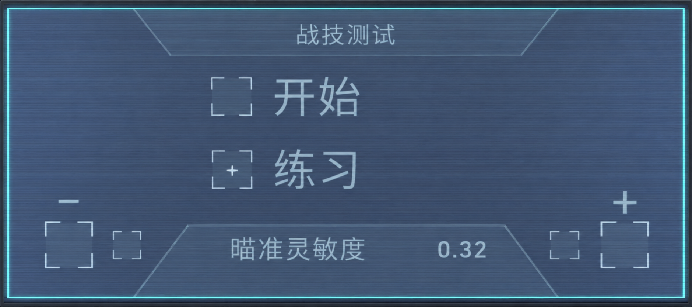
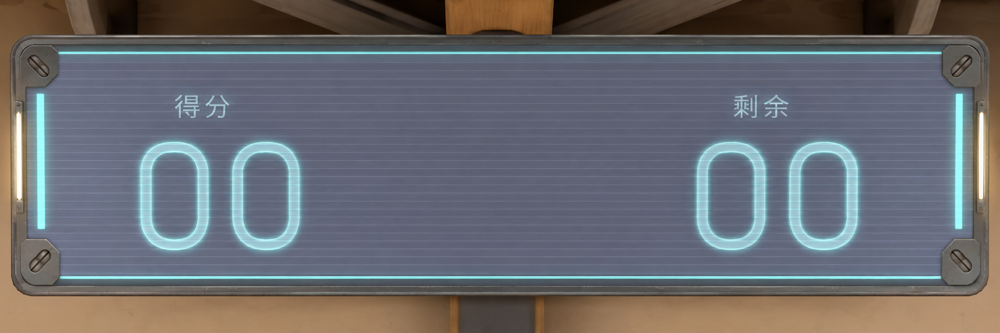
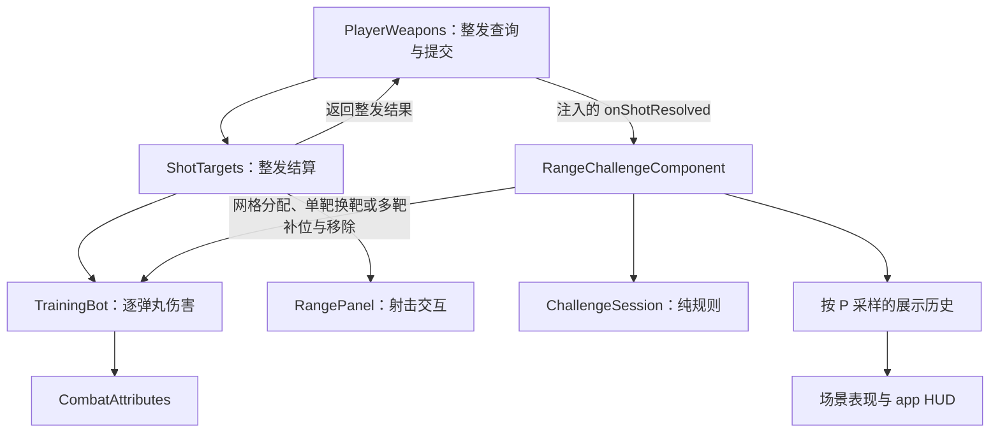
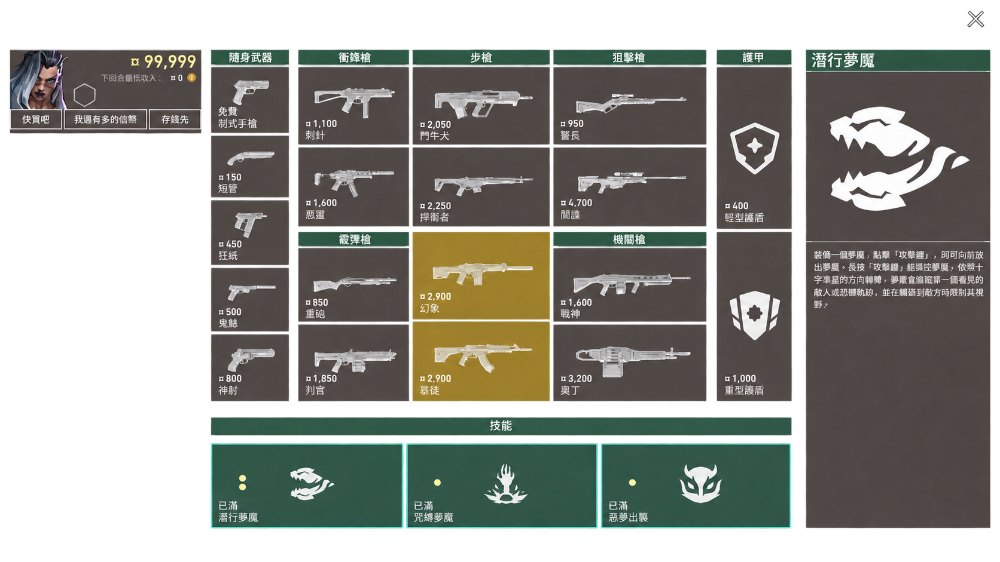

# 靶场核心玩法：30 靶射击测试与消灭 50／100 个

日期：2026-11-16  
更新：2026-11-18（阶段四已接入关卡；按用户确认将困难改为 0.7 秒，开始阶段五验收）

规则版本：`range-challenges-v3-2026-11-18`（仅调整困难档时限；固定伤害不变）

状态：**阶段一 `d300c8a`、阶段二 `5f5d0ef`、阶段三 `23e51c5`、阶段四 `ea3844c` 已提交。真实面板、目标池、HUD、设置／商店会话限制与击杀 VFX 已接入关卡。阶段五按本版规则验收，尚不宣称全部通过。模式一 1 只、模式二 10 只、1×1 米及八邻格规则不变。**

## 1. 目标与范围

在现有练枪房基础上建立两种完整的单人挑战：

| 模式 | 玩家选择 | 场上存活目标 | 推进条件 | 结束条件 | 成绩 |
| --- | --- | --- | --- | --- | --- |
| 射击测试（30 个） | 简单／中等／困难 | 有且只有 `1` 个 | 击倒当前目标，或当前目标超时后换一个 | 30 次出靶机会全部结算 | 击杀数／30，越高越好 |
| 消灭 50／100 个 | 50 个／100 个 | 同时 `10` 个（`N = 10`） | 击杀一个补刷一个，未击杀的机器人保留 | 完成选择的全部有效击杀 | 总用时，越短越好 |

两种模式均通过**射击靶场面板方框内的「开始」控件**启动。模式一单目标，模式二多目标，不能再共用“整局只有一个当前目标”的规则。出靶位置使用第 6.1 节扇形内的正方形网格；每个存活机器人占一个格子，其周围一圈八格不能放其他机器人。

本次需求不包含移动靶、玩家受伤、机器人反击、排行榜、联网、奖励或资产重做。模式二的有界多机器人并发属于本轮明确修订的首版范围；暂不扩展为通用任务／关卡脚本系统。

挑战接入前先建立共享 UI 基础、输入模式和练枪房最小商店。首版商店用于免费选择现有武器，完整经济系统、购买阶段、退货、队友请求／赠送及技能购买均后置；参考图中的技能栏和队伍信息不自动变成首版需求。

机器人被击杀时，必须先出现短促的击杀 VFX，随后主体消失；不播放倒地／倒下动画，不保留尸体或加入布娃娃模拟。该表现属于首版范围，视觉方向见第 5.4 节。

### 实施前置约束：采用用户制作的场景面板，另行取得实施授权

这是用户明确提出的约束，适用于后续实施，不是渲染技术选型可以代替的工作：

- 开局控制面板、悬挂计分板等场景面板的**实际大小和具体位置必须由用户提供**。用户现已通过当前 Blender 中选中的 `screen-bottom`、`screen-top` 提供，实测数据见第 5 节，不再视为尺寸／位置缺失。参考截图仍只说明视觉方向与信息结构，不能覆盖用户制作的空间基准。
- 两块面板的面内宽／高、几何中心、物体原点、世界朝向及挂载情况已记录，UI 图也已确定主要视觉区域。F3 设置、自由练习、灵敏度和暂停等首版产品行为已确认；像素／UV 换算与玩家侧文字方向属于后续技术核验，不能把整块显示面默认当成「开始」按钮。
- `CanvasTexture`、文字纹理或 Mesh 只解决绘制与承载方式，不能据此自行决定面板放在哪里、多大。不得猜坐标、自动选择摆放位置，或先做占位面板绕过此条件。
- **设计确认与实施授权分开记录。** 用户先授权阶段一、再要求 commit 后进入阶段二，随后同意“先提交阶段二，再开始阶段三”。阶段四已另行提交；2026-11-18 用户确认困难档改为 `0.7` 秒并开始验收，不因此扩大资产制作范围。

### 规则依据、项目简化与资料可信度

- 玩法规则及项目简化以用户明确描述为准。**不做武器距离衰减、采用复活点前方总角度 90°／半径 18 米刷靶域**是本项目决定，不声称复刻官方靶场范围或完整战斗规则。
- 用户提供的资料线索：[英文靶场 Wiki](https://wiki.playvalorant.com/en-us/Range)、[中文 BWIKI 靶场](https://wiki.biligame.com/valorant/靶场)、[Esports Tales 练枪攻略](https://www.esportstales.com/valorant/how-to-improve-your-aim-training-accuracy-recoil-pattern-crosshair-placement)。其中社区回忆、玩家测试与攻略中的模糊时间不能写成官方逐帧实测结果；本轮没有独立完成客户端测量。
- 2026-11-17 已读取第三方 [Valorant-API 武器接口](https://valorant-api.com/v1/weapons?language=en-US)及[版本接口](https://valorant-api.com/v1/version)，同轮版本标识为 `13.10.00.5893614`、分支 `release-13.10`。用户现已确认采用最近距离档作为全程固定伤害，并规范 Judge 的明显浮点尾差，见第 6.2 节。这是项目定值及其第三方来源，不是官方对本项目配置的保证；运行时不动态跟随 API 更新。

| 项目 | 本文采用的记录等级 |
| --- | --- |
| 简单／中等／困难 `2.0／1.0／0.7` 秒 | 最初线索来自社区回忆；困难档由用户于 2026-11-18 从 `0.5` 改为 `0.7` 秒。这是**项目定值**，不是官方精确时限 |
| 机器人 `100` 基础生命、开甲加 `50` | **已确认的项目属性**，默认关甲、F3 可在挑战前开甲；不声称本轮在原客户端完成独立验证 |
| 武器头／躯干／腿伤害 | **已确认最近距离档全程固定，保留小数**；Judge 腿伤将原始 `14.450001` 规范为项目值 `14.45`，扣血过程不取整 |
| 刷新间隔与点位分布 | **零额外等待保持不变；本轮将点位明确为扇形内正方形网格，空闲合法格等权抽取、一格一只且相邻八格禁放**；不从攻略反推官方秒数，也不把自由练习 `1／5／10` 当作本项目并发数或网格数量 |

## 2. 共同概念

| 名称 | 定义 |
| --- | --- |
| 一次出靶机会 | 仅用于模式一：一个新目标成为当前目标，直到它被击倒或超时移除 |
| 当前目标 | 模式一当前唯一存活且可被攻击、可推进挑战的机器人；模式二不使用单一当前目标 |
| 存活挑战目标集合 | 当前局所有存活且可命中的机器人；模式一集合大小为 1，模式二正常运行时为 10 |
| 并发数 `N` | 模式二维持的存活机器人数量，已确定 `N = 10`，50／100 两档相同；不等于目标击杀总数 |
| 网格格子 | 扇形内经验证的完整正方形，具有稳定的 `cellId = (i, j)`、中心与已确定的边长 `g = 1 m`，即每格 1×1 米 |
| 周围一圈 | 占用格之外、行列索引各相差不超过 1 的八个邻格，含斜对角 |
| 命中 | 射线／弹丸击中目标的有效命中部位；不等于击杀 |
| 击倒／击杀 | 目标由存活变为死亡；本设计中两者指同一计分事件 |
| 已结算机会数 | 已经因击杀或超时结束的出靶次数，仅用于 30 靶模式 |
| 击杀进度 | 已经完成的有效击杀数，不包含超时、打空或非致死命中 |

基本不变量：

1. 每次出靶有独立身份，新目标不继承上一个目标受到的伤害。
2. 一个出靶身份最多产生一次有效击杀；模式一另最多结算一次机会。模式二同一发可击杀多个旧目标，但不能重复计算同一目标。
3. 命中、受击动画、枪口特效和击杀是不同事实，不能用受击动画播放次数代替击杀数。
4. 开始按钮、墙面、已死亡目标以及非本局目标都不增加成绩。
5. 同一发射击的多个弹丸先查询同一批目标，再处理伤害；模式二查询的是该发开始时的完整存活集合，不能击倒旧目标后，让剩余弹丸继续攻击刚补刷的目标。
6. 每个格子最多占用一个存活机器人，任意两个存活机器人的占用格不能相同或八邻接；解除一个占用不能误删其他机器人的邻格禁放记录。

## 3. 模式一：射击测试（30 个）

### 3.1 开始流程

1. 玩家选择射击测试。
2. 玩家选择简单、中等或困难。
3. 玩家射击面板「开始」。
4. 游戏清空本局击杀数与已结算机会数，生成第 1 个目标。
5. 从该目标开始出现时计算它的有效射击窗口。

**30 指出靶机会总数，不是必须完成的击杀数。** 超时也会用掉一次机会。

**模式一运行中的稳定玩法／展示状态有且只有一个存活、可命中的机器人。** 自由练习机器人在挑战期间隐藏并停用命中；结束或取消后挑战目标为零。旧靶的短暂死亡退场与 VFX 不是第二个存活目标，不可命中，也不得与新靶共格穿模；换靶在一次结算边界内完成。

### 3.2 单个目标的处理

| 发生的事情 | 目标 | 计分与推进 |
| --- | --- | --- |
| 打空 | 保留，窗口继续减少 | 不加分，不换靶 |
| 命中但未击倒 | 保留剩余生命，窗口继续减少 | 不加分，允许补枪 |
| 在窗口内击倒 | 当前目标结束 | 击杀数 +1，已结算机会数 +1 |
| 窗口结束时仍存活 | 当前目标消失 | 击杀数不变，已结算机会数 +1 |
| 换弹、切枪、检视 | 仍按原窗口处理 | 不额外延长目标时间 |

一次机会结算后：

- 已结算机会数不足 30：在靶区另一个位置生成下一目标。
- 已结算机会数等于 30：立即结束，不再生成第 31 个目标。

本模式**没有固定的整局倒计时**。每个目标有自己的时限；提前击倒会提前推进，因此不同对局的总时长可以不同。

### 3.3 难度

| 难度 | 单靶有效时间（首版项目定值） | 状态 |
| --- | --- | --- |
| 简单 | `2.0` 秒 | 已确认，三档中最长 |
| 中等 | `1.0` 秒 | 已确认，介于简单与困难之间 |
| 困难 | `0.7` 秒 | 2026-11-18 确认，60 Hz 固定步下为 42 步 |

以上为用户确认的项目规则，已写入游戏配置，不是已核实的官方精确窗口。配置、测试与验收记录使用本文规则版本；若需改变时限，明确说明并重新确认，不因视觉调优静默改动。

时长配置必须满足：

```text
简单时长 > 中等时长 > 困难时长 > 0
```

难度仅改变单个目标的有效时间，不同时改变机器人生命、护甲、体型、受击判定或武器伤害。后续如需其他变化，应另行定义。

### 3.4 成绩与示例

```text
最终成绩 = 本局有效击杀数 / 30
0 ≤ 有效击杀数 ≤ 已结算机会数 ≤ 30
```

第 12 个目标出现在右侧，玩家命中但未击倒，补枪前目标超时：

- 第 12 次机会已消耗。
- 击杀数不增加。
- 继续生成第 13 个目标。
- 最终击倒 23 个时，成绩显示为 **23／30**。

第 30 个目标无论被击倒还是超时，都触发本局结束。命中次数、造成的伤害和总用时不替代击杀成绩。

## 4. 模式二：消灭 50／100 个

### 4.1 开始流程

1. 玩家选择消灭模式。
2. 玩家选择 50 个或 100 个。
3. 玩家射击面板「开始」。
4. 校验并锁定 `N = 10`、`g = 1 m`、网格容量及本局属性；实例和容量未就绪时不开局，不静默减少机器人或改格子尺寸。
5. 游戏将击杀进度与计时归零，在互不冲突的合法格中一次激活 **10 个机器人**；初始批次出现与计时开始属于同一个玩法提交边界，不逐只加载／生成后才补计时。

50 与 100 使用同一套多目标补刷规则，**并发数均为 10**，只改变目标击杀总数，不附加简单／中等／困难的单靶时限。`N` 是已确定的模式配置，不是把 50／100 个机器人一次放满场，也不自动加入 F3 并发数量控件。

### 4.2 多目标存活与击杀后补刷

| 发生的事情 | 场上机器人 | 进度与计时 |
| --- | --- | --- |
| 打空 | 所有存活机器人保留 | 进度不变，计时继续 |
| 命中一只但未击倒 | 该机器人保留剩余生命，其他机器人不变 | 进度不变，计时继续，允许补枪 |
| 停下来瞄准、换弹或切枪 | 所有存活机器人保留 | 进度不变，计时继续 |
| 击倒一只，尚未完成 | 仅移除该出靶身份，在另一个合法空闲格补一只，其余 9 只的位置／生命不重置 | 击杀数 +1，整发结算后恢复到 10 只，计时继续 |
| 一发击倒多只，仍未完成 | 汇总本发所有有效死亡后，成批补齐对应缺额 | 每个有效死亡各计一次，不等待 VFX，不让同发弹丸命中补刷新靶 |
| 本发达到 50／100 个有效击杀 | 停止补刷，关闭并清理其余存活目标 | 进度到目标数时立即停表并结算；清理剩余目标不加击杀、不播放击杀 VFX |

本模式**没有单个目标超时，也没有整局超时**。未被击倒的每一只机器人都不会因等待而被替换；普通击杀不刷新整场机器人。正常运行、每次提交完成后维持 **10 个存活目标**，最终完成的提交则将剩余挑战目标清零，而不是为凑满 10 只再多补一轮。

**50／100 表示有效击杀总数，不是整局只允许刷出 50／100 个实例。** 为维持并发，完成前场上可仍有机器人；最后达标时直接清理未击杀者，既不提前减少并发来“耗尽剩余靶”，也不把收场移除当作击杀。

一发霰弹可能同时击倒多个原已存活目标。死亡按致死弹丸索引及稳定目标身份排序；本发仅计入达到目标数所需的有效击杀，权威成绩不超过 50／100，不能仅在 HUD 上截断。整发正常伤害已产生的其他真实死亡仍只播放各自一次 VFX，但不增加已完成成绩，也不再补刷。

### 4.3 成绩与示例

```text
最终成绩 = 达到目标击杀数的致死命中时间 - 初始 10 个机器人批次激活时间
```

这里的挑战时间来自游戏模拟时间，不是读取电脑墙钟。普通瞄准、打空、补枪和换弹的耗时全部计入；真正暂停的处理见第 7 节。

在 50 个档位中，进度达到 **21／50** 后连续打空两枪：

- 场上原有的 10 个存活机器人保持各自位置和剩余生命，不重新刷整批。
- 进度仍为 21／50。
- 计时继续增加。
- 第 50 个目标被击倒时若累计 58 秒，结果为 **58 秒完成 50 个击杀**。

最终计分的致死命中接受时就应停表，不等待击杀 VFX、机器人主体消失、其他存活机器人的收场清理或成绩面板动画结束；同发多目标死亡共享本发提交时间，按稳定顺序确定达标事件。

## 5. 面板、局内显示与结算

本节的「射击开始按钮」及第 5.4 节的击杀 VFX／主体消失流程是已明确的需求。UI 分层、输入模式和最小商店按第 8.8 节规划；两块场景面板的空间数据采用下方 Blender 实测记录。用户现已提供具体 UI 图，面内主要视觉布局和商店构图不再列为缺失；尚未由图片明确的功能行为与模式适配见第 11 节。

### UI 参考来源与约束等级

以下仓库图片及用户补充的会话截图是本方案的**强视觉参考，不是可随意替换的风格示例**；已有仓库图片在对应小节直接展示：

| 编号 | 用户提供的原图 | 对应界面 | 主要约束 |
| --- | --- | --- | --- |
| R1 | [控制面板.png](../img/控制面板.png) | `screen-bottom`，见第 5.1 节 | 深蓝灰屏幕、青色细边、顶部标题、上下排列的开始／练习、底部灵敏度及左右加减控件 |
| R2 | [悬挂计分板.png](../img/悬挂计分板.png) | `screen-top`，见第 5.2 节 | 横向双栏、小标签与大数字、青色发光线框字、细扫描线、金属边框装饰 |
| R3 | [商店面板.png](../img/商店面板.png) | DOM 武器商店，见第 8.8.3 节 | 分类网格、枪械剪影卡片、绿色分类标题、金色强调、右侧详情、右上角关闭 |
| R4 | 本轮用户消息附件 Image 1：左侧「靶场」状态卡 | 屏幕左侧 DOM HUD，见第 5.1.1 节 | 绿色标题条、左右对齐的配置摘要、底部「按 F3 更改设置」提示 |
| R5 | 本轮用户消息附件 Image 2：完整游戏画面及红箭头位置标注 | HUD 与世界面板的位置关系，见第 5.1.1 节 | 状态卡在画面左侧；控制面板仍在场景近处，计分板仍悬挂于远处 |
| R6 | 用户本轮消息附件 Image 1：蓝色正方形区块组成的扇形示意 | 第 6.1.2、6.1.3 节刷靶网格 | 用完整正方形离散化扇形，一格一个机器人，同场不重格，周围一圈禁放 |

R4／R5／R6 当前以会话附件提供，尚未另存为仓库图片；此处记录来源与内容，不构造不存在的图片链接。R4／R5 补充屏幕 HUD 与设置入口，**不是要求把 Blender 的 `screen-bottom` 移到画面左侧**；R6 约束网格结构，不提供可直接照搬的米制边长或格子数量。模式二多机器人已由用户本轮文字明确要求，其他截图中的队伍、技能与护甲 HUD 仍不自动纳入范围。

- **优先级：**明确的玩法规则与用户制作的空间数据 → 本文明确列出的模式／首版适配 → 原图的布局、层级、配色和控件形态。不能用图片中的展示数字覆盖游戏配置，也不能用「参考」为由改成无关的网页列表或另一套视觉风格。
- **适配而非整图拉伸：**世界面板适配已记录的面内宽／高，商店适配实际视口。保留构图骨架、阅读顺序和主次，不因原图宽高比不同去改 Blender 尺寸，也不非等比拉伸字体、枪械图标或数字。R2 的房间背景／支柱不属于要绘入显示面的 UI。
- **原图不是实现或状态源：**不能把整张截图贴上去充当已完成交互；动态文字、按钮状态、命中区域和商店详情必须由真实状态驱动。扫描线与发光只作低强度装饰，不遮盖文字或下一靶。
- 图片已足够指导视觉测量；不要求用户再手填全部像素坐标、UV 数字、字体像素尺寸或 CSS 色值。交互语义确认后，由实施者从源图整理归一化布局与命中区域，并在实际面板／视口中预览验证。

参考图中的界面分为三类，不强行使用同一种渲染方式：

| 界面 | 首版承载方式 | 交互与数据来源 |
| --- | --- | --- |
| 武器商店、设置弹窗 | DOM／CSS | 鼠标、键盘与焦点导航；发出装备／设置命令，读取执行结果 |
| 底部武器 HUD、左侧练枪状态 | DOM／CSS；动态准星保留 Canvas | 只读已展示状态；不因图片中存在技能、护甲或经济区域就展示虚构数值 |
| 场景内开局控制台、悬挂计分板 | 用户已制作的面板承载面加 CanvasTexture 或文字／图形纹理 | 控制台的开始按钮接入真实射击；计分板只读。大小、位置及几何朝向使用下方实测记录，玩家可见侧与纹理方向另行确认 |

场景计分板与屏幕 HUD 使用同一份挑战展示状态。R2 的「得分／剩余」用于 30 靶模式，其中「剩余」表示 `30 - 已结算机会数`，包含当前尚未结算的靶，不能减去击杀数。**消灭模式已确认保留双栏结构，左栏为击杀数／目标数，右栏为用时**，具体映射见第 5.2 节，不把两个模式强行套在含糊标签下。

### 场景面板空间记录（2026-11-17）

用户已在 Blender 构建并选中两块面板：近处倾斜的 `screen-bottom` 用作开局控制面板，远处高挂的 `screen-top` 用作悬挂计分板，当前活动物体为 `screen-top`。这是用户提供的场景几何，不是根据参考图猜测的摆放，也不是本次新建的占位面板。

**实测来源与单位：**

- 当前文件：`D:/opencode-temp/opencode/collision-materials-candidate.blend`，场景 `Scene`，帧 `0`。场景使用米制、`scale_length = 1`，以下长度单位为米，Blender 世界坐标为 Z-up。
- 读取时文件含未保存修改，因此以下数据来自**当前会话状态**，不能假定原路径磁盘文件或已发布房间包已包含相同内容。为留存本次状态，已另存备份 `D:/opencode-temp/opencode/range-challenge-panels-2026-11-17/session-79e5cbc6/scene-snapshot.blend`；原文件路径、未保存标记、选中物体、活动物体与当前帧均保持不变。此备份不是正式发布源。
- 宽／高按世界空间中的矩形边长测量，**不是世界轴对齐包围盒的 X／Z 跨度**。位置同时记录几何中心与物体原点；两者不同，不能混用。数值保留六位小数，不代表要求微米级制作精度。

| 空间属性 | 控制面板 `screen-bottom` | 悬挂计分板 `screen-top` |
| --- | --- | --- |
| 实际面内宽 × 高 | `2.951843 × 1.173260` | `7.189490 × 2.489844` |
| 显示面几何中心，Blender `(x, y, z)` | `(0.499413, 1.844268, 9.595418)` | `(0.543338, -13.785929, 16.310728)` |
| 物体原点，Blender 世界坐标 | `(0.544396, 1.844268, 9.595418)` | `(0.371553, -13.785929, 16.555651)` |
| 世界旋转，XYZ 欧拉角（度） | `(-66.612233, 0, 0)` | `(90, 0, 0)` |
| 世界缩放 | `(1, 1, 1)` | `(1, 1, 1)` |
| 当前几何正面法线，Blender 世界方向 | `(0, 0.917839, 0.396952)` | `(0, -1, 0)` |
| 显示面几何中心，换算后 Three.js `(x, y, z)` | `(0.499413, 9.595418, -1.844268)` | `(0.543338, 16.310728, 13.785929)` |
| 当前几何正面法线，换算后 Three.js 世界方向 | `(0, 0.396952, -0.917839)` | `(0, 0, 1)` |

**几何、挂载与接入边界：**

- 两者均属于集合 `screen`，没有父物体、子物体、约束或修改器；各为独立 Mesh，均有 4 个顶点、1 个四边面，厚度为 `0`，网格数据各只有 1 个使用者。当前记录的是显示／交互承载面；集合归属不等于存在控制台／吊架父节点。
- 两者均未绑定材质或图片，各有一个 `UV贴图` 层，四角覆盖完整 `[0, 1] × [0, 1]`。`U` 增大均沿世界 `+X`；`screen-bottom` 的 `V` 增大沿 `(0, 0.396952, -0.917839)`，即向较低的世界 Z；`screen-top` 的 `V` 增大沿世界 `+Z`。这些是现有 UV 方向，不表示 Canvas 文字方向已经验证正确。
- 上表 Three.js 数据仅按项目既有约定 Blender `(x, y, z)` → Three.js `(x, z, -y)` 换算，房间根变换为 identity，依据见[房间导出工作流](../../blender-to-threejs-export-workflow.md)。手工空间配置只转换一次；若复用已转换的 glTF 节点，不再旋转整个模型，也不擅自减去地面高度或重置原点。Blender 欧拉角不能直接当作 Three.js 欧拉角。
- **原点偏移必须保留或显式换算：**复用原网格时使用其原有变换；若后续经确认采用中心化的承载面，则使用上表几何中心与面内宽／高。不能把居中的新平面放在现有物体原点，否则会偏离用户制作的位置。
- **计分板存在正背面注意项：**当前参考相机 `练枪房｜玩家视角` 位于 Blender `(0, 3.049279, 10.8)`，在计分板的 `+Y` 一侧，而 `screen-top` 当前正面法线朝 `-Y`，因此该机位看到的是其几何背面。后续须核验玩家侧显示、背面剔除与文字是否镜像；不能默认单面材质即可正确显示，也不以移动／旋转面板或全场景双面掩盖问题。这是实施者负责解决和预览验证的技术事项，不要求用户指定法线或材质参数；若需改动制作源网格，仍须先说明并取得确认。本次未修改法线、UV 或材质。
- **空间尺寸与主要视觉布局已提供：**开始／练习／灵敏度按 R1 分区，计分板双栏按 R2。模式／难度／数量等设置经 R4／R5 的左侧 HUD 和 F3 设置入口承载，不要求把全部选择控件塞入 R1。交互语义落定后再记录对应的归一化 UV 命中区域，不能将整个 `screen-bottom` 自动注册为开始按钮；`screen-top` 保持只读。
- 当前 Blender 几何不等于已经接入游戏或完成导出。后续需确认运行时房间包是否含对应节点及具体承载方式；如需新增资产，另走候选导出与验证流程。本次没有导出或发布，也没有验证运行时可读性、遮挡或射击可达性。

### 5.1 开局面板

**强参考 R1：用户提供的控制面板界面。**



| 原图区域 | 必须保留的视觉指引 | 本项目的功能映射／边界 |
| --- | --- | --- |
| 顶部标题 | 居中、大留白、细线梯形分隔；原图文案「战技测试」 | 不据此新增第三种挑战；标题／档位文案需与本项目当前选择一致 |
| 中部上行「开始」 | 左侧四角方框标记、右侧大号文字，是主要操作 | **已确认仅方框区域可射击触发**，右侧「开始」文字仅作标签；当前模式／档位可由左侧状态卡和 F3 设置显示，不强行塞入本行，不能只留开发入口 |
| 中部下行「练习」 | 与开始上下排列、相同对齐关系，方框内有状态标记 | **已确认启停现有自由练习，不计成绩**；挑战运行中禁用，开始挑战自动关闭自由练习，挑战完成后不自动恢复，不将其解释成消灭模式 |
| 底部灵敏度 | 中间「瞄准灵敏度」和数值，左右分别为减／加方向及大小方框 | **本期实现，调整玩家鼠标视角转动快慢。** 默认 `0.4`、细调 `0.01`、粗调 `0.1`、范围 `0.01～5`、本地保存，不新增独立 ADS 灵敏度；`0.32` 只是参考图示例 |
| 整体外观 | 深蓝灰底、青色细边与浅青文字、低对比扫描线、轻薄外框 | 不替换成通用网页按钮，不增加未经要求的立体外壳或改变承载面大小 |

R1 本身没有模式切换、三档难度和 50／100 数量控件；用户已用 R4／R5 补充：**游戏画面左侧显示靶场状态卡，按 F3 展开具体内容与简单设置。** 因此选项放在 F3 设置中，世界面板保留射击开始，不再把「弹窗还是场景面板」列为未决定的入口方案，也不挪用灵敏度按钮。

设置与场景操作的分工如下。**默认预选“射击测试／简单”，消灭预选 50 个；进入关卡不自动启动挑战。** 预选配置与已运行的本局配置分离，不因显示默认值而发出开始命令。

| 信息／操作 | 承载位置 | 内容 |
| --- | --- | --- |
| 模式 | F3 设置，左侧状态卡显示摘要 | 射击测试（30 个）／消灭 |
| 射击测试选项 | F3 设置 | 简单／中等／困难，仅在射击测试下显示 |
| 消灭选项 | F3 设置 | 50 个／100 个，仅在消灭模式下显示 |
| 开始 | 场景 `screen-bottom` | 真实射击命中开始控件，使用已验证的当前选择启动 |
| 说明 | F3 设置／左侧状态提示 | 射击测试限时出靶、按击杀数计分；消灭击杀后刷靶、按总用时结算 |

F3 设置使用菜单鼠标／键盘操作并遵守输入隔离，不代替真实射击开始。**用户已确认：开始按钮仅采用方框热区。** 该热区是四角标记围成的框内区域，不是仅允许击中细框线；右侧「开始」文字保留为标签，不扩展为整行热区。框外的文字、空白、标题、说明和面板装饰边框均不触发开始，但面板仍保留正常射线遮挡。实施者负责按原图测量、映射到 UV 并检查遮挡，不要求用户另填坐标表。

开始按钮还应满足：

- 不受所持武器伤害大小影响，合法射击命中即可触发。
- 一发霰弹命中多次仍只启动一局。
- 触发开始的这一发只作为面板交互，不能同时击中首个挑战目标。
- 捕获 Pointer Lock 的首次点击沿用现有规则，只捕获鼠标，不视为已经射击按钮。

#### 5.1.1 左侧靶场状态卡、F3 设置与鼠标灵敏度

**用户已确认：**R4 的小面板位于 R5 完整游戏画面的左侧，按提示键 `F3` 查看具体内容与简单设置。它是屏幕空间 DOM HUD，不是第三块需要提供世界尺寸／坐标的 Blender 面板。

- **视觉强指引：**使用窄小的纵向状态卡，绿色「靶场」标题条、深色半透明内容区、字段在左／当前值在右，底部独立的「按 F3 更改设置」提示。锚定画面左侧并按实际视口留安全边距，不挡住准星、靶区中央或底部武器 HUD，不要求照搬截图的绝对像素位置。
- **字段来源：**R4 展示「挑战：简单」「机器人护甲：已禁用」「无限弹药：已启用」，作为布局与字段参考。默认简单／关甲现已由用户另行确认，实际显示仍来自已生效配置，不能写死截图文字。「无限弹药」明确指**无限备用弹药**，不表示弹匣不消耗。
- **展开内容：**F3 进入练枪设置，查看模式、对应难度／数量、机器人护甲和鼠标灵敏度；挑战前可修改已支持的设置，护甲可在 `0／50` 间切换。表单像素排版可在预览调整，但产品入口与编辑边界已确定。设置不提供 DOM 开始按钮来绕过射击开始。
- **当前局与下一局分离：**左侧摘要反映当前有效配置；挑战运行时展示已锁定的本局信息。**F3 允许只读查看，并提供明确的「取消本局」按钮**，不能改本局设置，也不通过其他共享设置入口绕过只读状态。打开设置本身不暂停、不隐式取消，未暂停的挑战时间继续；取消意图按既有有效固定步提交。
- **灵敏度属于本期范围：**控制的是同样鼠标位移带来的玩家视角转动量；数值越大，视角转动越快。它不改变玩家行走速度、武器射速、弹道规则、操作系统鼠标指针速度或设备 DPI。菜单中仍不接收游戏视角输入。
- **同一设置来源：**场景 R1 与 F3 的灵敏度显示／调整共用玩家视角设置，不各维护一份数值、不由 DOM 直接改相机。显示值对应现有 `playerConfig.sensitivity` 倍率，沿用其 `0.4` 默认值与既有鼠标计数换算，不采用图中 `0.32`。
- **灵敏度参数已确认：**有效范围为闭区间 `[0.01, 5]`，小方框细调 `0.01`、大方框粗调 `0.1`，调整不越界；本地持久保存有效值，重新进入时恢复。无有效保存值时使用 `0.4`，无效数据或本地保存失败不能阻塞游戏，也不能把未经验证的值直接送入视角计算。本期不新增独立 ADS 灵敏度参数。
- 护甲开关是已确认的首版设置，只能在挑战前修改；无限备用弹药按固定的已确认策略展示，不因状态卡有该字段就额外增加未要求的切换功能。F3、B 与模态关闭共用第 8.8.2 节的输入归属，按键不能穿透成射击或移动。

### 5.2 局内显示

**强参考 R2：用户提供的悬挂计分板界面。**



必须保留横向双栏、标签在上／大数字在下的层级、两栏之间的大留白、青色发光线框数字和细扫描线。金属框、角部螺钉与边缘灯条是外观参考，可作为二维边饰，不自动要求新增框架几何、吊杆或照明资产。

两种玩法的字段映射如下；30 靶沿用原图标签，**消灭模式的左侧击杀数／目标数、右侧用时已经由用户明确确认**，不再列为待选择方案，也不声称是 R2 原图已经展示的状态：

| 模式 | 左栏 | 右栏 | 完成示例 |
| --- | --- | --- | --- |
| 射击测试（30 个） | 「得分」：本局有效击杀数 | 「剩余」：`30 - 已结算机会数` | `得分 23`／`剩余 00`；最终成绩仍为 `23／30` |
| 消灭 50／100 个（已确认） | 「击杀」：`已击杀／目标数` | 「用时」：累计秒数，完成后冻结 | `击杀 50／50`／`用时 58.00 秒` |

- 原图 `00／00` 是排版示意，不是默认有效成绩。30 靶数字可最少补足两位；消灭 100 个必须容纳 `100／100`，用时也不能因两位数字样式被截断到 99 秒。
- 模式、难度、当前第几靶等必要信息可由同份展示状态的 HUD 承担；计分板不为塞入所有字段而破坏双栏主结构。若增加辅助小字，必须保持其从属层级。
- 已完成时保留上一局冻结结果，直到下一局开始或离开；修改下一局选项不提前覆盖上一局成绩。取消不是有效完成，不能把部分进度显示成完整成绩。
- 真实玩家侧需同时核验文字方向、发光强度和可读性；不照搬截图中的房间背景，也不为凑原图比例改变 `screen-top` 的大小或位置。

屏幕 HUD 与世界面板共同满足的信息要求如下：

| 模式 | 必要信息 | 避免混淆 |
| --- | --- | --- |
| 射击测试 | 模式、难度、击杀数、当前第几靶／30 | 「第 12 靶」不是已经击杀 12 个 |
| 消灭 | 目标击杀数量、击杀进度、累计用时；F3 可只读展示并发数 | 21／50 表示已击倒 21 个，不代表场上第 22 只目标或并发数 |

射击测试可增加当前目标的剩余时间条，属于辅助显示，不改变结算规则。生命条、击杀音效等反馈可后续补充，不作为判断击杀的逻辑来源。

### 5.3 结算显示

- 射击测试：`射击测试 · 中等 · 23／30`。
- 消灭模式：`消灭 50 个 · 完成用时 58.00 秒`。
- 结果保留到玩家开始下一局或离开关卡。
- 显示到小数点后两位是建议格式，逻辑不按显示精度逐帧取整或累计。
- 中途取消不生成「已完成」成绩，不把未完成的消灭挑战显示成有效总用时。

### 5.4 击杀 VFX 与主体消失

**已确认：击杀时先播放 VFX，随后机器人主体消失，不需要额外的倒地动画。** 此项不能降级为无特效的直接隐藏，也不列为以后再补的可选反馈。

以前文需求讨论中用户提供的两张击杀效果图为视觉方向（不是本次 R1～R3 面板图）：第一张是机器人身上的黄白色强闪光、星芒和电弧；第二张是主体已消失，原位置仍有短暂电弧、火花及齿轮／机械碎片。首版据此形成以下短促过程：

1. 在击杀事实的展示时刻，机器人原位置爆发黄白色闪光，伴随金黄色／橙黄色电弧、火花和少量机械碎片。
2. 主体在闪光爆发之后迅速隐藏；保留击杀瞬间的姿态即可，不播放倒下、跪倒或其他死亡骨骼动画。
3. 电弧与机械碎片可以在主体隐藏后短暂残留，再衰减消失；不留下可交互残骸，不增加碰撞或伤害。

VFX 由一次有效 `TargetKilled` 驱动，一次出靶只触发一次。非致死命中沿用受击反馈；超时移除、主动取消、重生和卸载不冒充击杀，也不播放这套击杀 VFX。击杀音效仍是独立的可选反馈，不影响视觉需求。

计分、最后一击停表和换靶／补刷均不等待 VFX 播完。短暂旧靶退场表现可以与新靶同时显示，但旧靶已不可命中；**模式一保持一个存活目标，模式二保持 `N` 个，而不是两模式统一限制为一个**。仍可见的退场主体需遵守第 6.1.3 节占位保护，不能在同格或紧邻新靶处穿模；残余电弧不是新的目标。闪光强度等表现参数在预览调整，不能反向改变玩法时限或把补刷改成等待特效完成。

## 6. 出靶、生命与命中

### 6.1 出靶位置

**刷靶区域沿玩家的复活前向往靶场深处平移两排，每排 1 米。** 扇形以平移后的顶点为基准，左右各 `45°`，水平半径 `18 m`。

#### 6.1.1 锚点、坐标与扇形判定

- 坐标使用本项目 Three.js 的 Y-up 米制：水平面为 XZ，Y 为高度，不把 Blender 的 XZ 当作水平面。Blender 标注仍按 `(x, y, z) → (x, z, -y)` 转换一次。
- 从 `collision.spawn.position` 和 `collision.spawn.yaw` 取得复活脚点和朝向。沿此朝向偏移 `2 × g` 得到扇形顶点，玩家占位和可见性仍从实际复活位置核验。
- 每局开始前锁定复活锚点与水平前向。玩家走动、转头、蹲下或改变视野不会移动／旋转刷靶域；若关卡复活配置被明确更新，应在新局重新建立域，不重定位正在运行的一局。实际重生仍走第 7 节的会话生命周期。

令复活脚点为 `S = (sx, sy, sz)`，复活 yaw 为 `a`（弧度）。按项目玩家局部前向 `-Z` 的约定：

```text
F = (-sin(a), 0, -cos(a))        // 复活水平单位前向
O = S + (2 × g) F               // 平移后的扇形顶点，g = 1 m
D = (px - ox, 0, pz - oz)       // 扇形顶点到候选脚点 P 的水平位移
r = length(D)

候选的非零水平位移满足：
0 < r ≤ 18
dot(D, F) ≥ r × cos(45°)        // 两侧边界均包含
```

地面验证从实际地形取得候选脚点的 Y，并检查机器人占位和射击视线。

#### 6.1.2 扇形离散为正方形网格

**按 R6，将扇形划成由完整正方形组成的阶梯状区块，不再使用任意散点池。用户已明确每格为 1×1 米，即边长 `g = 1 m`，两种模式共用。** 这是用户给出的米制尺寸，不是从示意图像素或格子数量推导；不再把 `g` 列为待定。

- 网格以复活锚点与固定水平前向／侧向建立，使用稳定整数行列 `(i, j)` 作为 `cellId`；同一份锁定配置下格子位置不随玩家视角、帧率或截图变化。机器人脚点放在所选格的中心，Y 根据真实地面求得。
- 边界采用保守的完整格筛选：正方形四角均满足第 6.1.1 节扇形范围才保留，不产生半格，不因为阶梯边缘扩大 `18 m` 半径或 `90°` 角度。边缘有一部分原扇形面积未铺满是向内离散的结果，不额外猜一个扩大半径。
- 剔除穿墙、悬空、房间外、与玩家／场景重叠或从预定射击位置被遮住的格；验证考虑机器人实际体积与受击姿态范围，不能只因中心点落地就认定安全。一格一只指唯一的逻辑占用，模型姿态与外围空圈共同接受实际穿模检查；若 1 米格及既定空圈仍无法避免冲突，报告问题，不擅自改格子尺寸、缩小模型或减少并发数。
- 通过验证的完整格形成候选池，正常选点从当前合法空闲格中等权抽取，不添加人为远近权重；模式一相邻两靶不复用同一格，历史已释放格可再次使用。
- 候选生成与验证在准备期有界完成；实际随机选择和占位提交只在固定玩法提交阶段发生，可注入固定随机序列。渲染、HUD、截图和逐弹丸命中回调不生成格子、不重新抽样。
- 网格规模由扇形、已确认的 1 米边长与场景合法性共同决定，不再另猜点坐标。模式二 10 只来自本轮用户明确选择，而不是引用公开自由练习 `1／5／10` 或已有展示机器人数量作为默认值。

#### 6.1.3 一格一只与八邻格禁放

**一只机器人占一个格子，它周围一圈八格都不能再放其他机器人，包含四个斜对角。** 对任意两只存活机器人，其占用格 `(i₁, j₁)`、`(i₂, j₂)` 必须满足：

```text
max(abs(i₁ - i₂), abs(j₁ - j₂)) ≥ 2
```

这等价于：每只机器人占用中心格，并为周围 `3×3` 区域建立禁放保护；不仅是“不能同格”，也不是只禁止上下左右四格。例如 `(0, 0)` 与 `(1, 1)` 冲突，`(0, 0)` 与 `(2, 0)` 之间隔着一列空格，满足网格间隔条件，但仍需实际体积验证。

在已确认的 1 米网格下，任意两只存活机器人的格中心水平距离至少为 **2 米**；同排／列之间留有一格 1 米空格。这不是把格子改成 2 米，也不代替模型姿态与场景碰撞验收。

- **占用与禁放分开记账。** 格子最多有一个占用者；不同机器人的外围保护圈可以重叠，因为重叠格本来就不放机器人。保护使用带 owner 的记录／引用计数，移除一只时只撤销其贡献，不能把另一只仍在使用的禁放格误清空。
- 模式二开局批量放置 **10 只**，每放一只都计入本批占用；补刷也针对本批尚未分配的合法格预留，不能几只机器人同时抽到同格或互为邻格。未被击杀的机器人的占用、身份、位置和生命不变。
- 死亡立即关闭命中资格，但退场主体尚可见时，其格子及周围一圈仍需短暂保护，避免补刷与退场模型穿模。保护释放按提交时记录的固定模拟时刻／主体隐藏计划处理，展示层只读；不能由渲染帧率或 VFX 回调决定何时允许刷靶。无主体的残余火花不无限占格，也不能让补刷等整段 VFX 播完。
- 准备期必须验证**存在满足八邻格限制的并发布局，并留有换靶／退场缓冲**；仅统计空格数量大于 `N` 不代表能放下 `N` 只。补刷新靶使用其他合法空闲格，维持零额外等待。
- 容量不足时阻止开局并明确报告 `N／g` 或场景容量问题，不擅自降低 `N`、解除保护圈或扩大扇形。运行中若出现无法按规则完成补刷的容量异常，明确中止本局且不生成有效成绩，不能静默加等待或继续重叠刷靶。
- 完成收场时清理剩余活靶的占用，已击杀者仍可见的退场主体继续按固定计划保留／释放保护，不因停表就立即允许新靶穿过它。取消、重生、Editor、卸载或开始新局时，清理旧会话的目标、退场表现与占用／保护记录；旧回调不能释放新局格子，新局从干净账本开始。

本轮已确定 `N = 10`、`g = 1 m`，见第 11.4 节；只更新规则与占位契约，不在 Blender 创建格子或机器人。实际合法格数、10 只并发与退场缓冲容量、保护释放计划由实施者在固定时序下核验，不能把参数确认当作容量测试通过。

### 6.2 生命与伤害

“命中但未击倒”是必须支持的规则，因此需要真实的存活／死亡结算，而不是每次命中直接加分。

- 每个目标持有独立生命／护甲状态，可复用现有 `CombatAttributes`。
- 非致死命中保留剩余生命，同一个目标允许后续补枪。
- 新目标从配置的满生命／满护甲开始。
- 按存活到死亡的转换通知挑战推进，死亡后重复命中不能重复加分。
- **已确认不做距离衰减。** 有效伤害仅按武器 `definitionId` 与头／躯干／腿部位配置取固定值，不因命中距离切换档位、插值或乘距离系数；不能从受击动画或特效推测。
- 霰弹枪逐弹丸结算有效伤害；现有受击动画的“每目标合并一次”不能当作伤害合并规则。
- 场景遮挡继续限制目标命中，不允许穿过墙或面板命中后方机器人。

**距离仍有用途，但不是伤害输入：**射线最近命中、遮挡、命中位置与既有射程检查保留距离信息；不做衰减不等于允许穿墙、取消射程或把 18 米刷靶半径当成武器射程。玩家移动后实际射击距离即使变化，同武器、同部位的基础伤害仍不变。

#### 6.2.1 机器人属性（首版项目定值）

用户已确认 `maxHealth = 100`，**默认关甲**，即 `maxArmor = 0`；F3 可在挑战前开启 `maxArmor = 50`。这是本项目规则，不宣称本轮已在原 VALORANT 客户端独立验证：

| 属性档位 | 基础生命 | 护甲 | 满状态生命／护甲总量 |
| --- | --- | --- | --- |
| 关甲 | `100` | `0` | `100` |
| 开甲 | `100` | `50` | `150` |

复用[现有战斗属性契约](../../combat/attributes.md)：护甲最多分担输入伤害的 `2/3`，不足部分转给生命，不将其另改成优先吃完的护盾，也不把生命设成 `150` 后再额外加 `50` 护甲。该模型支持小数且不在每次扣血中取整。开局锁定选定的护甲档，局内不能更改，且不随简单／中等／困难联动。

#### 6.2.2 七枪无衰减固定伤害与版本

用户已确认以第三方 API 各枪**最近距离档**作为项目全程固定伤害，保留小数，只规范明显浮点尾差。下表已在阶段三固化为 `src/game/combat/fixed-damage.js`，但真实挑战目标池尚未装配；来源版本见第 1 节，不在运行时请求公网接口决定伤害。

| 武器 | 来源距离档（仅作出处，不参与本项目结算） | 头 | 躯干 | 腿 | 单位 |
| --- | --- | --- | --- | --- | --- |
| Classic | `0–30 m` | `78` | `26` | `22.1` | 每颗命中弹丸 |
| Ghost | `0–30 m` | `105` | `30` | `25.5` | 每颗命中弹丸 |
| Sheriff | `0–30 m` | `159.5` | `55` | `46.75` | 每颗命中弹丸 |
| Phantom | `0–20 m` | `156` | `39` | `33.15` | 每颗命中弹丸 |
| Vandal | `0–50 m` | `160` | `40` | `34` | 每颗命中弹丸 |
| Judge | `0–10 m` | `34` | `17` | `14.45` | **每颗霰弹弹丸，不是整发** |
| Odin | `0–30 m` | `95` | `38` | `32.3` | 每颗命中弹丸 |

- **已确认的精度规则：**采用 Sheriff `159.5／55／46.75`、Phantom 腿伤 `33.15` 等小数，不混用资料中的显示整数。Judge 腿伤 API 原始返回为 `14.450001`，在项目配置中一次性规范为 `14.45`；其余表值不变。后续每次伤害／生命／护甲结算不再取整，不把此表称为精确官方复刻。
- 固定数值后，同一武器／部位在所有可命中距离使用同一值，**连 Judge 也不切换 10／15 米档**；因此取消衰减会改变原游戏的距离平衡，这是用户明确选择的简化，而非复刻承诺。
- 实施时显式连接现有命中盒 profile 的 region 与头／躯干／腿三档，不让 UI 或动画猜伤害，也不为此新增命中盒。映射覆盖与语义由实施者核验；若现有数据出现无法归类的部位，报告具体冲突，不静默默认。霰弹枪按每颗有效弹丸累计，不能把整发伤害再乘一次弹丸数。
- 本轮只确认伤害规则，不因 API 中的弹匣容量、弹丸数、射速等字段自动改现有武器配置、动画或资产。缺失的部位映射／数值不得默认为一枪击倒。

### 6.3 弹药与刷新间隔

**供弹、开局与零额外换靶间隔均已确认：**

1. **弹药供应。** 本方案练枪房采用无限备用弹药；这不是无限弹匣，保留现有弹匣消耗和手动换弹。首版按该固定策略显示状态，不从截图自行推导额外的供弹切换功能。
2. **无开局倒计时已确认。** 合法射击开始被接受、资源与配置就绪后，在同一提交边界激活模式一的 1 个目标或模式二初始 `N` 个目标并开始本局，不额外加入开场等待。
3. **刷新间隔定为 `0` 秒额外等待。** 模式一击杀／超时后换一只；模式二未达标时击杀多少就补多少，未被击杀者不重置。两模式都不加入空档、不等 VFX 播完；原先讨论的 `0.2` 秒不采用。模式二最终达标后不补刷，而是清理剩余存活目标。
4. **零等待不绕过整发提交与网格约束。** 补刷在全部弹丸查询和本发结算返回后安排，不能被同发弹丸继续命中；选格仍须遵守占用与一圈禁放。模式一超时按固定步截止流程处理，模式二不做单靶超时。消灭用时按初始批次到达标致死命中的模拟时间差计算，不扣除普通动作或表现耗时。

不因普通命中或换弹重置目标窗口，不为了维持进度自动把目标判为击杀。

## 7. 对局状态与边界

本节为已确认的首版对局边界。暂停恢复与输入隔离已落地；会话规则／生命周期接口在阶段三完成，真实商店互斥与 F3 取消仍需关卡装配，实际范围见阶段记录，不将契约本身当作完成证明。

### 7.1 状态

| 状态 | 含义 | 允许操作 |
| --- | --- | --- |
| 待开始 | 尚无运行中的挑战 | 选择模式／档位，射击开始 |
| 进行中 | 按当前固定配置出靶、计分／计时 | 攻击本局任一存活目标、正常切枪；通过明确的取消入口结束本局 |
| 已完成 | 保存最后结果，不再推进 | 查看结果，选择下一局配置，再次开始 |

已确认规则：

- 开始时锁定本局模式、难度／数量，首版禁用运行中的选项更改；以后若允许预选下一局，也不能改变当前局规则。
- 进行中重复射击开始按钮不清分、不重开，也不额外增加任何模式的存活目标数。
- F3 只读面板提供明确的「取消本局」入口，提交后清理本局全部目标及网格占用并回到待开始，不能冒充自然完成；打开商店或按 Esc 不隐式取消。
- 开始新局时生成新的对局身份，旧局的迟到命中／回调不能影响新局。
- 「练习」启停现有自由练习，不计挑战成绩；挑战运行中该控件禁用，开始挑战自动关闭自由练习，挑战完成后不自动恢复。玩家可在本局结束／取消后主动开启，已有结果仍按第 5.3 节保留。

### 7.2 同刻击杀与超时

模式一已确认采用半开窗口；模式二不使用单靶截止时间：

```text
有效射击时段：[目标出现时间, 目标截止时间)
```

- 早于截止时间接受的致死命中有效。
- 恰好到达或晚于截止时间，按超时处理，不再击杀旧目标。
- 截止检查与命中处理必须由明确的玩法流程协调，不能取决于两个组件谁恰好先执行。
- 如固定步需要量化时长，应记录实际采用的窗口，不用动画帧数推算，也不让帧率改变规则。

这一边界是已确认的项目规则，不是对 VALORANT 同刻事件规则的核实结论。

### 7.3 暂停、观察模式与重生

| 情况 | 处理策略 |
| --- | --- |
| 正常打空、补枪、换弹、切枪、检视 | 挑战时间照常推进 |
| `Engine.pause()` 或 `timeScale = 0` | 冻结挑战计时与目标剩余窗口，恢复时不补算暂停时长 |
| 进入飞行／轨道 Editor 观察模式 | 取消未完成挑战且不生成成绩；避免全局时间继续但玩家无法射击 |
| Home／复位／越界自动重生 | 取消未完成挑战且不生成成绩，避免通过重生刷新弹药或位置影响成绩 |
| 打开商店／更改配装 | 首版在挑战进行中拒绝打开和提交更改，需先明确取消挑战；正常切换已有武器仍可继续 |
| 商店打开后选择武器，首次 Esc | **已确认：**只关闭商店，不因这一按键额外暂停、不自动清理为取消挑战；消费关闭事件，按实际鼠标捕获状态交回游戏输入 |
| 无模态时再次 Esc，解除鼠标捕获／游戏焦点 | **已确认：**暂停游戏，冻结挑战、目标窗口与展示时间；不是仅清空输入，也不把未完成挑战结算为取消或完成 |
| 真正的窗口失焦（如 Alt+Tab）／切到后台 | **已确认暂停**，保留当前未完成对局；不把主动打开商店／F3 所需的 Pointer Lock 释放误判为窗口失焦 |
| 点击暂停层「继续」 | 请求重新捕获鼠标，仅在捕获成功、窗口可交互且没有其他模态占用输入后恢复；失败保持暂停，不把继续操作算作射击 |
| 卸载关卡／关闭应用 | 清理本局目标、面板注册与待展示事件，不保留有效进行中对局 |

Esc、窗口失焦与后台暂停都保留当前未完成对局、全部存活目标的独立生命／身份与网格占用；模式一另保留剩余窗口，不取消、不重新刷整批。**恢复入口为「继续」按钮，实际重新捕获鼠标后才恢复，不因窗口回焦而自动继续。** 暂停原因与模态状态协调，不能由单个回调越过尚未解除的暂停／输入限制。恢复点击不射击，不通过读取系统时间补算暂停或后台间隔。

## 8. 接入架构与接口契约

本节描述整体接入方案，沿用 `app → game → runtime`。阶段一／二及阶段三逻辑已按记录实施；真实场景面板、目标池和 VFX 仍属后续工作。下方“编写设计时的代码状态”保留为历史基线，不覆盖阶段三实际交付记录。

### 8.1 当前基础与缺口

以下是编写本设计时的代码状态，不是本设计已经完成的内容：

| 现有模块 | 可以复用 | 尚需补充 |
| --- | --- | --- |
| `RangeRoomLevel` | 关卡资源与对象生命周期、现有机器人装配 | 挑战装配、面板、出生点与自由练习切换 |
| `PlayerWeapons` | 固定步射击事实、整发弹丸查询、场景遮挡 | 整发提交入口，以及提交完成后的窄通知接口 |
| `ShotTargets` | 关卡本地目标注册、射线查询与受击分发 | 交互与伤害分流、逐弹丸信息、身份校验和重复提交抑制 |
| `TrainingBotComponent` / `BoneHitboxes` | 骨骼命中盒、部位识别与受击动画 | 独立生命、出靶身份、一次性死亡事实，以及权威姿态与可见姿态的隔离 |
| `CombatAttributes` | 独立生命／护甲及致死转换模型 | 由目标持有，在有效固定玩法步骤调用 |
| Engine / Time | `fixed → postPhysics → motion → presentation`、固定模拟时间与公共展示时间 | 复用既有阶段，不增加靶场专用阶段或第二条时间轴 |
| app HUD／诊断 | 当前关卡的显示和只读检查入口 | 挑战显示，以及分开的权威快照和已展示快照 |
| app 武器 HUD／准星设置 | DOM HUD、准星 Canvas 与现有弹窗 | 共享挂载／焦点／输入模式，窄展示读模型和按变化更新 |
| `InputSystem` / `PlayerComponent` | Pointer Lock、输入清理、玩家与 Editor 的交接 | 单独的菜单输入模式，避免借用停用整个玩家的路径 |
| `EquipmentController` / `WeaponInventory` | 七个现有武器槽位、切换命令及资源准备反馈 | 最小商店入口与显示模型；当前并没有购买／动态替换背包的交易接口 |

当前默认装配蓝／黄／紫三个展示机器人，皮肤上的难度只是视觉元数据；挑战难度必须来自本局锁定配置，不能反向读取皮肤标签决定时限。现有机器人只有命中计数和受击反应，独立战斗属性模型尚未接到目标。

当前 `PlayerWeapons.fixed()` 已先查完一发中的全部弹丸，再调用 `ShotTargets.react()`；后者只保留每个目标最近的一次命中来播放反馈。这个查询顺序可以复用，但合并后的结果不足以结算伤害。当前机器人还在 `fixed` 中直接推进可见骨架，而 `BoneHitboxes` 读取同一套骨骼，展示接入必须同时处理这个耦合。

当前武器 HUD 在 app `frame` 中读取完整玩家快照，并重复查询节点、写入武器名与弹药文本；`PlayerWeapons.snapshot()` 还包含音频、特效和近期事件等诊断内容。应提供供 UI 使用的小型只读展示模型，避免把诊断快照复制和无变化的 DOM 写入放进每帧路径。这是可观察的接入问题，不表示已经测得它是当前帧率瓶颈。

当前七个槽位装配 Phantom、Classic、Ghost、Vandal、Sheriff、Judge、Odin，现有 `select`／`selectSlot` 负责切换已持有武器。`PlayerComponent.setEnabled(false)` 会连同移动、相机、武器生命周期一起停用；不能直接把这条 Editor 路径用作打开商店。

### 8.2 模块职责与装配

| 模块 | 拥有的职责 | 调用方不需要知道的实现细节 |
| --- | --- | --- |
| `ChallengeSession` | 纯数据规则：锁定配置、活跃出靶身份集合、模式一机会／截止、模式二并发数／累计击杀、批量死亡、取消与最终结果 | 单目标换靶与多目标补刷差异、逐身份去重、达标批次不超计 |
| `RangeChallengeComponent` | 关卡内适配：正方形网格、占用／八邻格保护账本、批量初始放置与补位、整发结果及展示历史 | 目标池、格子分配／退场保护、自由练习隔离；不建立全局 GridSystem |
| `ShotTargets` | 目标注册、最近射线命中、整发交互／伤害分流与结果汇总 | 注册项查找、身份与射击去重；不持有挑战进度或武器伤害表 |
| `TrainingBotComponent` | 本次出靶的属性、命中资格、权威姿态、可见姿态及受击／击杀表现 | 逐弹丸结算、姿态采样、退场记录与重置；不决定下一靶或最终成绩 |
| 伤害配置与计算函数 | 根据 `definitionId`、命中部位求固定有效伤害值，不做距离衰减 | 固化的数值版本与映射；距离只留在射线／遮挡事实，不参与伤害分档，不从动画、皮肤或反馈音效推测伤害 |
| `RangePanel` | 可射击控件、控制项身份与当前可交互状态 | 几何命中与命令构造；不直接扣血、刷靶或改成绩 |
| 挑战展示与 app HUD | 按 `P` 读取目标显隐、进度、计时和结果 | 展示游标与格式化；不重新抽出生点或推进规则 |
| app UI 宿主与输入模式协调 | UI 挂载、层级、模态焦点、输入归属与 Pointer Lock 交接 | 具体 DOM 节点与监听清理；不拥有挑战、背包或战斗属性 |
| 最小商店视图与装备命令适配 | 武器目录、选中／准备／失败状态、提交已有槽位的选择意图 | DOM 不知道背包可变结构，不直接创建或替换武器实例 |

`RangeRoomLevel` 是装配入口：持有共享机器人资源和 `ShotTargets`，创建挑战 GO、面板与玩家，注入整发结果通知及玩家生命周期通知。目标 GO 仍由 Level 管理；挑战模块保存句柄并请求停用／移除，不建立另一套对象所有权。

运行时数据流如下，回传事实通过注入的窄接口完成，不要求目标或武器反向导入练枪房模块：



两种模式使用同一个 `ChallengeSession`，以明确分支处理“模式一单目标机会耗尽”和“模式二多目标击杀达标”，暂不建立模式插件框架。纯规则使用 `spawnId` 为键维护活跃身份集合，不能只保存一个可被新目标覆盖的 `currentSpawnId`；每次激活／退役都有独立身份。模式一集合大小为 1，模式二正常提交完成后为 `N`，结束时为空。

纯规则不持有 DOM、Three.js、资源 Promise 或机器人实例；固定随机源与第 6.1 节网格的合法分配结果由外部注入。`RangeChallengeComponent` 持有 `cellId` 的占用／保护账本，按整批出生／死亡／补刷提交，负责网格容量与实际地面／可见性校验，不把场景查询放进纯规则。重复死亡和旧回调不得重复释放格子，也不能借「清空当前目标」删除其他存活机器人。

### 8.3 固定步内的提交顺序

复用现有 Engine 的阶段顺序。`RangeChallengeComponent` 在 `fixed` 处理到期和排队命令；射击发生在玩家的 `postPhysics` 调用链内；展示在 `motion`／`presentation` 消费已提交事实。

| 阶段 | 顺序与提交职责 |
| --- | --- |
| `input` | 收集玩家输入及下一局选项／取消意图；不开始挑战、不消耗机会、不扣血。开始仍必须来自合法射击命中 |
| `fixed` | 应用控制命令与固定时间的网格保护释放；仅模式一检查单靶截止、提交超时换靶或完成，模式二不按等待时间移除目标。无人射击时模式一也必须推进 |
| `postPhysics`：射击前 | 玩家实际重生时先通知取消；确认本步可射击。冻结本发全部活跃目标的权威姿态与身份后查询 |
| `postPhysics`：整发提交 | 完成全部弹丸查询 → 判定是否整发用于面板交互 → 预校验伤害 → 逐弹丸扣血 → 汇总一次性死亡与反馈事实 |
| `postPhysics`：整发提交后 | 同步通知完整 `deaths[]`；模式一安排单靶换靶，模式二先批量计分／判定完成，再分配互不冲突的格子补齐缺额；达标时不补刷并清理剩余活靶 |
| `motion`／`presentation` | 按公共 `P` 消费目标和挑战历史，生成共享展示读模型；在渲染前更新到时的显隐、姿态及有变化的场景面板纹理 |
| app `frame` | 渲染后 HUD 消费同一份已准备的展示读模型，合并写入发生变化的 DOM 字段；诊断按需读取双快照 |

必须保持以下约束：

- **同一发查询期间不改变目标集合、姿态或出靶身份。** 模式二的一发可以命中多个原已存活机器人；死亡立即关闭各自命中资格，但所有补刷及格子重新分配都在整发结果完整返回后执行，不能在单颗弹丸回调里刷靶。
- `onShotResolved(result, context)` 由 `PlayerWeapons.fixed()` 在整发结算后直接调用；不再增加一个依赖 GO 插入顺序的 `postPhysics` 消费者，也不通过 app `frame` 轮询最近射击来补结算。
- 模式一按第 7.2 节半开窗口，截止检查先于本步射击。恰在截止步旧靶已超时；零额外等待允许下一靶在该步建立，但使用新 `spawnId` 与合法格，旧命中不可迁移。模式二没有单靶截止检查。
- 开始和击杀补刷发生在整发结算后。模式二初始 `N` 只使用同一个批次激活时间作为计时起点；达到目标数的有效致死事实 `at` 即停表时间，不等下一固定步或动画完成。达标判定先于补刷和新格分配。
- 同发多个死亡按稳定顺序归并，每只旧目标各处理一次；未达标才按缺额批量补齐 `N`，不逐个补刷再让后续死亡打断，也不重置未被击杀者。格子保护的增减随该提交进行，禁止由 `P`、渲染回调或 VFX 完成回调修改权威占用。
- 激活目标时同步建立该 `spawnId` 的初始权威姿态。固定姿态按提交时间采样，同一步的初始化／采样不得重复推进动画，避免机器人和挑战 GO 的 `fixed` 执行先后改变命中盒。
- 无实际固定步的帧只允许收集命令和读取展示，不提交开局、超时或伤害。多固定步追帧必须逐步处理，不能合并成一次帧末结算。
- 当前 Engine 在渲染之后发出 `frame`。场景纹理更新必须安排在渲染前的展示阶段，不能只在 DOM HUD 的 `frame` 订阅里重绘，否则会额外滞后一帧。两端复用同一份按 `P` 准备的显示值与版本，不能各自查询不同时间的玩法状态。

时间直接来自固定步的 `fixedTick / fixedElapsed`。模式一时限需量化时向上取整，将 `windowTicks` 记录进锁定配置，`deadlineTick` 记录进该靶状态，并验证三档严格递减。模式二用时由初始整批激活与达标致死事实的时间差计算，不给每只机器人各开一个计时器，也不使用墙钟。网格退场保护释放同样记录固定时间，不能随渲染帧率改变；实现使用本次修订版及已确认的 `N = 10／g = 1 m`，不从图片或历史展示配置猜默认值。

### 8.4 整发射击提交接口

#### 8.4.1 调用位置与输入

拟新增同步接口 `ShotTargets.resolveShot(shot, context)`。调用方使用装备控制器已经接受的 `ShotFired` 事实，完成所有射线查询后提交一次。原有 `trace()` 保持只读；`resolveShot()` 不补发射线、不再次扣弹，也不负责武器冷却。

| 输入信息 | 契约 |
| --- | --- |
| `epoch`、`sequence` | 使用现有射击事实身份，在当前关卡／射击来源作用域内唯一；不能只使用会重置的 `shotSequence` |
| `instanceId`、武器 `definitionId` | 分别标识武器实例与伤害配置来源，不从当前展示的武器推断 |
| `fixedTick`、`at` | 必须与实际 `postPhysics` 固定步一致；接受时间不由动画或回调完成时刻填写 |
| `pellets[]` | 按弹丸索引保留方向和完整命中信息。单弹射击在接口内部归一化为 `index = 0` 的一项 |
| 每项 `impact` | 保留距离、命中部位、位置、法线、表面和 `targetId`；打空／静态场景命中也保留 |
| 挑战目标身份 | 每个命中记录查询时捕获的 `targetId / sessionId / spawnId`，不能只记局内最新的一个 `spawnId`；关联 `cellId` 由该出靶记录确定，不在结算时猜最新格子 |
| 面板控件身份 | 标识注册项、控件动作及选项修订；命令绑定本次查询时确认的选择，不读取事后变化的 DOM |

已有的汇总 `impact` 可以继续用于准星等展示，但有 `pellets` 时伤害只遍历 `pellets`，不能再把汇总命中扣一次。查询与结算之间只传普通只读数据，不传可变机器人、材质或骨骼引用。

#### 8.4.2 分流、伤害与返回事实

`ShotTargets` 先验证输入结构及射击身份，重复／旧代次提交直接返回 `ignored`；对新射击再校验实际固定步和命中记录，并按注册目标分组。每组保留原弹丸索引；注册目标提供机器人伤害或面板交互的具体实现，注册表不解释难度、生命上限或伤害表。

处理规则：

1. **先判断合法面板交互。** 面板状态包含资源、玩家操作资格、已验证选项以及模式所需网格容量。一发命中开始控件多次只生成一个 `StartRequested`；接受后整发不再结算机器人伤害或受击反馈。模式一首靶／模式二初始整批均在完整结果被消费后才激活。
2. **未接受交互时处理伤害。** 先由各目标只读预计算本发有效命中的伤害，整发全部通过校验后，再按弹丸索引调用目标持有的 `CombatAttributes` 同步提交。同一目标允许多个弹丸累计伤害；首次存活到死亡后，不再扣血，也不再产生第二次死亡。
3. **整发结束后汇总反馈。** 对本发后仍存活的目标，注册表将合并受击反馈交给目标一次，更新权威受击起点并记录待展示事实；本发致死则向目标展示队列提交一次 `TargetKilled`，用于第 5.4 节的 VFX 与主体消失，不再启动普通受击动画。合并反馈不能代替逐弹丸伤害；返回的事实仅供读取，挑战计分通知不得再次派发特效。旧 `react()` 路径应迁入这条流程，不能新旧路径各执行一次。
4. **返回后再推进挑战。** 目标返回死亡事实，不在单次扣血回调中调用挑战或刷靶。`PlayerWeapons` 将完整结果交给 `onShotResolved`；挑战验证同一 `sessionId` 且 `spawnId` 属于本发活跃身份集合的死亡，稳定归并后一次更新计分和补刷需求。模式二不能只校验一个“当前出靶”，也不能把未击杀者清掉重建。

返回一个只读的整发结果，建议字段如下：

| 返回字段 | 含义 |
| --- | --- |
| 射击身份、`fixedTick`、`at` | 原射击的身份与提交时间，供接收方关联及校验 |
| `disposition` | `interaction / combat / none / ignored`：已接受交互、有效目标伤害、无目标结算、重复／失效提交 |
| `interactions[]` | 已接受的面板命令；开始命令带控件身份、已验证选项及修订，当前一发最多接受一个开始命令 |
| `damage[]` | 逐弹丸实际结算记录：目标／出靶身份、弹丸索引、部位、输入伤害、生命损失与护甲损失 |
| `deaths[]` | 每次生命只产生一次的 `TargetKilled`，带目标／出靶身份、致死射击与弹丸索引、`at`、原 `cellId`／位置／姿态；可包含多只旧目标。按稳定顺序供模式二计分／达标截定使用，返回后不重复派发 VFX |
| `reactions[]` | 已交给存活目标的合并受击事实的只读副本，保留目标／出靶身份、部位和 `at`；可见反馈由目标表现适配者按展示时间消费，致死目标改用 `TargetKilled` |

合法面板命中不取决于武器伤害大小，但仍必须是装备控制器接受的真实开火，沿用扣弹、冷却与 Pointer Lock 规则。运行中再次命中开始按钮不重开；按钮即使暂不可操作也保留物理遮挡，不能因为忽略交互就让该弹丸穿过面板。其他未击中面板的弹丸只有在整发未接受开始交互时，才可按普通规则伤害本局原已存活目标。

#### 8.4.3 去重与失败语义

- 注册表对整发去重，目标对出靶资格校验，`ChallengeSession` 对机会／死亡结算去重。三处各守自己的不变量；同一个 GameObject 被复用不代表仍是同一次出靶。
- 重复提交同一射击返回 `ignored` 和空的新事实；再次传给挑战也不改变成绩。过期局、过期出靶、已注销目标与旧装备代次的迟到新增结算同样不能产生伤害或反馈；已经接受并入队的旧靶退场表现则按第 8.5.3 节独立播放，不因下一靶生成而丢弃。
- 去重记录跟随关卡及射击来源生命周期，使用有界游标／窗口清理；不为每局永久保存全部弹丸，也不允许清理后重放旧代次。
- 武器／部位伤害配置在可开始前校验完整，不能缺失时默认为一击必杀或零伤害。非法输入、重复弹丸索引、非有限伤害等属于程序／配置错误，在任何目标扣血前完成预校验并报错；不留下前几个弹丸已经扣血、后几个才因配置失败退出的结果。
- 接口同步完成，不在逐弹丸结算中加载资源、等待 Promise 或执行外部异步回调。静态场景命中仍可供现有弹痕／粒子使用，但不产生目标死亡事实。

### 8.5 目标展示时序与姿态隔离

#### 8.5.1 权威时间与展示时间

令 `C` 为最近完成的固定模拟时间，`h` 为固定步长，公共展示时间沿用运行时：

```text
P = max(0, C - h + alpha * h)
```

玩法在固定步提交，画面在 `P` 到达事实时间后展示。“目标出现时间”在规则中指 `TargetSpawned.at`；可见目标与 HUD 在 `P` 到达同一个 `at` 时一起切换，不能以 GPU 实际绘制或动画启动回调重设计时起点。

| 已提交事实 | 权威状态立即发生的变化 | `P` 到达该事实时展示 |
| --- | --- | --- |
| `TargetSpawned` | 为该机器人建立新 `spawnId`、满属性、`cellId`、位置／朝向；仅模式一有单靶窗口 | 在该格显示该目标；模式一更新靶序号，模式二逐身份显示初始批次或补刷新靶，不覆盖其他存活机器人 |
| 非致死伤害与受击 | 只扣该目标生命／护甲，其他目标保留；模式一截止不重置 | 对应目标／部位反馈；若显示生命，同步更新该目标 |
| `TargetKilled` | 旧靶不可命中，结算击杀，安排后续；记录死亡表现数据 | 更新进度并启动闪光／电弧／碎片 VFX，随后快速隐藏旧靶主体，残留特效自行衰减 |
| `TargetExpired` | 仅模式一：关闭旧靶命中资格、消耗一次机会并安排后续 | 直接移除旧靶并更新机会进度，不播放击杀 VFX |
| `ChallengeCompleted` | 冻结结果；模式二达标后停止补刷，关闭剩余活靶并清理其占用，移除不计击杀 | 事实到达 `P` 时显示成绩并移除剩余未击杀目标；已接受的真实死亡 VFX 可继续，不等待表现完成才显示结果 |

同一时刻的事实保留稳定序号，按旧靶结束、进度变化、下一靶出现或挑战完成的顺序消费；击杀的旧靶结束会启动独立退场表现，超时则直接隐藏。不同 `spawnId` 的位置切换是离散切换，不能插值成机器人从上一个出生点滑到下一个出生点，也不能把尚未结束的旧靶 VFX 移到新出生点。

展示历史至少保留 `P` 所需的最近状态、当前动画所需的起点和全部尚未展示事实；不能在固定步复用目标时覆盖仍待展示的上一靶记录。消费后按展示游标回收，不保存无限增长的整局日志。多固定步追帧时按提交顺序消费所有到期事实，同一个 `P` 重复采样不重复播放反馈。

诊断暴露 `simulation` 和 `presentation` 双快照：权威侧含活跃目标身份数组／映射、各自属性与格子、占用／保护摘要、模式一截止或模式二并发数，以及进度／结果；展示侧含 `presentationTime` 与已展示目标集合／成绩。不能用单个 latest target 覆盖模式二其他目标。HUD 只读展示侧，运行用时由批次开始时间与 `P` 推导，完成后读冻结结果，仅格式化时取两位小数。

#### 8.5.2 命中姿态与可见姿态

`BoneHitboxes.trace()` 必须读取固定步准备的权威姿态，不能读一个刚按 `P` 采样过的可见骨架。把现有机器人动画直接从 `fixed` 移到 `motion` 而继续共用同一套骨骼，会让命中受渲染帧率影响，不满足本设计。

首版建议在目标模块内部采用独立的权威骨架与可见骨架：

- **权威骨架：**不加入可见场景，由固定步驱动自己的动画播放器和命中盒；出靶时恢复初始姿态，使用权威 Transform。逐弹丸查询不推进动画。
- **可见骨架：**使用独立播放器，依据已提交的带时间戳事实推进到 `P`。有多个事件时先推进到事件时刻、应用事件，再推进到 `P`，不能每帧无条件加一次 `fixedDelta`。
- 非致死受击在整发完成后以射击的 `at` 更新权威动画起点，影响后续固定步的命中姿态；可见侧在 `P` 到达该 `at` 后播放同一反应。致死时保留击杀姿态供退场闪光使用，不启动死亡骨骼动画；退场记录与复用后的新靶分开，不让旧靶反馈重启新靶。
- 两者可以共享模板、几何、纹理和动画片段，但骨骼、播放状态及出靶重置互相独立。权威采样产生的动画结束只恢复命中姿态，不触发击杀或出靶；声音／表现事件只由展示侧消费一次。
- 挑战目标的可见根节点由目标展示适配者单独写入位置、朝向、尺度与显隐。实例的 `MeshComponent` 可保留挂载／释放职责并关闭逐帧姿态同步，避免它又用最新 Transform 覆盖按 `P` 选出的旧靶位置；不需要新增靶场专用引擎阶段。
- 旧靶死亡后即使仍在等待 `P` 到达，其命中资格已经关闭；新靶初始权威姿态也可先准备好。不能用 `GameObject.active = false` 同时停止仍需消费的展示过程，应分别管理命中资格与可见生命周期。

该方案只增加运行时实例状态，不要求重做或重新发布机器人资产。若后续以权威骨骼矩阵快照替代第二套骨架，仍须通过相同的跨帧率命中和姿态隔离验收，不能为了省实例重新共享可变采样状态。

#### 8.5.3 击杀 VFX 的独立生命周期

- `TargetKilled` 提交时固定原目标的世界位置、朝向、尺度、击杀部位及退场所需姿态数据；表现使用与玩法随机源分开的固定种子。记录不得借用下一靶会修改的 Transform、骨骼或可变对象引用。
- 目标展示适配者以 `sessionId / spawnId` 关联一份退场记录，在 `P >= killedAt` 时按 `age = P - killedAt` 采样闪光、电弧与碎片。主体在配置的短暂隐藏延迟后消失，特效在自身寿命结束时回收；使用模拟展示时间，不自建 RAF 或墙钟定时器。
- 下一靶即刻生成时，上一靶所需的短暂可见实例／姿态由退场记录保留，之后再回收。不能因为复用单个可见实例就提前删掉闪光阶段，也不能为了等旧实例释放而推迟下一靶。退场实例与效果使用有界资源预算，不能无限增长。
- 多目标的退场记录按各自 `spawnId／cellId` 独立持有，补刷新靶不能移动其他人的 VFX。仍可见主体的格子保护由固定模拟计划管理，展示仅按该计划隐藏；不能通过渲染回调释放占用，退场缓冲也不得成为额外换靶等待。
- 击杀视觉与普通命中粒子区分，单个 `TargetKilled` 只消费一次；重复绘制不重放爆发。多步追帧后若展示时间已越过部分效果，直接采样当前年龄，不从零重播或延长寿命。
- 目标的 VFX 使用独立的 owner／scope；若复用公共粒子能力，必须能按来源清理，不能通过全局 `clear()` 顺带清掉其他武器或目标的效果。只读 HUD 和挑战计分模块不拥有特效实例。
- 自然完成允许已提交的真实击杀 VFX 播完，成绩已经冻结；模式二收场移除剩余活靶不是击杀，不新发 VFX。暂停随 `P` 冻结；取消、重生、Editor 或卸载清理本局退场记录及格子保护，旧事实不能在新局重新发射。

### 8.6 配置、供弹与生命周期接线

- **配置锁定：**下一局选择与当前局配置分开。锁定模式一时限、模式二 `N = 10`、目标击杀数、`g = 1 m`、属性、伤害版本及零等待策略；运行中不改规则。实际配置不符合已确认参数、实例未就绪或网格不足以满足邻格保护／补刷容量时，开始控件不接受命令，也不消耗机会。
- **资源准备：**关卡期加载共享资源，准备模式二的多机器人及有界退场缓冲；每次出靶不重复下载。初始 `N` 只必须整批同步建立独立身份／属性／权威姿态与格子后才激活，不能异步逐只加入又先开始计时；回调只报告准备结果。
- **自由练习：**「练习」控件启停现有自由练习机器人，挑战开始时关闭其命中资格并按同一展示时间切换显隐；运行中控件禁用，完成后不自动恢复，由玩家在挑战结束／取消后主动开启。自由练习命中或死亡不进入挑战计分。
- **供弹策略：**已确认练枪房使用无限备用弹药，由关卡注入显式 `ammoPolicy`，在 `EquipmentController` 与换弹提交逻辑中实现；保持弹匣消耗、换弹动作和提交时刻。当前 `WeaponInventory` 校验备用弹药为非负安全整数，不能把 `reserve` 填成 `Infinity`，也不能由挑战每帧直接补弹。HUD 从已展示的武器事实读取供弹策略，左侧「无限弹药」状态与武器 HUD 对该策略的解释一致；不扩散成其他关卡的隐式全局默认值。
- **Editor：**在 `RangeRoomLevel.setPlayerEnabled(false)` 对应的模式交接入口通知挑战取消并使旧局失效，不能只隐藏 HUD 或停掉玩家输入。失效／清理可随生命周期立即执行，不等待已经停用对象的下一次 tick。
- **菜单：**由 app 协调输入归属，保持玩家和武器的资源准备／固定步生命周期可运行；不调用 Editor 停用路径。挑战进行中拒绝商店打开与装备选择请求，已拥有武器的普通切换不受此商店限制。关卡退出或实际重生使旧菜单请求失效。
- **重生：**在玩家实际执行 `respawn()` 时注入通知，先使进行中的挑战失效，再重置玩家／武器；覆盖 Home、面板复位及越界自动重生。仅监听 Home 按键不足以覆盖这些路径。
- **暂停：**`Engine.pause()` 与零 timeScale 沿用引擎冻结，不另做墙钟补算。落实首次 Esc 关模态、无模态时 Esc 解锁暂停、窗口失焦／后台暂停及「继续」成功捕获后恢复；冻结当前局而非取消。输入清理本身不代表挑战已经暂停，窗口回焦也不代表已经恢复。
- **释放：**app 先移除 HUD／监听；关卡使会话失效、注销全部面板／目标并清理活跃身份、格子占用／保护、待展示事实与 VFX／退场实例；Level 再释放各 GO 播放器／骨架／实例及共享资源。旧回调不得重新占格或释放新局格子。

### 8.7 建议落点与改动范围

| 位置 | 拟实施内容 |
| --- | --- |
| `src/game/range-room/challenges/` | 单／多目标 `ChallengeSession`、`RangeChallengeComponent`、正方形网格及占用／八邻格保护、配置、面板和私有展示历史；不增加全局网格系统 |
| `src/game/range-room/level.js` | 装配、共享资源和生命周期接线，保留为组装入口 |
| `src/game/targets/` | 整发目标结算、机器人属性与出靶身份、权威／展示姿态及反馈 |
| `src/game/combat/` | 复用 `CombatAttributes`，增加显式伤害配置的计算入口；模型不承担射击去重或挑战推进 |
| `src/game/weapons/` | 整发提交和结果通知、已确认的无限备用弹药策略，以及装备选择命令／准备结果和 UI 展示读模型；保留装备控制器对库存、弹药／冷却的所有权 |
| `src/game/player/player.js` | 实际重生／停用通知的窄接线，不导入具体挑战规则 |
| `src/app/` | UI 宿主、输入模式协调、左侧状态卡／F3 设置、鼠标灵敏度设置适配、最小商店、武器／挑战 HUD、按变化更新的 DOM 绑定；诊断与产品展示读模型分开 |

runtime 继续提供既有时间、组件、资源、动画与渲染能力。首版不增加全局 ChallengeSystem、事件总线、第二个 RAF 或通用任务脚本框架。

相关现行契约：

- [运行时架构](../../architecture.md)
- [模块所有权与时序契约](../../runtime-module-contracts.md)
- [最小战斗属性模型](../../combat/attributes.md)
- [武器玩法模块](../../weapons/gameplay.md)

### 8.8 UI 基础、输入模式与最小商店

#### 8.8.1 UI 的所有权与最小公共能力

UI 基础先放在 `app`，由现有应用装配入口创建和释放，不新增 runtime 全局 `UISystem`。它解决已有武器 HUD、准星设置、左侧靶场状态／F3 设置、商店与挑战 HUD 的共同问题；继续使用现有 DOM／CSS／Canvas 即可，不为本次接入引入新的 UI 框架或全局状态库。鼠标灵敏度仍属于真实玩家视角设置，UI 只展示／提交设置意图，不拥有另一套相机状态。

公共能力限于：

1. **生命周期与层级：**统一 HUD、模态窗口和调试层的挂载／卸载；固定节点引用，登记并清理事件监听。关闭顶层模态后恢复到之前的 UI 焦点，最后一个模态关闭才允许进入鼠标重新捕获流程。
2. **焦点与输入归属：**鼠标、键盘导航及 Esc 先交给当前模态；模态内保持可见焦点和焦点约束。商店打开、关闭、错误提示等 UI 输入独立于游戏输入启用状态，否则关闭按钮会随游戏输入一起失效。
3. **展示读模型与命令边界：**游戏模块提供窄的只读展示值；UI 只发意图，游戏在有效固定步验证并提交。各模块继续拥有各自状态，不复制成一个每帧重建的全局 UI 大对象。
4. **更新协调：**缓存上次显示值／版本，复用现有 Engine 的展示阶段与 `frame` 订阅；批量处理有变化的绑定。关闭的页面停止订阅其连续展示，重新打开时读取当前模型补齐状态。

建议的窄接口如下，名称是设计契约，不代表已存在实现；读模型应保持小且只读，静态目录可复用引用，具体字段按消费者裁剪：

| 接口边界 | 最小数据或意图 | 不包含的内容 |
| --- | --- | --- |
| 武器展示读模型 | scope／revision、已展示武器身份、弹匣／备用弹药、供弹策略、装备／换弹状态 | 音频发射器、粒子实例、完整背包可变对象、近期事件日志 |
| 挑战展示读模型 | session／revision、`presentationTime`、模式、阶段、已结算机会／击杀进度、模式二并发数／已展示存活数、用时与冻结结果 | 可变目标对象集合、权威骨架、可变规则实例；诊断可另读普通只读目标身份摘要 |
| 商店模型 | 静态武器目录、已有槽位、当前已展示装备、请求状态与失败原因 | 伪造的资金、未实现的技能／护甲购买状态 |
| 装备选择命令 | `scopeId`、`requestId`、`slotId`，进入游戏命令队列 | DOM 节点、资源 Promise、直接修改库存／网格的回调 |
| 下一局设置／取消命令 | 选项与会话身份，进入挑战控制队列 | 直接改当前局配置；DOM 按钮代替射击开始 |
| 左侧靶场状态／F3 设置 | 当前有效模式／档位、已明确的规则摘要、下一局候选设置及命令结果 | 从截图写死「简单／护甲禁用」；运行中直接改已锁定配置 |
| 鼠标灵敏度设置 | 当前视角灵敏度、已确认的默认值／步长／范围、本地保存结果与调整意图 | 操作系统鼠标速度／设备 DPI、DOM 对相机的直接引用、本期范围外的独立 ADS 配置 |

商店内的悬停、焦点、尚未提交的候选武器属于 UI 本地状态，可以立即变化。已装备武器、弹药、挑战分数等事实必须等提交并到达 `P` 后显示，不能把点击成功当作装备成功。调试需要的完整快照保留为按需入口，不再承担每帧 HUD 数据传递。

#### 8.8.2 输入模式与 Pointer Lock 交接

输入模式是 app 对输入归属的协调，和 Engine 是否暂停是两件事。用户已确认 **F3 打开靶场设置、B 打开商店；选枪后不自动关闭，Esc 关闭商店，再次 Esc 解除游戏焦点并暂停**。至少明确以下状态，不能仅用一个 `menuOpen` 布尔值代替实际 Pointer Lock 状态；暂停状态与暂停原因独立记录：

| 模式 | 进入条件与可用输入 | 玩家与模拟行为 |
| --- | --- | --- |
| `gameplay` | 游戏画布实际持有 Pointer Lock、窗口可交互、没有模态、未进入 Editor 且游戏未暂停 | 接收移动、视角、射击、瞄准与普通切枪 |
| `menu` | 商店／设置等模态持有焦点，游戏输入被屏蔽 | 保留玩家、相机和装备生命周期；无新的玩家移动／视角／射击意图，合法已提交的换弹和资源准备继续推进 |
| `unlocked` | 没有模态但尚未捕获鼠标，或捕获失败／已解锁 | 不接收游戏操作；是否同时暂停取决于实际原因，不能仅凭未捕获鼠标就一律暂停。恢复输入的点击本身不射击 |
| `editor` | 明确切到飞行／轨道观察模式 | 沿用玩家停用与挑战取消的生命周期路径，和菜单区分 |

打开商店的顺序：

1. 先校验当前关卡及挑战状态；首版挑战 `running` 时拒绝打开，提示先取消挑战，不自动取消、不暂停本局来绕过限制。
2. 同步将输入归属切为 `menu`，阻止新游戏输入入队，清理按住键、鼠标增量和未消费的射击／瞄准等动作。下一有效固定步在装备推进前归零 `fireHeld`／瞄准意图，并丢弃失效输入；已开始的合法动作不伪造回滚。
3. 请求释放 Pointer Lock，显示模态并设置焦点。异步 `pointerlockchange`／`pointerlockerror` 负责校准实际状态；解锁回调不能覆盖已经进入的 Editor 或另一个模态。

**B／Esc 的已确认交接顺序：**

1. 按 `B` 打开商店，释放 Pointer Lock 并把输入交给模态；这是主动进入菜单，不能把该解锁本身视为 Esc 失焦暂停。
2. 选择武器后商店保持打开，装备仍按既定命令／准备／展示提交。用户随后按下的第一次 `Esc` 只关闭顶层商店模态并消费事件，不再同次触发暂停。
3. 关闭商店后，若已没有模态，先按实际状态进入 `unlocked`；有合法用户手势时请求重新捕获鼠标，只有确认成功、没有其他模态且 Engine 未暂停才恢复 `gameplay`。浏览器暂不允许捕获时保持无游戏输入，不能假装已获得 Pointer Lock，也不能把这次关闭自动算成第二次 Esc。
4. 没有模态时，用户再次按 `Esc` 解除鼠标捕获／游戏焦点，进入暂停：清理残留输入，调用既有引擎暂停路径，冻结当前挑战、目标窗口、动画和展示时间，不取消或结算本局。在本来就没有模态的正常玩法中，按 Esc 即走这一暂停路径，无需先打开一次商店。
5. `×` 或 Esc 的模态关闭都先交给顶层 UI，不能穿透成暂停／射击；同一次按键、按住后的自动重复和 Pointer Lock 回调不能被当作两次用户操作。已经暂停时关闭某个 UI 也不能擅自清除原暂停原因。

F3 设置沿用同一模态焦点与输入隔离机制，不借用 Editor 停用玩家路径。挑战运行中只读查看并提供「取消本局」，不允许改设置，不因打开设置自动取消或暂停。Alt+Tab／后台另走明确暂停路径；「继续」请求重新捕获鼠标，捕获成功且窗口可交互、无其他模态阻挡后才能恢复引擎与游戏输入。失败保持暂停，窗口回焦不自动恢复，继续按钮的按键／点击不能穿透为射击。

菜单点击、Esc、打开／关闭快捷键及恢复捕获的点击都不能穿透成射击；按住开火开菜单后返回，也不恢复旧的按住状态。

不得通过 `PlayerComponent.setEnabled(false)` 打开菜单：它会停用 Motor／Camera、挂起武器并影响视图模型。菜单需要屏蔽输入，同时保留接受装备命令和完成资源准备所需的固定步路径。UI 热键／焦点层与受 Pointer Lock 限制的游戏输入分别接线，不能只是关闭整个输入系统后期待它继续响应菜单。

首版商店只在未进行挑战时使用；模式／难度／数量／护甲的更改锁到下一局，正常切换已拥有武器仍允许。请求提交时必须再次检查状态，防止“先打开／排队，再开始挑战”的迟到选择改变局内装备；装备准备中也不接受开局。Esc、窗口失焦／后台与继续行为按已确认规则接线，并核对既有引擎后台暂停逻辑，避免重复恢复；不新增 UI 私有暂停时钟。

若 Engine 已暂停，DOM 本地导航、关闭与提示仍可响应，游戏命令等待恢复后的有效固定步，不绕过暂停直接改装备；恢复前再次验证 scope 与当前模式。Editor、重生、关卡切换会使旧 scope 的菜单请求和资源回调失效。

#### 8.8.3 首版最小商店：选择已有武器

首版采用练枪房军械库语义：**免费选择已经装配的七个槽位，复用现有 `selectSlot` 路径。** 保留当前槽位结构，不在本阶段暗中改成仅一个主武器加一个副武器；“选择持有武器”和“购买／替换背包”是不同接口。

**强参考 R3：用户提供的商店界面。**



**必须遵循的视觉结构：**

- 大面积覆盖式商店，以中部分类网格为主体、右侧独立详情栏为次级区域，右上保留明显的 `×` 关闭；保持绿色窄分类标题、深灰褐卡片、浅色枪械剪影与金色强调。不能降级成只有七个文本按钮的列表。
- 枪械图标是卡片视觉主体，名称和「免费／选择」等项目文案从属；详情随候选武器变化。悬停／键盘焦点、候选、准备中、已装备和失败需可区分，不能把原图两个金色卡片直接解释为本项目同时装备两把当前武器。
- 左侧信息区如使用，只显示真实的练枪房／当前配装信息。右侧原图显示的是技能图标和说明，本项目明确改为**候选武器**名称、图标和已有真实配置，不照搬技能内容。
- 保持整体列关系和阅读顺序，按实际屏幕响应式适配。没有内容的分类不放假武器占位；可以收敛列宽／留白，但不能以首版武器较少为由取消分类和详情层级。无需用户另提供每个屏幕尺寸的像素稿。

**原图内容与首版目录的映射：**

| 原图区块 | 首版处理 |
| --- | --- |
| 随身武器 | Classic、Ghost、Sheriff |
| 步枪 | Phantom、Vandal |
| 霰弹枪 | Judge |
| 机关枪 | Odin |
| 冲锋枪、狙击枪及图中其他枪械 | 当前七槽位没有对应内容，不因图片存在而新增或放置可点击假卡片 |
| 余额、价格、队友请求／赠送、护甲和底部技能栏 | 不纳入本阶段功能；不显示 `99,999` 等虚构经济数据，不创建无行为入口 |

以上是保留强参考视觉结构、同时遵守七槽位免费选择范围的显式适配。若用户要求图中全部武器、护甲或技能也可用，须另行扩大需求，不能仅凭参考图认定已经获得该授权。**用户已确认 B 打开商店，选枪后保持打开、由 Esc 关闭；再次 Esc 解除游戏焦点则暂停。** 右上 `×` 仍可关闭，交接按第 8.8.2 节执行；不再将 B 和选枪后关闭行为列为待决定项，也不自动增加 B 作为关闭切换键。

| 首版提供 | 具体边界 |
| --- | --- |
| 武器分类、名称与图标 | 覆盖当前七把枪；目录取自显式游戏配置，已有图标优先复用，不从截图猜武器可用性 |
| 选中详情与当前装备标记 | 候选高亮立即响应；当前装备标记使用已展示装备结果 |
| 免费选择并装备 | UI 将槽位选择交给装备命令适配者，在固定步通过现有控制器执行 |
| 准备中、成功与失败反馈 | 关联请求身份，阻止重复提交；失败保留原武器及背包，支持重新选择或重试 |
| 关闭与回到射击 | 按输入模式完成焦点／Pointer Lock 交接，不以页面隐藏作为成功捕获的证明 |

武器详情只展示已有明确来源的配置。伤害如展示，读取第 6.2 节已确认的项目固定表，不复制参考图数值或额外请求第三方数据；尚未接入的数据不得冒充已经生效。生命／护甲 HUD 只在存在真实状态来源时接入；技能购买、余额、队友请求和购买阶段都不做无行为的伪入口。

选择事务的顺序为 `本地候选 → 排队请求 → 固定步验证 → 必要的资源准备 → 固定步提交 → P 到达后显示已装备`。已准备资源可走短路径，但仍只在固定步提交；资源 Promise 回调仅报告带请求身份的准备结果，不能直接换枪或替换 Mesh。准备失败不得丢失原装备；重复请求不重复执行。新选择取代尚未完成的旧选择时，旧完成回调失效；重生／关卡退出同样失效。

关闭菜单不等于撤销本 scope 已接受的选择请求：它可按既定固定步完成，但必须保持输入隔离，失败反馈可在 HUD 简短呈现或重新打开时显示。挑战开始需要有效装备且没有待完成的商店选择；游戏侧必须同时验证此条件和挑战状态，不能仅禁用一个 DOM 按钮。

后续若要只携带主／副武器、动态替换库存或真正付费购买，另行定义装备获取／替换事务，明确槽位约束、资源成功后的提交、失败保留与库存／金额的一致性。现有切枪命令不能冒充购买接口；完整经济功能不作为本次挑战交付的前置条件。

### 8.9 DOM 与场景纹理的更新策略

逻辑精度、展示采样和 DOM 写入频率分别管理。固定步仍负责命中、伤害和成绩；所有玩法展示从同一个 `P` 及其已提交历史取值，降低文字刷新率不能改变成绩，也不能延迟关键状态到下一次低频轮询。

#### 8.9.1 频率分层

以下是首版起始策略，后续通过实际测量调整，不是已经验证的最优频率或性能结果：

| 内容 | 采样／更新策略 | 写入条件 |
| --- | --- | --- |
| 武器名、弹药、真实生命／护甲、击杀分数、靶序号、模式和结果 | 事实到达 `P` 时及时更新，不做低频轮询 | 比较上次显示值；无变化不写 DOM。低帧率多事实可合并到本帧最终文本，反馈事件仍逐项消费 |
| 商店目录、详情、选中、准备状态和错误 | 打开／本地交互／状态变化时更新 | 静态列表复用；关闭后不逐帧重建或更新隐藏页面 |
| 挑战运行用时文字 | 先采用 20～30 Hz 的刷新上限；低帧率下每帧最多一次 | 由展示状态和 `P` 计算；开始、结束、取消和模式切换强制刷新，完成时显示精确冻结结果的格式化值 |
| 动态准星、连续剩余时间条 | 每个渲染帧采样同一个 `P` | 仅在绘制参数变化时重绘 Canvas 或写样式；剩余时间条不推进规则 |
| 场景计分板、控制台文字 | 内容变化时重绘；若带连续时间文字，复用上述文字采样策略 | 只对变化的纹理标记 `needsUpdate`，相机移动不引发 Canvas 重绘／上传 |
| 调试统计 | 可见时先采用 2～5 Hz | 隐藏停止采样；不混入产品 HUD 必需更新 |

两位小数是格式，不要求每秒写 DOM 100 次。文字限频仅决定何时选取新的显示值，不能用 `setInterval` 每次加 0.01 秒模拟计时，也不能由 DOM、CSS 动画结束或纹理上传回调决定成绩。

#### 8.9.2 单份展示值与提交时机

在已有 `motion`／`presentation` 中准备一次小型展示读模型，同时计算需要共享的格式化文本与版本。场景计分板与 DOM HUD 若显示同一个用时字段，应共享同一个限频后显示值，不各自启动计时器。击杀、机会结算与完成等离散变化不受运行用时限频阻挡，下一次展示机会就更新两端。

场景面板在本帧 renderer 之前检查内容版本，必要时绘制 Canvas 并标记纹理更新；DOM HUD 在渲染后的 app `frame` 中消费同一版本。这保证它们对应同一个展示时刻，不承诺 DOM 合成和 GPU 实际出屏具有物理上的原子同步。摄像机变化由渲染器处理现有 Mesh，不触发面板内容重绘。纹理分辨率根据用户提供的实际面板尺寸与最终清晰度需求再定，不能反推或擅自改变场景尺寸。

没有固定步的帧仍可按既有 `P` 采样展示，但不提交玩法；若 `P` 冻结且显示值未变，相关 UI 不产生重复写入。多个固定步只在同一个展示出口合并本帧文本，不能每完成一步就重建 DOM。

#### 8.9.3 DOM 写入、释放与测量

- 挂载时缓存节点引用，分别比较文本、可见性、class 与连续样式参数；值未变化不赋值，不每帧 `querySelector`、全量 `innerHTML` 或重建整个面板。
- 玩法驱动的 DOM 更新每帧集中提交一次；布局读取集中放在写入前，避免写样式后逐项读取尺寸。尺寸测量仅在挂载、布局变化或窗口调整时进行，不因弹药数字变化反复测量。
- 悬停、键盘焦点、滚动和关闭等纯 UI 响应可直接处理 DOM 事件；装饰性过渡可以由 CSS 完成。它们不需要等待物理步，但不能借此提前显示尚未提交的装备或挑战状态。
- 不新增 RAF、轮询定时器或全局事件总线来同步玩法。商店、HUD 和世界面板的观察／监听随各自 owner 释放；重新挂载先完整同步一次，旧异步结果不能写入已卸载节点或已释放纹理。
- 验收时记录 UI 读取与提交耗时、实际 DOM 变更数、Canvas 重绘及纹理更新次数，分别观察静止画面、连续射击、打开／关闭商店和挑战结束。初始重点是消除无变化写入与无关数据复制；不在未测量时声明帧率提升比例或规定虚构的设备预算。

## 9. 验收清单

以下均为后续实施时应验证的项目，**不是本次已经运行通过的测试**。

### 9.1 射击测试

- [ ] 模式一运行的稳定提交／展示状态恰好一个存活可命中目标，其他自由练习机器人已隐藏；结束后为零，退场 VFX 不成为额外目标。
- [ ] 简单／中等／困难只改变单靶时限，且时限关系正确。
- [ ] 连续击倒全部目标，恰好生成 30 靶，结果为 30／30。
- [ ] 全部不射击，30 次超时后结束，结果为 0／30。
- [ ] 23 次击杀、7 次超时，结果为 23／30。
- [ ] 非致死命中不刷新目标、不增加分数、不重置时限，窗口内可补枪击倒。
- [ ] 第 30 靶击杀和第 30 靶超时都能结束，绝不生成第 31 靶。
- [ ] 截止前、恰到截止、截止后的命中符合最终选定的边界规则。

### 9.2 消灭 50／100 个

- [ ] 模式二整批激活 10 个机器人并开始计时，50／100 两档并发数相同；初始占格唯一且任意两只不八邻接，不将目标击杀数当作并发数。
- [ ] 未达标时杀一补一，多杀则整发结束后批量补齐；其余机器人的身份、格子、位置和剩余生命均不重置。
- [ ] 两档在第 50／100 次有效计分击杀时立即停表，最终不补刷，清理剩余活靶但不加分、不发击杀 VFX；累计刷出数无需恰好等于 50／100。
- [ ] 打空、非致死命中和等待保留每只未死亡机器人，不按时间换整场，计时继续。
- [ ] 同发多目标死亡临近终点时按稳定顺序达标，权威成绩不超 50／100，不是仅 HUD 截断；重复死亡不重复计数／释放格子。
- [ ] 换弹／切枪不增加进度、不停止计时。
- [ ] 在固定致死时间序列下，最终用时等于初始整批激活到达标致死事实的时间差，不受初始实例准备先后影响。
- [ ] 最后一击立即停表，击杀 VFX、主体隐藏延迟或结果动画长度不影响成绩。
- [ ] 按确认后的弹药供应规则，50／100 个挑战不存在备用弹药耗尽后无法继续的问题。

### 9.3 共用与集成

- [ ] 射击真实面板开始按钮可开局；一发多弹丸／重复输入只开一局。
- [ ] 开始交互仅由四角方框围成的框内热区触发；射击右侧「开始」文字、整行其他区域或面板装饰边框均不开局，面板遮挡保持有效。
- [ ] 触发开始的射击不能击中模式一首靶或模式二初始批次。
- [ ] 模式一为 1 只、模式二未完成时为 10 只，完成／取消后为零；重复开始不改变该基数。
- [ ] 霰弹全部弹丸先查询本发旧目标集合；允许击杀多个原有目标，但不能顺带击杀补刷新靶。
- [ ] 同一目标多弹丸可累计伤害，每个出靶身份只产生一次死亡／计分；不同旧目标各自结算，不能把整发强行合成一次击杀。
- [ ] 不同部位和武器按明确配置结算；场景遮挡继续有效。
- [ ] 同一武器／部位在不同有效命中距离得到相同基础伤害，Judge 也不按来源距离档切换；保留射线最近命中、射程与遮挡检查。
- [ ] 新目标不继承旧目标伤害；旧局／旧出靶的迟到事实不污染新目标或新局。
- [ ] 出生位置是完整 1×1 米正方形格的中心，模式一相邻两靶不同格；模式二同时存活者不重格，彼此八邻格禁放（含斜角），格中心水平距离至少 2 米。
- [ ] 候选脚点处于平移后的扇形内。以 `collision.spawn.position／yaw` 向场内偏移两排，保留左右各 `45°` 和水平半径 `18 m`。转头、移动、蹲下均使用同一固定网格。
- [ ] 完整 1 米方格四角落在扇形内，边缘向内离散；排除障碍／悬空／占位／不可见格，并验证中心格与外围空圈下的实际机器人姿态不会穿模，不擅自改格尺寸或缩小模型兜底。
- [ ] 属性采用 `100／0` 或 `100／50` 并逐靶重置，默认关甲、F3 只能在挑战前切换；固定时限和伤害使用本文项目规则版本，不冒充官方精确测量。
- [ ] 两模式均零额外等待；模式一换一只、模式二按缺额补位，均在整发结束后安排，不等待 VFX，达标后不补刷。
- [ ] 随机从当次可用格等权抽取，初始／补刷批次不重复分配格子；固定随机序列可复现，不由渲染帧改变结果。
- [ ] 共享外围禁放格使用 owner／计数保护，退役一只不误释放另一只的保护；仍可见退场主体不与补刷新靶同格或邻格穿模。
- [ ] 网格容量检查考虑八邻格与退场缓冲，而非仅格子总数；不足时不开局，运行中异常明确中止且不产生成绩，不降低 `N`／扩域／加等待兜底。
- [ ] 发布配置采用 `N = 10／g = 1 m`；缺失、非法或与已确认值不一致时不能静默回退开局，不把测试夹具、图片像素或已有机器人数量当作配置。
- [ ] 暂停冻结时间；观察模式、重生、失焦与后台遵循确认后的策略。
- [ ] 零固定步帧不提前提交开始／结算；30／60／144 FPS 和多固定步追帧不改变相同输入序列的结果。
- [ ] 目标、计分、计时与结果按统一展示时间显示；单独重复绘制不推进玩法。
- [ ] 卸载与重新加载没有残留机器人、注册项、面板监听或旧成绩写入。

### 9.4 提交接口与展示专项

- [ ] 相同整发事实提交两次，以及相同死亡结果消费两次，都不重复扣血、计分、刷靶、播放反馈。
- [ ] 单弹射击只归一化为一个弹丸；霰弹不额外把汇总 `impact` 算作另一颗弹丸。
- [ ] 面板交互在伤害前裁定；一发同时命中开始控件和其他机器人时，接受开始后整发只产生交互结果。
- [ ] 不可操作的面板仍遮挡射线；运行中射击开始控件不重开本局。
- [ ] 错误伤害配置、重复弹丸索引或无效数值在整发预校验中失败，不产生部分扣血结果。
- [ ] 替换／复用目标后，查询时捕获的旧 `sessionId / spawnId` 不会被替换成新身份；注销／卸载后的事实失效。
- [ ] 权威已提交换靶／批量补刷而 `P` 尚未到达时，画面与 HUD 保持上一份目标集合；到时逐身份更新，未死亡机器人不消失，格子之间不滑动插值。
- [ ] 完成用时在最后一击提交时冻结；延迟展示、动画长度、重复采样和 HUD 刷新均不改变结果。
- [ ] 可见骨架反复采样不同展示帧不修改权威命中姿态；相同固定步输入在 30／60／144 FPS 下得到相同部位和伤害。
- [ ] 交换挑战 GO 与机器人 GO 的装配顺序，不改变截止处理、初始命中姿态和整发结算结果。
- [ ] 暂停／取消／重生后无重复声音或旧靶反馈；待展示历史消费后可以回收，连续多局不会持续增长。
- [ ] 已确认的无限备用弹药仍仅在换弹提交点补入弹匣；有限供弹路径保持原行为，挑战不直接写背包数值。
- [ ] 多目标按活跃 `spawnId` 集合校验，旧身份不能扣新靶血／释放新格；完成清理余活靶而保留必要退场保护至计划释放，取消／重生／卸载／新局启动清理旧会话全部记录，连续多局无泄漏。

### 9.5 击杀 VFX 专项

- [ ] 真实击杀出现参考方向的黄白闪光、金黄电弧、火花和少量机械碎片，随后主体消失；不出现倒地动画、布娃娃或持久尸体。
- [ ] 非致死命中、超时、取消及卸载不播放击杀 VFX；一发多弹丸、重复死亡通知或重复采样不会多次发射。
- [ ] 主体先经历短促的闪光阶段再隐藏，残留效果可继续衰减；计分、最终停表与下一靶生成均不等待表现结束。
- [ ] 下一靶生成或同一机器人实例复用后，上一靶 VFX 仍位于原击杀位置，不附着新靶；短暂退场主体、碎片与电弧均不可命中。
- [ ] 30／60／144 FPS 及多步追帧时效果年龄遵循 `P`，不因重绘延长寿命；暂停冻结，取消／重生／卸载清理本局效果，自然完成保留最后一次 VFX 至结束。
- [ ] 清理目标 VFX 不影响其他来源的效果；连续多局后退场记录、粒子及临时视觉实例可以回收。
- [ ] 模式二同发多目标 VFX 各在原格独立播放，达标时只清理未击杀者而不伪造死亡；退场格保护按固定计划释放，不由 VFX 渲染回调决定玩法。

### 9.6 UI 基础、输入模式与最小商店

- [ ] 实施采用第 5 节用户制作面板的实测尺寸、位置与几何朝向，正确区分物体原点和几何中心、保留控制面板倾斜；没有猜测坐标、自动摆放或占位实现。
- [ ] 玩家侧可正确读取计分板文字，没有背面剔除或镜像问题；控制面板的真实射击命中区域与确认后的 UV 分区一致，不把整块面板当成开始按钮。
- [ ] 对照 R1 验收标题、开始／练习的层级、底部灵敏度和方框形态；图中功能按确认后的范围接入，不以整图贴图、无行为按钮或擅自挪用控件代替。
- [ ] 对照 R2 验收双栏、小标签与大数字、青色外观；30 靶剩余按机会计算，消灭字段按确认的模式适配，能完整容纳 `100／100` 和较长用时。
- [ ] 对照 R3 验收分类网格、枪械剪影卡片、详情栏、强调色和右上关闭；只提供已确认的七把枪，不因参考图擅自增加经济、护甲、技能或其他武器。
- [ ] 左侧状态卡按 R4／R5 的位置关系与层级显示真实配置，F3 展开简单设置，不把它误做为 Blender 面板，也不照抄示例难度／护甲为默认规则。
- [ ] 本期灵敏度可实际调整同样鼠标位移对应的玩家视角转动快慢，界面显示和有效设置一致；不改变行走、武器或菜单指针行为，不以只有数字变化代替生效。
- [ ] 灵敏度默认 `0.4`，细／粗调 `0.01／0.1`，边界 `[0.01, 5]` 生效；本地保存／恢复一致，无效数据或保存失败有安全回退，不新增独立 ADS 设置。
- [ ] 默认射击测试／简单、消灭预选 50 且不自动开局；「练习」可启停自由练习，开局自动关闭、运行中禁用、完成不自动恢复。
- [ ] 运行中的 F3 只读并可明确取消，本局设置不能被任一入口改写；打开设置本身不暂停，取消不生成有效完成成绩。
- [ ] Alt+Tab／后台实际暂停，窗口回焦不自动继续；「继续」仅在实际捕获成功后恢复，失败保持暂停，恢复点击不射击。
- [ ] B 开商店、选枪后保持打开；首次 Esc 只关模态，再次 Esc 解锁并实际暂停。自动重复、同次事件或捕获回调不双重触发，恢复不补算暂停时间、不恢复旧开火输入。
- [ ] HUD、商店和现有准星设置按统一生命周期挂载／释放；模态拥有可见焦点、键盘导航与明确关闭顺序，重载不重复监听。
- [ ] 按住移动／开火／瞄准时打开商店，未消费动作被清理，菜单内不会继续产生射击；装备准备和合法已提交动作仍能完成。
- [ ] 菜单不调用停用整个玩家的 Editor 路径；关闭按钮和 UI 热键在游戏输入屏蔽、Engine 暂停时仍能响应，游戏提交等待有效固定步。
- [ ] Pointer Lock 请求成功、失败、Esc 解锁和失焦都按实际状态切换；菜单点击及重新捕获鼠标的点击不穿透成射击，恢复后不重放旧输入。
- [ ] 七把已有武器可免费选择；候选、准备中、当前装备和失败状态能区分。失败保留原装备，重复请求／旧请求完成回调／旧关卡回调不覆盖新状态。
- [ ] 无固定步时只记录选择意图；资源回调不直接装备，已装备标记与武器 HUD 在对应事实到达 `P` 后更新。关闭菜单后已接受请求仍按 scope 规则完成。
- [ ] 挑战进行中不能打开商店或提交商店配装；取消是明确操作，普通切枪保持可用。先排队选择再尝试开局时不会带着未完成装备请求进入挑战。
- [ ] 商店详情来自显式游戏配置；未配置的价格／伤害不冒充有效数值，不出现无实现的经济、技能或队友请求流程。

### 9.7 DOM 与场景纹理更新

- [ ] 静止且字段未变时，HUD 无重复文本／样式写入，场景面板无重复 Canvas 重绘和纹理更新；相机移动只改变场景渲染，不使面板内容重绘。
- [ ] 分数、弹药、模式与最终结果不受计时文字限频阻挡；用时文字从 `P` 推导，最终成绩来自冻结结果，不依赖 DOM 刷新次数。
- [ ] 场景面板在渲染前更新、DOM 在 `frame` 读取同一版展示值；用时文字共用采样值，没有相互独立的计时器或多余一帧的纹理更新延迟。
- [ ] 动态准星／时间条可随渲染帧采样，未变化时不重复绘制；关闭商店和隐藏调试信息后，其连续刷新停止，重开能同步最新状态。
- [ ] 零固定步、多步追帧、暂停及 30／60／144 FPS 下，展示限频不改变命中、成绩和 VFX 时序；多步完成后只合并文本，不丢失应消费的反馈事实。
- [ ] 记录 UI 耗时、DOM 变更及纹理更新次数，验证节点复用、批量写入与释放；没有以整个诊断快照作为每帧 HUD 输入。

验证分层与每阶段退出条件见第 10 节。阶段一实际实现与针对性验收另见实施记录；未完成的挑战／场景条目仍保持未勾选，不将 UI 验收冒充玩法或资产验收。

## 10. 分阶段实施与交付

模式二 10 只、每格 1×1 米保持不变。阶段一至四已提交；用户于 2026-11-18 确认困难档改为 0.7 秒并开始阶段五验收。当前设置快捷键为 `~`（`Backquote`），商店已演进为三槽配装，验收以当前实现记录与原设计的差异。早期规则测试和自由练习回归不代替实际挑战及真实容量验收。

### 阶段零：N／g 已确定，阶段一授权已取得

- **已补录空间基准：**用户已在 Blender 制作并选中 `screen-bottom`、`screen-top`，尺寸、位置、几何朝向、挂载情况与坐标换算见第 5 节；不再等待用户重复提供这两块面板的大小／位置。此项仅为文档记录，不代表玩法、UI 或资产接入已经实施。
- **已提供 UI 强参考：**R1 控制面板、R2 悬挂计分板、R3 商店已直接嵌入对应小节；主要排版、视觉层级、风格及已有控件位置不再列为缺失，也不要求用户重画像素稿。
- **本轮已确认：**R4／R5 左侧状态卡与 F3 设置入口、本期鼠标视角灵敏度、消灭计分板左侧击杀数／目标数与右侧用时、无限备用弹药、不做开局倒计时，以及 B 开商店／选枪后 Esc 关商店／再次 Esc 解锁暂停。不再重复询问这些决定。
- **此前确认保持有效：**时限／固定伤害与护甲、零额外换靶等待、默认配置／自由练习、F3、灵敏度／本地保存、暂停恢复及模式一截止边界不因本次网格修订而重新开放选择。
- **本轮修订及数值已确认：**模式一恰好 1 只存活目标；模式二同时 10 只、击杀后按缺额补刷，达标后收场；两模式共用 1×1 米完整正方形格，一格一只、周围八格禁放，含对角。`N = 10／g = 1 m` 见第 11.4 节，不再重复询问。
- **留待预览与核验：**1 米网格下的有效格数量、地面／遮挡／实际占位、10 只并发与退场缓冲容量、命中盒 region 映射、文字方向／清晰度、VFX 强度及资源承载。规则确认不代表这些检查已通过；若出现冲突，报告后由用户确认调整，不擅自改 `N／g` 或其他规则。
- 用户明确要求开始实施后，才依次推进后续阶段；本次设计确认不包含该授权。
- **退出条件已满足：**设计及参数确定后，用户明确要求「开始阶段一」。该请求不授权其他阶段，也不把设计确认当作功能验收通过。

### 阶段一：UI 基础、输入模式与展示读模型

**已实现并提交，完成针对性验收。** 具体范围、测试与未接入项见[阶段一记录](../plans/2026-11-17-range-ui-phase-one.md)。阶段一交付时 B 仅保留适配入口，真实商店在阶段二接入；挑战运行中 F3 只读／取消仍须等待真实挑战会话验收。

- 建立 app UI 宿主，统一现有武器 HUD、准星设置和后续模态的生命周期、层级、焦点与 Esc 关闭顺序。
- 接入 `gameplay / menu / unlocked / editor` 的输入归属与独立暂停状态，落实 F3 设置入口、B／Esc 分层、清理残留输入和真实 Pointer Lock 交接；保持未暂停菜单下玩家与装备的有效固定步路径。
- 建立左侧靶场状态卡、F3 设置视图与真实鼠标视角灵敏度的共享设置入口；规则字段随已确认配置接入，未定值不伪造为正式默认。场景 R1 的灵敏度控件在阶段四绑定同一来源，不形成两套参数。
- 提供小型武器展示读模型，将 HUD 从完整诊断快照中分离；落实节点缓存、脏字段比较、批量写入和准星绘制策略。挑战展示接口在此确定，具体挑战数据留到后续接入。
- **退出条件：**现有武器 HUD／准星设置行为可用；菜单内无移动／开火输入泄漏，暂停与捕获失败可正确返回；重载无监听泄漏，静止 HUD 无重复 DOM 写入。验证重点为输入交接和真实 Pointer Lock 行为，不为静态样式补镜像测试。

### 阶段二：最小商店闭环

**已实现并完成针对性验收，提交信息以 Git 记录为准。** 分类网格、七个本地图标、候选详情、带 scope／request 的固定步选择、P 展示、失败重试及输入／生命周期验证见[阶段二记录](../plans/2026-11-17-range-armory-phase-two.md)。挑战开局／运行限制通过 `setArmoryAccess()` 与 `canStartChallenge()` 的游戏侧边界及注入条件测试；真实挑战仍未接入。

- 按 R3 及第 8.8.3 节的首版适配接入七把现有武器的分类网格、详情、当前装备和免费选择，保留现有槽位；复用装备控制器，建立带 scope／request 身份的命令适配与状态反馈。
- 完成准备中、失败保留、重复请求、连续改选、关闭后完成及卸载失效处理；显示当前装备时遵守 `P`，资源回调不直接换枪。
- 为挑战增加窄的可操作性约束：运行中不能打开／提交商店配装，待完成的装备选择阻止挑战开始。此时可用测试状态验证，下一阶段接入真实挑战状态。
- **退出条件：**能完成打开 → 选择 → 固定步提交／资源准备 → 显示装备 → 关闭并恢复射击；测试覆盖失败与过期回调，实际浏览器验证鼠标／键盘交接。没有假经济数据，也没有把 `selectSlot` 包装成已完成购买系统。

### 阶段三：挑战规则、整发提交与目标伤害

**逻辑／接线已实施并完成相关验收，提交信息以 Git 记录为准。** 范围、接口、303 项相关测试及本次浏览器回归见[阶段三记录](../plans/2026-11-17-range-rules-phase-three.md)。`RangeChallengeComponent` 仍通过预加载池夹具验证，未装配到关卡；真实格子合法性／姿态包络、10 只并发及退场缓冲仍待阶段四验收。可选供弹核心已支持，当前关卡仍使用有限备用弹药，不冒充已启用无限备用或完整挑战。

- **先完成纯规则：**实现共享 `ChallengeSession` 的模式一单目标／机会窗口与模式二活跃身份集合／批量死亡／补刷缺额／达标收场，覆盖取消与结果。固定时间与随机源外部注入，不依赖渲染、DOM 或 Promise。
- 校验模式、目标击杀数、并发数 `N`、格子边长 `g`、三档时限、属性／固定伤害及零等待；准备 90°／18 米扇形正方形网格及占用／八邻格保护规则。参数使用本次修订版及用户确认值，不由图片、测试夹具或第三方自由练习数量推导。
- **再完成射击接线：**接入 `ShotTargets.resolveShot()` 和窄结果通知，查完全部弹丸再处理；机器人持有 `CombatAttributes`，支持逐弹丸累计伤害、一次死亡、出靶重置与身份校验，迁移旧受击反馈以免双发。
- 建立独立权威姿态；定义展示事实的身份、时间和反馈内容，`TargetKilled` 固定击杀位置／姿态与独立表现种子。接入面板交互命令及整发消费语义，供下一阶段真实场景控件使用；明确供弹接口及有限供弹兼容性。
- **退出条件：**纯规则覆盖模式一 30 次机会与单存活目标、模式二 `N` 并发／杀一补一／同发多杀／终点不超计与收场，另测旧身份、取消和固定随机序列。网格测试含重格／八邻接拒绝、保护圈重叠计数、批量分配、退场保护及容量失败；接线验证整发返回前不补刷、面板消费整发和预校验原子性。未完成真实面板不宣称可玩交付。

### 阶段四：用户指定的场景面板、挑战展示与击杀 VFX

- 复用用户已制作的 `screen-bottom`、`screen-top` 空间基准，按第 5 节与阶段零约定接入开局控制面板及计分板，不重新猜测位置或制作占位面板。检查原点偏移、唯一一次坐标转换、玩家侧剔除／文字方向、遮挡、可读性和射击可达性；若需调整几何或摆放，先反馈并由用户确认，不自行改大小或挪位置。纹理分辨率服务于这些已确定的尺寸。
- 在 `RangeRoomLevel` 装配单／多目标实例池、退场缓冲及复活点前向 90°／18 米完整正方形网格，接入自由练习与重生／Editor 通知。验证格尺寸、边界、地面、遮挡、实际体积、八邻格和补刷容量；转头／移动不重建域，不用三色展示位置充数。
- 按 R1、R2 及已确认的模式映射接入真实可射击开始控件、灵敏度显示／调整与现有射线／遮挡链，DOM 或控制台只作辅助开始入口；装配挑战 HUD、场景计分板、左侧配置摘要与商店状态约束，复用前两阶段 UI／F3／共享灵敏度能力。
- 完成权威／可见骨架隔离、按 `P` 消费的目标历史与反馈、双快照诊断，以及渲染前的面板纹理更新／渲染后的 DOM 提交。
- 完成首版必需的击杀 VFX、主体隐藏和独立退场实例，不制作倒地动画；保证历史、去重记录、纹理与特效有清理时机，VFX 不延迟换靶或停表。
- **退出条件：**集成验证零步／多步帧、GO 顺序变化、暂停、重生、Editor、取消和卸载。针对性浏览器检查真实面板开局、HUD／计分板同步、击杀 VFX 后主体消失、商店限制及完整挑战流程，并注明正式配置或测试配置。

### 阶段五：最终参数、UI 测量与完整验收

**验收进行中。** 2026-11-18 已验证困难档新时限、真实面板开局和消灭 50／100 的实际关卡闭环；范围、数据及未验收项见[阶段五验收记录](../plans/2026-11-18-range-acceptance-phase-five.md)。

- 对照第 11 节已确认的 `N = 10／g = 1 m` 及其他规则验收并发／补刷、完整网格／八邻格保护、时限、护甲、固定伤害、零等待、默认配置和暂停。预览记录可用格、容量、界面清晰度及表现预算；调整并发数、格边长、安全圈、时限、伤害或范围须说明并确认新版本，不能当作普通显示调优。
- 对照第 5.4 节调整 VFX 强度、主体隐藏延迟、粒子数量与寿命，反馈清晰且不持续遮挡下一靶；这些表现参数不改变成绩或玩法时间。
- 按已确认的无限备用弹药完成换弹提交与供弹策略显示，完整跑通 50／100 个挑战，验证可持续完成且保留手动换弹；验证开始不附加倒计时、换靶无额外等待，且不让同一发射击命中新靶。
- 使用最终配置验收两种模式、三档时限及第 9 节适用项目，检查跨帧率结果、最后一击停表、连续多局和关卡重载。测量 UI 成本与实际更新次数，再调整文字／调试刷新上限；保持关键状态及时更新。
- **退出条件：**有最终配置版本、相关测试结果、UI 更新测量及实际浏览器验收记录。测试夹具、临时控制台开局或仅显示计数器都不算完整交付。

### 后续独立工作：完整商店与更多 HUD

只有新增明确需求后，再设计主／副武器背包约束、购买／替换事务、经济、护甲、技能与队伍功能，复用本方案的 UI、输入及命令边界。此项没有纳入当前挑战交付，不要求先完成完整商店才能练枪。

各阶段按改动选择验证范围：UI／商店重点验证焦点、输入隔离与装备提交；规则使用无渲染单元测试；射击接线运行目标、属性、玩家／武器与架构相关测试；场景展示补动画、HUD 和针对性浏览器检查。只有修改公共调度／资源等契约时才扩大相应回归，完整集成交付再按范围执行 build 与集成检查。仅挑战逻辑修改无需重新导出房间或武器资产；如需将 Blender 新面板纳入运行时资产，须另按房间工作流处理候选和匹配资源，不能默认已发布包包含它们。阶段一／二只完成各自相关源码／浏览器验证，不导出资产，也不替代后续完整玩法验收。

## 11. 规则与参数确认记录、预览待办

**此前 v1 收口建议及本轮 v2 并发／网格修订均获用户确认，本版 v2 替代对应旧条款；`N = 10／g = 1 m` 见第 11.4 节。** 阶段一／二及随后单独授权的阶段三逻辑不改变这些规则；阶段三完成不代表阶段四自动获准或完整挑战已可玩。

### 11.1 已明确，无需重复提供

- 两块场景面板的大小、位置、几何朝向与挂载情况：第 5 节 Blender 实测记录。
- 控制面板、悬挂计分板及商店的主要视觉布局、配色、层级与控件形态：R1～R3，按第 5.1、5.2、8.8.3 节强指引执行。
- UI 使用 app 基础与独立菜单输入模式；最小商店免费选择现有七槽位，不做经济、库存替换、护甲、技能或队友交易。
- 挑战进行中不打开商店／提交商店配装，正常切换已有武器仍允许；开始必须接入真实射击，击杀必须先有 VFX 再隐藏主体、无倒地动画。
- 左侧靶场状态卡及 F3 具体设置入口，参考 R4／R5；不是把场景控制面板搬到屏幕左侧。
- 鼠标灵敏度在本期实现，控制玩家游戏内的鼠标视角转动快慢。
- 消灭计分板左栏为击杀数／目标数、右栏为用时。
- 开始按钮仅四角方框围成的框内区域可射击触发，右侧文字仅作标签，不采用整行热区。
- 无限备用弹药，不取消弹匣消耗和手动换弹；不做开局倒计时。
- B 打开商店，选枪后保持打开并由 Esc 关闭；无模态时再次 Esc 解除游戏焦点并暂停，不由首次关闭模态的同一次按键同时触发暂停。
- 武器伤害不做距离衰减，按武器／部位固定取值；射程、最近命中与场景遮挡仍保留。
- 刷靶几何域以前移两排后的顶点为基准，XOZ 水平面总角度 `90°`（左右各 `45°`）、半径 `18 m`。平移沿复活时的朝向计算。
- **本轮模式差异与数量已确定：**模式一场上有且只有一只存活可命中机器人；模式二正常运行时同时 10 只，击杀后补刷，未击杀者不重置，达标后停止补刷并清理余下活靶。
- **本轮网格结构与尺寸已确定：**扇形拆为完整 1×1 米正方形格，一格一只、周围八格禁放且含斜角；格子唯一占用与重叠保护圈分开记账，不是仅“同一坐标不重复”。
- 当前参数：三档时限 `2.0／1.0／0.7` 秒、机器人基础生命 `100`、默认关甲／可选 `50` 护甲，以及第 6.2 节七枪固定伤害。来源与项目选择分别记录，不等同官方精确规则。

### 11.2 已确认的首版项目规则

| 编号 | 已确认规则 | 预览／实现核验（不重新开放产品选择） |
| --- | --- | --- |
| Q1 模式与 F3 | 默认射击测试／简单、消灭预选 50，不自动开局；左侧状态卡＋F3，开始仅方框热区；运行中 F3 只读并提供「取消本局」，打开本身不暂停 | 表单排版、焦点导航、真实热区和输入隔离 |
| Q2 自由练习 | 「练习」启停现有自由练习、不计成绩；开局自动关闭，运行中禁用，完成后不自动恢复 | 显隐与命中资格切换、结果保留、生命周期清理 |
| Q3 灵敏度 | 默认 `0.4`、细调 `0.01`、粗调 `0.1`、范围 `[0.01, 5]`、本地保存；不新增独立 ADS 灵敏度 | 实际视角响应、边界与存储失败回退、R1／F3 同源 |
| Q4 计分板 | 30 靶为得分／剩余，消灭为击杀数／目标数与用时；结果冻结保留 | 数字容量、格式与清晰度，两位小数格式可在预览细化，不改真实计时 |
| Q5 时限 | 简单 `2.0`、中等 `1.0`、困难 `0.7` 秒；困难档于 2026-11-18 更新 | 固定步量化、来源标记及跨帧率一致性；不是官方逐帧测量 |
| Q6 伤害与护甲 | 七枪最近档全距离固定、保留小数；Judge 腿伤规范为 `14.45`，过程不取整。机器人 `100` HP，默认关甲，挑战前 F3 可开 `50` 护甲 | profile region 到三档伤害的显式映射、逐弹丸累计及逐靶重置，不改无关武器参数 |
| Q7 出生网格 | 沿复活前向平移两排后的 `90°`／`18 m` 扇形，使用完整 1×1 米正方形格。机器人在格中心，可用格等权抽取。一格一只，八邻格禁放 | 实际合法格／机器人姿态／保护圈／退场容量核验 |
| Q8 供弹与节奏 | 无限备用弹药、手动换弹、无开局倒计时；模式一结算后换一只，模式二未达标则按缺额补位，均零额外等待且整发后再补刷 | 检查同发不命中新靶、其他存活机器人不重置；达标收场不加分／不发伪击杀 VFX |
| Q9 暂停与中断 | B 开商店、选枪后 Esc 关商店，再次 Esc 解锁暂停；Alt+Tab／后台也暂停，「继续」捕获成功后恢复且不射击。F3 显式取消；重生／Editor 取消不计成绩，截止时刻按超时 | 区分菜单主动解锁与真实失焦，捕获失败保持暂停、不自动回焦恢复，既有暂停逻辑兼容 |
| Q10 模式并发 | 模式一恰好 `1` 个存活目标；模式二 `N = 10`，50／100 两档相同，初始整批激活、杀一补一，同发多杀批量补齐，达标后不补刷 | 验证实际 10 只布局与持续补刷；50／100 是有效击杀数，不是并发数或必须刷出的实例总数 |

包括 `N = 10／g = 1 m` 在内，上述已确认规则不再逐项重复询问。仍需明确实施请求才按第 10 节推进；预览负责合法格／容量验证、显示清晰度和 VFX 调整，不擅自改变并发数、格边长、保护圈或扇形范围，也不回退成模式二单目标。

### 11.3 由实施者核验，不要求用户补参数

- 根据原图和最终承载尺寸整理归一化布局／UV 热区，处理不同宽高比与屏幕适配；确定纹理清晰度、字体尺寸及低强度装饰。不能因此改变用户制作的空间尺寸。
- 核验 `screen-top` 玩家侧剔除、文字镜像、原点偏移、唯一一次坐标转换，以及真实射击遮挡；涉及改制作源文件时另行说明，不要求用户先选法线或材质实现。
- 检查运行时包是否已有面板节点，确定具体资产承载与候选验证路径；不把 Blender 已制作当作已经发布。
- 按已确认的 `N = 10／g = 1 m` 生成和验证网格，核对八邻格容量、实际机器人姿态体积、退场缓冲与固定时序下的保护释放；用户不需逐格填写坐标，两项数值也不得由实施者擅自修改。
- 按既有 `P`、脏字段与渲染前纹理更新策略实现并测量；用时 20～30 Hz、调试 2～5 Hz 是待实测调整的起始上限，不是需要用户填写的设备预算。
- 在场景预览时调整必需击杀 VFX 的闪光、隐藏延迟、粒子数量与寿命；这些可迭代，不影响玩法计分。剩余时间条、击杀音效等额外反馈仍按需后置，不与已确认必需的 VFX 混淆。

### 11.4 本轮新增参数已确认

| 参数 | 用户确认的项目值 | 实施／验收约束 |
| --- | --- | --- |
| 模式二并发数 `N` | **`10` 只**，消灭 50／100 两档相同；未达标时每次结算后补齐到 10 只 | 初始整批激活，杀一补一，最终达标不补刷；容量不足不静默减少数量 |
| 正方形边长 `g` | **`1 m`，即每格 `1×1 m`**，两模式共用 | 完整格向内筛选，一格一只、八邻格禁放；模型姿态／碰撞与 10 只并发补刷容量需实际验证，不按图片像素改尺寸 |

两项均由用户明确提供，无需再猜值。阶段三已完成几何网格／账本算法与夹具验证，尚未据真实房间筛选完整合法格或装配挑战机器人；后续若实际体积／容量与规则冲突，应报告并请用户确认，不擅自扩大格子、减少 10 只并发或撤销保护圈。

两模式的核心区别为：**30 靶场上恰好一个存活目标，按机会限时、按击杀数计分；消灭 50／100 个同时维持 10 个存活目标、杀一补一，按达成目标击杀数的总用时结算。两者均使用扇形内 1×1 米正方形网格，并遵守一格一只、周围八格禁放。**
